# Daily Dungeon: detailed changelog (internal)

The full version, with every number, odd and hidden rule. NOT for the public repo: this file is in `.gitignore`.
The public one is `CHANGELOG.md` (vague on purpose: no odds, no hidden mechanics, no room names).

## v1.28 - Tidy Up - Oct 18 2026, 19:40 HST

Removals only. No new feature, no rules change that a player can see. Decisions (ryan, Oct 18): "Exchange and cloud save can go"; delete, don't park (systems audit, `/mnt/project-files/dungeons/systems-audit.md`).

- **Cloud save removed.** Obsolete since v1.21 (the run lives on the server): `signedIn()` needs ACCOUNT_HOST, which implies SERVER, so the page's pull branch could never run. Gone: SAVE RUN / GET RUN and the auto-save in `index.html` (new `reloadRun()` for the one place that re-read it), the `/save` routes in `leaderboard/accounts.js`, its test, the `cloud_saves` table in `schema.sql`, README lines.
- **Exchange removed.** Off since v1.04 (`EXCHANGE_ON = false`). `rules.js`: exchange flag, `exchDir`, the exchange screen/room (`exchDir` returned null while off and used no randomness, so seeds and runs are unchanged). `screen.js`, `floor.js`: the exchange screen. `index.html`: the window, `exTick`, `showExchange`, `exRefresh`, keys, `.exframe`, the `\u2800` replace, `ecoSeen/ecoRun/ecoNews/ecoEnded` and `exchangeOpen` in the page-kept fields. `leaderboard/worker.js`: `economy()`, every `/eco/*` route, `marketFeed` and the `market` entry in `/feed`, `BOTS_PUBLIC` (also in `wrangler.toml`). `game.js`: `exchangeOpen` in the outbox. `schema.sql`: `eco_owners`, `eco_items`, `eco_offers`, `eco_retired`. About 750 lines gone.
- **Bots:** `bots/bot.js` no longer trades (`TRADE`, `eco()`, `trade()`, the Exchange column). `bots/SUMMARY.md` loses the column on the next run.
- **Left alone on purpose:** the live `cloud_saves` and `eco_*` tables stay in D1 (dropping is irreversible; needs ryan's word). The `present` table and live count are not exchange and stay.
- **Same release, other repos:** dungeon-items gets `GET /api/registry/head` (ok, entries, head, copies; cached 5 min) with one test, no migration. 88x31-anchors `stamp.py` now stamps two ledgers (88x31 and the shared registry, folder `registry/`), a failure in one doesn't stop the other. The scheduled "Registry ledger backup" task becomes redundant once the first registry receipt lands.
- **No migration.** Tests: 16 pass in daily-dungeon. dungeon-items has one failing test (migration 004, "no such table: main.copies") that fails without these changes too.

## Bots to latest - Oct 18 2026

No game code. `bots/roster.json`: the seven bots pinned to v0.94 (HAL, C3PO, TARS, DATA, MARVIN, BENDER, WALLE) now play the latest build, like R2D2, GORT and ROSIE. Reason: their diaries since Oct 13 are almost all "out of breath" / "needs a moment" lines. Not confirmed that the pin was the cause (GORT, already on latest, shows the same lines). Watch the next daily run.

## Notes only - Oct 18 2026

No code. `daily-dungeon-design.md` brought up to v1.27.1; new "The gate" subsection and a first gate review of unbuilt items in section 16 (what does it add, take away, touch). No game files changed.

## v1.27.1 - Quick Turns - Oct 17 2026, 19:20 HST

Page only (`index.html`, `screen.js` version). No Worker change.

- **Dropped clicks.** `act()` returned at once while `waiting` (a server move or the once-a-minute background `tick`) was set, for every button. Now: `VIEW_ONLY` (invoke, exchange, log, board, about, codex, backup) skips that wait; `left` / `right` tapped meanwhile are kept in `queuedTurn` (one at most, 3 seconds at most) and replayed by `flushTurn()` when `act` (depth 0) or `tick` finishes, only if there is no fight, question, raise, altar, found box, open screen, search beat or title. `act` is now a wrapper around `actCore`; `tick` around `tickCore`. Forward and search are NOT queued (a queued step could walk through a door).
- Still dropped during the wait: forward, search, fight and the rest. The search beat still blocks everything on purpose.
- Checked in Chromium with a mock server answering after 0.8 s: three quick taps on [>] gave two turns.

## v1.27 - Blessed - Oct 17 2026, 19:05 HST

Rules, `screen.js`, Worker (`game.js`), tests. No migration (marks accept any new value). Design doc section 15.

- **Copy matching** (the "bag slots by order" gap). `takeOut(st, i, to)` replaces the bare `st.items.splice`s (altar offering, breaking, use, handTo, box give, keepItem's drop, COMPILER): it takes bag slot i out and records `{ n, k, to }` in `st.slots`, k being the index among items of that name (oldest first). `trackBag` turns each lost name into `st.gone` plus aligned `st.goneAt` (k; 0 when no slot was named, which is what `indexOf` took) and `st.goneTo` (a friend's name or ""). keepItem's never-kept find is k = -1 (the newest). `settleCopies` splices copy k out of `st.copies[name]` and spends THAT copy; no k falls back to the newest. `goneAt` and `goneTo` are in OUTBOX and in the reset list, with `slots` and `pocketed`.
- **Friends' pockets.** A thing handed to a PARTY member is no longer used up: its copy entry moves to `st.pocketed[member]`; `takeFrom` tags the new find `w: member`, and `settleCopies` puts the same entry (same number, same marks) back instead of numbering a new copy. Handed to a demon (a trade): still used up. A member who leaves or dies keeps the copy in `pocketed` unspent until the run resets (known leak, see below).
- **Blessings.** `slotTier(st, i)` = `tierWithBlessings` for the copy in slot i. Read by `aura` (AURA_STR), the altar offering (ALTAR_SIZE) and breaking (BREAK, BREAK_MIN). NOT yet read by `affinity` (demon taste), the box-gift check, or the heat/TIER lookups by name.
- **Marks for the unmarked.** New deeds: `kit` ("Brought along", the starting bag, which already had registry copies), `moon_gift` ("A moon gift", `moonGift` item/gamble), `found_inside` ("Found inside", a hollow thing's contents), `made_compiler` ("Made by COMPILER"), `copied_cache` ("Copied by CACHE"). Still no marks: visitors (display only), anything found before v1.25.
- **Occasions** (`screen.js` `occasions(date)`, UTC calendar, the game's mean moon): `blue_moon` (the full phase around a full moon that is the second of its UTC month), `supermoon` (full moon at peak <= 361,500 km by Meeus' biggest distance terms; the mean moon misses some real ones, e.g. Jan 3 2026), `thirteenth_moon` (the 13th full moon of a year with 13), `eclipse_solar` / `eclipse_lunar` (NASA's tables 2026-2040, entered by hand in `ECLIPSES`; penumbral lunar left out; EXTEND IN 2040), `equinox` / `solstice` (Meeus' mean formulas, the UTC day), `mirror_day` (month = day). `gain` stamps `f.o` on a find; `settleCopies` queues each as a `night` mark. INVOKE line 1 names the rarest occasion in place of the phase when it fits 41 columns.
- **Copy-number marks.** When the registry numbers a copy as #1 or #100, `settleCopies` queues `first_copy` / `hundredth_copy` (deeds). INVOKE line 2: "The first copy." before "Carried up N levels." when it fits.
- **Not built (coincidence occasions).** Everyone on a level taking the same door, even tallies, a 1-of-1 changing hands, round player counts: they need a shared count across players; the first two need a Worker-side tally.
- Tests: 17 (new: the right copy is spent, blessed counts one tier up, friends' pockets round trip, occasions and every history line fitting 41).

## v1.26 - Show Her - Oct 17 2026, 18:50 HST

Rules, page, `act.js`, Worker (`game.js`, one line). No migration. The Moon's wish and the offering at the stairs (design doc section 15).

- **The wish** (`wishFor(st)`): per level, keyed by `d.quarter`, rolled once (`st.wish = { n, night, deed, base: { k, v } }`), private, never rerolled. Night: a phase of that quarter still ahead (`2q`, `2q+1`, only those `>= moon()` when the level's quarter is now; quarter q ends at the first half, full, last half and new moon). Deed: `found_wall`, `from_demon`, `given_member`, `from_stranger`. Base: alignment (LAW, NEUTRAL, CHAOS), nature (tech, spirit, both) or tier (COMMON, UNCOMMON, RARE, counting blessings via `tierWithBlessings`). Uniform picks.
- **[M]OON** (`moonLook`): her offers of two things are gone (the offer branch, `MOON_OFFER`, `MOON_OFFERS`, `moonPair` removed; `moonTake` stays for an offer left waiting in an old run; `moonHunch` is now unused). Every look under MOON_TALKS with the moon up says the wish, plainly, as line 1 (`wishLine`, at most 77 columns for every wish, checked over all 288): "> She wants something alive, found in a wall, under a first quarter." The first telling sets `wish.told`. The moon's chatter is only for when she has set or there is no level.
- **Pip.** `inventory()` gives `pips` per copy (`wishPip`: the wish was told, belongs to this level, and the copy meets any part); INVOKE draws a `+` at column 44.
- **The stairs** are found on entering their room (`go`: `floor.stairs === i` adds "stairs" to `found`), no searching. Stepping onto them (no encounter) opens `st.raise = { dir, picks }` instead of climbing.
- **SHOW** (page `raiseBox`, in the 3D view; actions `raisePick`, `raiseGo`, `raiseCancel`): numbers pick up to two (again unpicks), S or Enter shows, Esc steps back. "Your offering: ..." lists the picks or "nothing".
- **Her judgment** (`raiseGo` -> `wishJudge`, a part counts if any shown thing has it; marks are `m` plus waiting `q` of the copy behind that bag slot, `copyAt`: the k-th of a name in the bag is the k-th in `st.copies`). 0 parts or nothing shown: one dry line (`MOON_NO` / `MOON_NOTHING`), no marks. 1-2: `MOON_SOME`, each shown copy queues `answered`, and "Behind the doors you left:" lists the flavor name (first of `NAMES_BY_KIND`) of every sealed wing door on the level, once each. 3: `MOON_YES`, plus `blessed` on the copy meeting the most parts (first shown on a tie), unless it is already MYTHIC or not COMMON to MYTHIC; that copy's line is the blessing. Then `st.judged = { k, lines }` and `go()` climbs (`st.raiseOk` for that one call). Tallies `moonJudged`, `moonBlessed`.
- **The popup** (`judgedBox`): `noticeBox(J.lines)` once per `J.k` (`save.logged.judged`, page-kept).
- **Worker:** `stampMarks` stamps `answered` and `blessed` as kind `moon`.
- Known: the title card "moon answered" (`moonAnswered`) no longer grows; a run on a level before this release gets its wish on the next look.
- Tests: 14 Worker tests pass. Checked by a script that plays a level to the sealed stairs and shows the moon a marked thing (judgment, marks queued, the climb), 300 looks with no offer, and in Chromium: picking, unpicking, SHOW, the popup, INVOKE's + (no page errors).

## v1.25 - Marked - Oct 17 2026, 18:30 HST

Rules, Worker (`game.js`), page, `act.js`. No migration here; needs dungeon-items migration 005 (marks, already live on `items-db`) and dungeon-items `a7fa204` (`addMark`, `marksOf`). First step of provenance and the Moon's wish (design doc section 15).

- **What a find carries.** `gain(st, it, lines, noQueue, how)`: each `st.finds` entry gains `p` (the moon's phase, `moonIndex` 0-7) and `h` (the deed): `found_wall` (wall search, deep find, lure locker, a HOT dig), `from_demon` (a fallen demon's drop, a demon's offer or trade back, via `takeFrom`), `given_member` (`takeFrom` with a party member), `from_stranger` (the signal-room gift box, `boxDone`). No deed: the starting kit, the moon's gifts, junk insides, COMPILER, CACHE.
- **Stamping (Worker).** `settleCopies(env, inner, st, a, me, old)` (now exported for tests): a new find's entry in `st.copies` gets `q` (waiting marks: the phase name, then the deed). A climb (`st.climb` above the stored run's) adds `carried_up:<climb>` to every copy in the bag. `stampMarks` runs after numbering: each waiting mark on a numbered copy goes to `REGISTRY.addMark` (kind `night` for a phase name, else `deed`; key `<player>:<find key>:<mark>`, so a retry never makes two) and moves to `m`; refused for good (not theirs, used up, no such copy) it is dropped; anything else waits for the next move. Phase names: `new, wax_cres, first_q, wax_gib, full, wan_gib, last_q, wan_cres` (`ACT.phaseMark(i)`).
- **INVOKE.** `RULES.inventory` gives each name `marks` (one list per copy, from `st.copies[name][k].m`); the page gives each line its own copy's `history` (`RULES.markLines`): "<deed> under <phase>." (one line, at most 41 columns for every pair, tested) and "Carried up a level." / "Carried up N levels.", dim, under the description. Only marks the registry confirmed are shown. Words: Found in a wall / From a demon / A friend's gift / From a stranger; a new moon, a waxing crescent, a first quarter, a waxing gibbous, a full moon, a waning gibbous, a last quarter, a waning crescent.
- **INVOKE layout (owner's).** ICHOR and SILVER left the list for the foot line (`ICHOR n/60  SILVER n  [M]AIL [C]LOSE`), no "0" and no "[1-9] use"; one click on either uses it (was: first click selects). Keys unchanged (0 and arrows still reach them). The blank line under the title stays. With a full bag there is room for a one-line description and both history lines; a two-line description loses the "Carried up" line.
- **MAIL** is `[M]AIL`; M opens it and M or Esc closes it.
- Not marked yet: the starting kit (never "found"), visitors, copies made before this release, things in party pockets.
- Tests: 14 Worker tests (1 new: a find is stamped with its moon and deed once numbered, a climb adds carried_up, every history line fits). INVOKE checked in Chromium with a full bag; no new page errors.

## v1.24 - Behind Closed Doors - Oct 17 2026, 10:50 HST

Worker (`game.js`). No page change, no migration. Stage 5 of `4dungeon-server-move.md`, the last one.

- **`secretless(st)`** on every run the page is sent (`/run`, `/act`, a stale 409): drops `st.pseed`, `dungeon.seed`, `floor.seed`, `floor.pseed` (either rebuilds the floor), `floor.kinds` (which kind is behind which door), `floor.stairs`, `floor.lure`, every `rooms[].hidden`, and each `dungeon.state[].walls` down to `{ taken }` (what a wall hides, its `need` and `prog`). The server's stored run keeps everything.
- **Checked before choosing the list:** a script played 400 states (searches, turns, TALK, fights, offers, questions, walking, new runs after a death) and compared every read the page and screen make on the full run against the redacted one: `available`, `isLocked` (4 ways), `offerView`, `aura`, `codex`, `inventory`, `summary`, `score`, `altarGifts`, `silverCost`, `levelMap` and `renderScreen`. No differences. Redacting saves about 10% of the answer's size.
- **The webmaster** (`players.admin`) gets the whole run, for the debug line.
- Not hidden (shown on screen anyway, or the player's own): the shared offers, the map's rotation (`sym`), heat, a demon's pockets once met.
- Tests: 13 Worker tests (1 new: no secrets in what the page gets, the server keeps them, the admin sees them). End to end in Chromium as before; no page errors.

## v1.23 - Numbered - Oct 17 2026, 10:35 HST

Worker (`game.js`), `act.js`, page (one line). No migration. Stage 4b of `4dungeon-server-move.md`: the groundwork provenance needs.

- **`st.copies`** (run state, kept on the server): item name to the bag's copies of it, oldest first, `{ k: find key, c: copy number or null, t: tries }`. Only present when non-empty, so a quiet tick is still `same`.
- **`settleCopies(env, inner, st, a)`** runs inside `/act`, after the rules and before the save: each `st.finds` entry is added with `c: null`; every unnumbered entry (up to 5 tries each) goes to `/found` in the same move and gets its copy back (same key, same copy, so a retry never makes a second copy); each `st.gone` name pops the newest copy of that name, and the known ones are used up after the answer (`/spent` in `sendOut`). v1.22's "newest copy the registry says you hold" guess is gone (it could use up a copy from an older run).
- **Send home.** MAIL's `takeAway` now carries `{ name, itemId, copy }`; that copy leaves `st.copies` without being used up (the registry move was `/send`).
- **Cost.** A move that gains an item now waits for its numbering (one registry call through `/found`). A search asks during its dots (v1.21.1), so it mostly hides there; an offer or a demon's gift shows it.
- **Not tracked:** the starting kit (never "found"), visitors (the rules' own `st.visitors`), things in party members' pockets (an item handed to a member is `gone` and used up, as since v1.17).
- Tests: 12 Worker tests (the v1.22 queue test became: a find is numbered into `st.copies`, a gone item uses up exactly that copy, the page gets no queues). End to end in Chromium as before; no page errors.

## v1.22 - Word Gets Around - Oct 17 2026, 10:20 HST

Worker (`game.js`, `worker.js`), page, `act.js`. No migration. Stage 4a of `4dungeon-server-move.md` (4b, bag slots as registry copies, is next).

- **`sendOut(env, inner, me, st)`** runs after `/act` has answered (`ctx.waitUntil`; inline when there is no ctx, as in tests): `st.finds` to `/found`; `st.gone` names to item ids (`ACT.itemId`), matched to the newest copy of each that `REGISTRY.heldBy("4dungeon", me)` lists (each copy once), then `/spent`; `st.tally` to `/tally`; the last 4 `st.events` to `/event` unless the run is `cheated` or `freeSteps`. Errors are logged and never fail the move.
- **`inner(path, data)`** in `worker.js`: a POST to the Worker's own route with the original request's `origin`, `cf-connecting-ip` and `authorization`, so the existing validation, limits (finds and spends a day, events an hour, one tally mark per address) and tables apply unchanged. `export default { fetch }` became `const WORKER = { fetch(req, env, ctx) }` so it can call itself.
- **The answer to the page** is `kept(run)` (no `finds`, `gone`, `events`, `tally`), with `line3` and `exchangeOpen` put back for the screen.
- **Page:** in server mode `tallyTick`, `registryTick`, `goneTick` and the event half of `flushEvents` return at once. MAIL's send-home takes a find out of the bag when the bag holds that item (the page's `regCopies` no longer fills in server mode).
- **Known:** guests are players, so their finds are registered too (to the guest player); `/run` fresh's opening events are dropped (they were never sent before either); `visitorTick` (88x31 buttons arriving) is still the page's.
- Tests: 12 Worker tests (1 new: a find is born in the registry and the queues aren't sent to the page). End to end in Chromium as in v1.21: searches, walking, a blocked server, no page errors.

## v1.21.1 - Quicker Steps - Oct 17 2026, 10:05 HST

Page, Worker (`game.js`, `accounts.js`). No migration.

- **Two database trips an action** (was 5 to 7, each a round trip from the edge near the player to the D1 primary in WNAM, which from Hawaii is the lag). `act()` does one `DB.batch` to read (player by session or token, `admin`, the run, all in one `LEFT JOIN`; and the rate limit's upsert with `RETURNING count`), then one batch to write (`UPDATE runs`; `players.seen_at` only when 5 minutes stale). The `acct_limits` sweep runs on 1% of actions instead of every one. `playerOf` and `limited` are no longer used by `/act` (session `seen_at` isn't touched by it).
- **Search prefetch.** The search beat sends `play({t: "search"})` when its dots start and keeps the promise in `prefetch`; `act("search")` at the end of the dots takes it (allowed past `waiting`). Measured locally with every `/api/act` held 400 ms: a search took 1,245 ms before and 838 ms after, which is the beat alone.
- **Board on the same origin.** At dungeon.88x31.app `LEADERBOARD_URL` is `/api` (the same Worker), so the board, registry, gift box, tally, presence and event calls no longer need a CORS preflight before each POST and share one connection. A same-origin GET sends no `Origin`, so `accountsRoute` takes the request's own origin when `sec-fetch-site` is `same-origin`.
- **Exchange chart.** `exTick` (every 110 ms) returns at once while `EXCHANGE_ON` is false.
- **Audit, not changed yet:** after an action the page can still send up to four more requests (`/found`, `/spent`, `/tally`, `/event`), which stage 4 folds into `/act`; `/run` peek and fresh still use `playerOf` + `load` + `store` (3 to 5 trips, only at start); the once-a-minute tick is one read batch and no write when nothing changed; the 250 ms breath check is local only.
- Tests: 11 Worker tests pass (the test D1's `batch` now returns `results` like D1's). End to end with a slowed server as above; no page errors.

## v1.21 - Down the Wire - Oct 17 2026, 09:55 HST

Page, `act.js`, Worker (`game.js`). No migration (v1.20's `runs` table and `players.admin` are already live). Stage 3 of `4dungeon-server-move.md`.

- **Server mode.** `SERVER` is on at dungeon.88x31.app and on localhost (wrangler dev); anywhere else (itch.io, a file) the page plays locally through `ACT.apply` as in v1.19. `play(action)` sends `POST /api/act { n: runN, action }` (bearer `dd-token`), one at a time through a promise chain; `waiting` blocks `act()`, `bagPick`, `useInv`, `holdAction` and `tick` while an answer is out. `reset` goes to `POST /api/run { fresh: true }`. A failure keeps the run and puts "> The dark doesn't answer. Try again in a moment." on line 2.
- **Async page.** `act`, `tick`, `freshRun`, `titleAction`, `bagPick`, `useInv`, `holdAction` and the search beat's `step` are async. The search beat awaits `act("search")` when its dots are done; the solo-TALK beat and the out-of-breath search start `act()` with their guard flag set and await it after.
- **The page's own fields.** `adopt(run, n, old)`: `PAGE_KEEP` (history, logged, eco*, key, unsaved, saved, endShown, submitted, auraBand, regCopies, visitDay, breathNow) come from the page's copy; `OUT_LIST` (finds, gone, events) are the page's unsent ones plus the server's new ones; `OUT_ONE` (tally, line3, exchangeOpen) the server's, else the page's.
- **Server outbox.** `game.js` hands `OUTBOX` (finds, gone, events, tally, line3, exchangeOpen) over in the answer and never stores them, so the page's queues are sent once. An action that changes nothing answers `{ same: true, n }` with no write (the once-a-minute tick; a refused rename keeps `next === save`). `POST /run { peek: true }` returns the run or `{ run: null }` and never makes a player, so the title only shows CONTINUE for a real run; the first NEW RUN makes the guest.
- **Start and sign-in.** `start()` calls `serverRun(local)` (peek); the browser's copy gives back `PAGE_KEEP` only when its `runId` matches. `cloudPull` in server mode reloads the run from the server (after ENTER CODE or a passkey login); `cloudPush` does nothing. `sweepCheats` is off in server mode (the admin flag decides).
- **New actions.** `boxCancel` (was `delete save.box` in the page) and `roundClear` (was `delete save.round/roundOver`; sent after the page clears its own copy).
- **Old runs** in the browser aren't carried over (owner's call): the server has none for them, so everyone starts fresh.
- **Not moved yet (stage 4):** the registry, gift box, tally, events and score posting are still sent by the page; `RULES.holding` (key repeat) is still the page's; the cookie login instead of `dd-token`.
- **Test notes.** Worker: 11 tests (1 new: peek, no-change, outbox). End to end in Chromium against the real `worker.js` on a local server with SQLite: the title has no run until NEW RUN; search, turns, TALK, 25 searches with their beats, walking through a door, a reload keeps the run and `n`; with `/api/act` blocked the move doesn't happen, the line says so and play goes on; no page errors. Not run: a fight (none came up in 25 searches), the altar, the gift box, offers, the live server.

## v1.20 - The Other Side - Oct 17 2026, 09:30 HST

Worker (`leaderboard/game.js`, wired in `worker.js`), schema, migration `leaderboard/migrations/001_runs.sql` (must run on the live board database before the push). The page doesn't call the new routes yet. Stage 2 of `4dungeon-server-move.md`.

- **Routes.** `POST /run {}`: the player's run, a fresh one (reset, named, tick) if none; ticks a kept run to today and saves it. `POST /run {fresh: true}`: a new run. `POST /act {n, action}`: one `ACT.apply` on the kept run. `n` counts accepted actions (column `runs.n`); a stale `n` answers 409 with the real run and `n`, so a resend is never done twice. `reset` is refused on `/act` (use `/run`). Only `ACCOUNT_ORIGINS` pages; JSON only.
- **Players.** The existing bearer-token players. `/run` makes a guest player (rate-limited `makePlayer`) when the request has none, and returns its token. Guest cleanup isn't built yet.
- **Breath off.** `tidy()` deletes `st.breath` after every apply; with no breath record `breathNow` returns `BREATH_MAX`.
- **Admin flag.** `players.admin` (0 by default, set by hand). Actions in `ACT.ADMIN` (`freesteps`, `next`) answer 403 without it. The page's `x-admin-key` is untouched until stage 3.
- **Rate limit.** 3600 actions an hour per address (`acct_limits`, key `act`).
- **Engine in the Worker.** `game.js` imports `../act.js`, which requires `rules.js` (and through it `floor.js`, `items.js`, `screen.js`, `sky.js`), the same CommonJS pattern `accounts.js` already uses for `items.js`. Node runs it in the tests; Cloudflare's bundling of `rules.js` is not checked (no wrangler here) and is the first thing to watch after the push.
- `accounts.js` now exports `Oops`, `reply`, `body`, `limited`, `makePlayer`, `originsOf` for `game.js`.
- **Tests.** 10 Worker tests pass (2 new: a guest's run, actions, a refused resend, breath full; admin tools need the flag).

## v1.19.1 - Admin Keys - Oct 17 2026, 09:25 HST

Page only (`act.js`, `screen.js` VERSION).

- v1.19's action list missed the admin keys `freesteps` (infinite steps) and `next` (jump the clock a day), so `ACT.apply` threw "unknown action" on them. Both are in the list now, and `ACT.ADMIN` names them so the server can require the admin flag.
- Checked: every name the page can send to `act()` (buttons, keys, offer and fight boxes, the altar, the confirm boxes, the admin keys) maps to a type in the list.

## v1.19 - One List - Oct 17 2026, 09:15 HST

Page only, plus the new `act.js`. No Worker or migration change. Stage 1 of `4dungeon-server-move.md`.

- **`act.js`**: `ACT.apply(st, { t, ... })`, 29 action types, one entry per way the page changes a run; unknown types throw. `ACT.fromName` turns the page's old button names (`go-N`, `opick-2`, `altar-none`, `yes`, ...) into actions. Loaded after `rules.js`.
- **The page** sends the main dispatcher and the 14 other calls that changed the run (keep, tick, named, reset, setName, takeAway, useSilver, giveIchor, useItem, useBankedOmen, reply, welcomeVisitor, boxFound, boxDone) through `ACT.apply`. Read-only calls (available, offerView, aura, codex, ...) still go to `RULES` directly.
- **Running** picked its door with `Math.random` in the page; that roll is now `ACT.runWay(st)`, so the server can make it later.
- **Bug fixed (since v1.16):** TALK out of a fight with no standing member was routed to `act("aura")`, which called `RULES.aura(save)`. That returns the aura reading `{ piles, dom, band, ... }`, not a run, so the save was replaced and the run lost. `aura` now maps to `RULES.word`, which already does the solo room or door read.
- **Found, for stage 2:** the page also writes about 35 run fields itself (`log` 16 times, `regCopies`, `history`, `gone`, `extra`, `ecoSeen`, `box`, `auraBand`, `finds`, ...). Those have to be split into page-only display state and run state before the server can own the run.
- **Test notes.** Node: every page button name applied to a fresh run without losing it or throwing; solo TALK keeps the run; an unknown action throws. Worker: 8 tests pass. Chromium (Worker routes mocked): a new run, search, turns, TALK, solo TALK, no page errors. Not run: a real fight, the altar, the gift box against the real server.

## v1.18 - Automatic Saves - Oct 17 2026, 07:50 HST

Page only. No Worker change.

- **Shared helpers.** `acctApi(path, body, keep)` (bearer token from `dd-token`, optional `keepalive`) and `signedIn()` are top level; the account page and the bag use them.
- **Cloud save.** `persist()` calls `cloudSoon()`: a 2-minute timer, then `cloudPush` sends the run (history sliced to 300, skipped when the code equals the last one sent). `visibilitychange` (hidden) and `pagehide` push at once with `keepalive`. A failed push clears `cloudLast` so it retries. The Worker limit is 120 saves an hour per player.
- **Pull.** `cloudPull` runs after `start()` and after an account sign-in (ENTER CODE, PASSKEY LOGIN). If there is no local run, or the cloud run is further along (day, then steps), it goes through `loadRunCode` (confirm box when a local run exists). Otherwise it pushes local.
- **Account page.** SAVE RUN, GET RUN, INVENTORY and the send handlers are gone. Buttons sit in `.brow2` flex rows; the pass-mode box wraps (`pre-wrap`, max width the viewport).
- **Bag.** The top row is two `.btn` spans (`data-top` 0 and 1): click selects, click again uses. The foot is `[1-9] use  INVENTORY  [C]LOSE` (arrows still switch ICHOR and SILVER). INVENTORY (`invReg`, `drawReg`, `regAct`) lists `/inventory` 7 a page with SEND HOME / VISIT 88x31 (`/send`, `takeAway`); Esc, C, I or Backspace go back.
- **Test notes.** Chromium at 390x844 on a mapped dungeon.88x31.app with mocked Worker routes: account page without sideways scroll, bag clicks, inventory send, pagehide push. Not run: the real server, a real passkey login, a pull onto a second device.

## v1.17 - Visitors - Oct 17 2026, 07:35 HST

Page, rules, screen, Worker (`POST /spent`, `/inventory` returns `align` and `nature`). No migration.

- **Bag to registry.** `trackBag` (in `show()`) diffs `st.itemSnap` and queues removed items in `st.gone` (visitors exempt). The page's `goneTick()` sends `/spent` with `save.regCopies` ({id, copy}), newest copy of that item from this run. `/spent` is rate limited (`acct_limits`) and calls `spendCopy` for the player's own 4dungeon copies. `registryTick` stores `regCopies`.
- **Visitors.** `visitorTick(force)`: once per day, or when the bag opens (at most every 30s). `welcomeVisitor` registers runtime info (`regVisitor`; tier from rarity; alignment NEUTRAL, nature plain). Visitors can't break or go to an altar, can be asked for by members and demons, are never used up, and get +1 in `affinity`. If in neither the bag nor a member's pockets, the next check returns them to the bag. `takeAway()` removes from the bag or a pocket for send-home. New reset keys: itemSnap, gone, visitors, visitorInfo, regCopies, visitDay.
- **Fix.** v1.14 overflow double-registration: `gain(st, it, lines, noQueue)`; `keepItem` passes `noQueue`.
- **Tags.** `TAG_KIND`: fight to fought, offer / offerLAW to gave. `TAG_SAY` fought / gave; `PARTY_TAG_SAY` broke / talked / fought / gave. Flip lines reworded; relic text says the mark fades.
- **Phones.** CSS: under 700px wide the pre font is (100vw - 8px) / 32.5 (80 VT323 columns are 32em), body padding 4px; landscape under 500px tall uses min of that and (100vh - 16px) / 35. Viewport `maximum-scale=1, user-scalable=no`, `touch-action: manipulation`, iOS gesture events blocked.
- **Test notes.** Worker: 8 tests pass. Chromium smoke test; title screen at 844x390, 390x844, 1200x800. Not run on a real phone.

## v1.16 - Flask - Oct 17 2026, 06:58 HST

Page, rules, screen. No Worker or migration change. New optional save fields: none that old saves need.

- **Tag lines.** `TAG_KIND` maps tag ids to six kinds (finished, ran, paid, broke, talked, restored); `TAG_SAY[kind][family]` has one line per family. `tagRemark` runs at fight start when `auraRemark` returned nothing: 25%, not for CU SITH or UNIQUE demons. `PARTY_TAG_SAY` (finished, ran, paid; ELF / PIXIE / CU SITH) can replace a party banter line, 20%, in `wordParty`.
- **Hot room tell.** Crossing heat tier 2 with a demon in the party sets "The others go quiet." when no other tell is waiting. A hushed member now draws from all three of the family's old tired lines.
- **Solo TALK keeps its beat.** The page routes `word` to `aura` when KURA has no standing member and no fight, so the typed-out room read still plays.
- **ICHOR flask.** `FLASK_MAX` 60; `fillFlask(st, n)` caps and returns what went in. Fallen demon: the old 5 to 30 plus 3 per level, capped. A demon that parts in peace (`departs`): 6 to 12, "It leaves N ICHOR in the flask." Description now "A flask of demon blood and old light. Heals the party." Feeding and giving are unchanged (1 ICHOR per HP, 3 per HP for a fallen member).
- **SILVER.** `useSilver`: costs `SILVER_COST` 40 per level (`silverCost(st)`); sets the room's heat to 0, clears the drunk and TRIP (no come-down loss), clears every `hush`. Refuses, keeping the silver, when the room is under 6 heat and nothing needs clearing. The bag's top row is `0  ICHOR  (n/60)   SILVER  (n)`; arrows left and right move the `>` when row 0 is chosen (`topSel`); Enter uses the chosen one; `0` still means ICHOR; the help line shows `[<][>] ICHOR/SILVER`. Stat `silverUsed`.
- **TAINT is DRUNK** in the debug line and the forge hint ("BRING WHAT YOU DRANK TO BURN OUT."); the save field is still `taint`.
- **STANDBY removed.** Gone: the camp (full heal, patience set to full, taint cleared, rooms halved and this one zeroed, loop reset), the rested search bonus (`restedDay` is no longer set), `STANDBY_LINES`, the title card and the run-summary line. Kept dormant: `hold`, `bankedOmen`, `useBankedOmen`, the Hold Omen button code (still off behind `HOLD_OMEN_ON = false`), and the "In the dark, a voice" wake line. Nothing reaches `hold` now, so no omen is banked. The popup title reads "HOLD THE OMEN?".
- **Program jobs every night.** `campJobs` (COMPILER merges two COMMON items into an UNCOMMON; CACHE copies a COMMON) now runs in every night's rollover after `nightFinds`, not only after a STANDBY. Members' night finds are unchanged.
- **README** rewritten for TALK, VIBES, aura and the account page. `voice-guide.md` (KURA's voice now lives in TALK reads).
- **Test notes.** Chromium: new run, the bag row, left/right select, Enter spends 40 and clears the drunk, no page errors. Node: flask cap; SILVER with heat, drunk and a hushed member; a refusal with nothing to clear and a refusal when short; a simulated night with COMPILER in the party (two commons became a VR visor). Not run: tag lines at a real fight start (random), the signed-in account page, the hot-room tell in real play.

## v1.15 - Talk - Oct 17 2026, 06:22 HST

Page, rules, screen. No Worker or migration change. Nothing is saved differently apart from new optional fields (`st.tags`, party `hush`), so old runs load.

- **WORD becomes TALK.** Key `T`; the bottom bar is `[T]ALK [I]NVOKE [S]EARCH [M]OON` and the fight row is `[F]IGHT [T]ALK [R]UN`. Internal action ids stay `word` / `word:party` / `word:demon`. Alone (no standing member past KURA), TALK calls `auraOut`: the room read or the door hunch, 4 breaths (`AURA_BREATH`), with two new leads ("KURA listens to the air", "KURA pauses and listens"). With a party it is `wordParty` as before (its banter still carries the aura lines, 30%). In a fight, the first TALK of an encounter adds one line "X comes off as <alignment name>" (not for UNIQUE demons). `readAura` and the `aura` action are no longer wired to any button or key.
- **Patience becomes VIBES (wear removed).** The only thing that cost patience was `heatUp` crossing heat tier 2 (-1 for every demon member each crossing; heat cools by a third per demon and halves overnight, so a room re-crossed it many times a day and members hit 0). It now sets `p.hush = true` and takes nothing. Hush is cleared by sleep (`sync`), and by a check-in TALK with that member (which also gives +1 patience, still capped at 7). A hushed member gets the old "tired" lines (index 1), is 3x likelier to answer a TALK, and skips banter questions. `PATIENCE` stays the number behind VIBES (grows with talks, questions and confiding, never falls); the night's +3 is gone because nothing lowers it. The status ticker line says "has gone quiet".
- **AURA = volume + colour (hidden).** Volume = 2 (KURA) + 3 per standing party member + items by tier (`AURA_STR`: COMMON 1, UNCOMMON 2, RARE 3, MYTHIC 5, MOON 8; new, unused so far: PROTOTYPE 5, RELIC 8, ULTRA 40) + half the room's heat. Bands moved to NOTICED at 12 and LOUD at 24 (were 6 and 12) because party members and heat now count. Colour = the biggest pile of LAW / NEUTRAL / CHAOS among those (KURA herself counts as NEUTRAL; a tie reads NEUTRAL). `show()` sets `st.align` from `aura(st).dom` on every action.
- **Lean score replaced by tags.** `lean()` no longer keeps a -6..+6 score. A choice with weight at least 0.1 pushes a tag onto `st.tags` (last 6). Each tag adds to the LAW or CHAOS pile: 1.5 per point, 2 points for a weight of 0.5 or more (kill, breakLAW, restore, pay/task at -0.4 count 1). Tiny nudges (search -0.03) leave no tag. `st.alignScore` is now the tags' net pull (kept for the altar and the debug line); `st.pull` is the sign of the last choice (the arrow on the colour tag). Flip lines and the "something is pulling at you" tell (net 3 or more while NEUTRAL) still fire from `lean()`.
- **Encounter chance unchanged:** still `heat` curve x moon x [1, 1.15, 1.35] by band; with the new bands the multiplier applies a little less often.
- **Password box removed.** `backup()` now just opens the account page; `loadRunCode()` is the old load path, used by GET RUN. The account page works only on dungeon.88x31.app (otherwise it shows that message). New save code: `[ COPY CODE ]` and `[ DOWNLOAD .TXT ]` (`4dungeon-save-code.txt`) appear after `[ NEW SAVE CODE ]`.
- **Test notes.** Chromium run: new run, 3 TALKs, `A` does nothing, `P` opens the account page, no page errors. Node: hush set by hand clears on a check-in and VIBES reached 7; 200 TALKs ran clean; rough tags (kill, fight, fight, kill) read CHAOS, kind ones LAW. Not run: the real hot-room crossing in play (heat set by hand only), the signed-in account page.

## v1.14 - Shared Things - Oct 17 2026, 04:55 HST

Game commits `ebca6f9` (04:39) and `03e4c7c` (04:55). Page, rules, Worker. No migration here; the shared side is dungeon-items migration 004 (already run on `items-db`).

- **Items from the shared list.** `items.js` (generated by `tools/sync-items.mjs` from dungeon-items `GET /api/items?source=4dungeon&all=1`, or a saved copy) is loaded before `rules.js` (`<script src="items.js">`; node: `require("./items.js")`). `rules.js` builds `CATALOG`, `ITEM_ALIGN`, `ITEM_NATURE`, `BOTH_NAME` and new `ITEM_ID` (name → shared id) from it. Only what items DO stays in rules: `USES` by key (`UNCOMMON:0` heal 1/3, `UNCOMMON:1` heal 1/4 fallen, `UNCOMMON:2` calm). A retired item keeps its alignment but is never dealt. Checked item by item against the old built-in tables: 46 compared, 0 differences, and the game scripts load in a browser-like context.
- **Shared ladder (for reference).** common · uncommon · rare · prototype · relic · ultra (1-of-1), plus moon. Going forward only: 4Dungeon's six old `MYTHIC` items keep `mythic`; new top-tier dungeon items will be relics. 4Dungeon never deals prototype or ultra (88x31 is their home game; the registry enforces it).
- **Finds become registry copies.** `gain()` queues `{ id: ITEM_ID[it], key: runId + ":" + gainN }` on `st.finds` (last 50; `st.gainN` counts every gain in the run). The page's `registryTick` (after each action, next to `tallyTick`) posts them to `POST /found` with the bearer token when signed in on dungeon.88x31.app, and drops the queue otherwise. Worker `found()`: only `items.js` ids (not retired), keys `/^[A-Za-z0-9:_-]{1,80}$/`, at most 300 a player a day (`acct_limits` key `found:<player>`), registry key `<player>:<runId>:<n>` so a resend returns the same copy. New service binding `REGISTRY` → dungeon-items `Registry`.
- **INVENTORY.** Account screen button `[ INVENTORY ]`: `GET /inventory` (registry `heldBy("4dungeon", me)` with item details) lists up to 40, `[88x31 BUTTON]` tagged; `[ SEND HOME ]` / `[ SEND TO 88x31 ]` → `POST /send { itemId, copy }`: the account's 88x31 player (`ACCOUNTS.playerFor`), then `REGISTRY.moveCopy` 4dungeon → 88x31. Display only: visitors do nothing in play.
- **Known gaps (by decision).** The run's bag still lives in the browser and isn't tied to registry copies: an item given away, used or swapped in a run still shows as held in the registry, and a find sent to 88x31 is also still in that run's bag. Left for the systems redesign. Cross-game gameplay for visiting items is also deferred until then.
- **Repo fix.** The root `package.json` (copied from `leaderboard/` in v1.13's deploy fix) had `"type": "module"`, which made node load `rules.js`/`floor.js` as ES modules and broke them for the bots. Root is plain now; `leaderboard/package.json` keeps `"type": "module"` for the Worker. Fixed before the 08:17 bot run.
- Tests: 7 Worker tests (2 new: finds, inventory/send). `dungeon-items` test now checks this repo's `items.js` against its seed.

## v1.13 - Accounts - Oct 17 2026, 03:43 HST

Game commits `fdadfe6` (03:39) and `fe3c7a6` (03:43). Page and Worker. Tables `players`, `player_sessions`, `cloud_saves`, `score_players`, `acct_limits` (in `leaderboard/schema.sql`; they already existed on the live board database).

- **The snag (previous session).** Accounts first shipped (`bb5e2c7`, 02:57) as same-origin: the page and the Worker on dungeon.88x31.app, Worker under `/api/*`, a cookie. `/api/account` answered a blank 404. Tries: pin Wrangler 4 for `run_worker_first = ["/api/*"]`, `run_worker_first = true` with an `ASSETS` binding (reverted), then a rollback to v1.12.1 (`0a665f9`).
- **Real cause.** The Worker in Cloudflare was "static assets only": no code, no bindings. Workers Builds ran from the repo root, found no `wrangler.toml` there (it was in `leaderboard/`), and uploaded the repo as a plain static site. Fix: `wrangler.toml` moved to the repo root (`main = "leaderboard/worker.js"`, `[assets] directory = "."`), `.assetsignore` also skips `wrangler.toml`, `package.json`, `node_modules`, `.wrangler`, `tools`. The rollback had also put back the placeholder D1 id; the real one is restored.
- **Rebuilt without the same-address requirement.** The page calls the board on workers.dev as before (`LEADERBOARD_URL`). The login is a token the page keeps (`localStorage` `dd-token`), sent as `Authorization: Bearer`; answers that log in carry `{ token }`, logout `{ token: "" }`. Only pages in `ACCOUNT_ORIGINS` (`https://dungeon.88x31.app`) may use account routes, and that origin is what the shared service checks passkeys against (RP ID 88x31.app). CORS allows `authorization`.
- **Accounts merged (owner's request).** One account now covers 4Dungeon, 88x31 (kura), irl-dungeon and dawn-baton: 5 save codes, 3 passkeys. space keeps its own account (its old passkey removed; save code kept). Hobo (a friend's iPhone) untouched.
- The "by API token" deploy in the Worker's list was a Workers Build of main started through Cloudflare's API (like a dashboard redeploy), not a second deployer: nothing in the repos deploys this Worker.

## v1.12.1 - Softer Edges - Oct 15 2026, 09:48 HST

Game only (the Worker is unchanged).

- **Questions:** `p.talks` counts every talk ever with a member (kept across nights). `ask` fires only when `p.talks >= 10`, `p.words >= 2` (the 2nd talk of the day, since `WORD_YIELD` is 1 only for talks 1 and 2) and `y >= 1`, at 15%.
- **Answer log:** `ASK_DID[pool][k][answer]` gives the log line as an action; fallback is the old "KURA answers X: label". "KURA declines." on a join is now "KURA shakes her head."
- **Gift box:** `boxArrive` sets `st.box = {k, state: "hidden", n: 0, done}` (a settled room goes straight to "ask"). `act` counts `search:` keys while hidden; `BOX_SEARCHES` = 3 flips it to "ask" (the page then looks in the box), with a tell at the 2nd. `go()` clears any old `st.box` before `boxArrive`.
- **Moon view:** `screen.js` skips the `[  ^  ]` overlay when `st.look === "U"`.
- **Heat color:** hue 55 to 0, saturation 45 to 95, lightness 88 to 58, over heat 2 to 20 (`t = (heat - 1) / 19`); same 20-action life and fade as v1.12.

## v1.12 - A Warm Little Room - Oct 15 2026, 09:34 HST

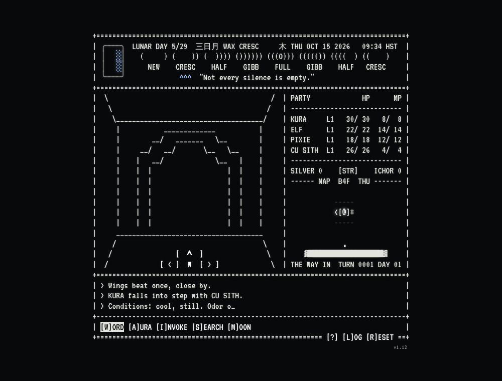

Game only (the Worker is unchanged). Notes: `daily-dungeon-heat-notes.md`.

- **Breath:** `BREATH_BACK` [4, 3.5, 3, 2.5, 2, 1.5, 1.5, 1.5], `BREATH_WAIT` 1000, `STEP_BREATH` 0.25, `WORD_BREATH` 0.5. Search 1 and `AURA_BREATH` 4 unchanged.
- **TALK popup fix:** `SIGNIFICANT` now `KURA falls (?!into)`, so "KURA falls into step with X" stays on line 2.
- **Cooling (`coolOff`):** heat `floor(heat * 2/3)` when a demon dies, is recruited, leaves, or KURA runs past it.
- **Patience:** the only wear is a room first reaching heat 12 (tier 2): -1 for each demon member (`heatUp`). `wearTension` returns at once, `snap` always returns false, and the costs for nagging, fiddling, breaking, grief, tripping and ICHOR are removed. `PARTY_TIRED` / `FAMILY_TIRED` rewritten as content lines; check-in lines softened. `PARTY_TENSE`, `SNAP` and `QUIT` are now unreachable.
- **Hot-room gamble (`hotGamble`):** after a miss, heat 12+ asks 1 in 6, heat 18+ asks 1 in 3. Question pool `HOT`: `[1] LOOSE` +2 breath, `[2] DIG` 50% an UNCOMMON (25% RARE) item, else a `FIZZLE_DIG` line. +1 patience for the asker.
- **Worn-wall gamble (`wornGamble`):** the wall still hides something and `prog >= 3`; chance 1/12 + (1/3 - 1/12) * heat/20. Pool `WORN`: `[1] STEADY` +1.5 progress, `[2] DIG` heat +2, 50% progress set to the next need, else a fizzle.
- **Moon gamble:** `fullness / 3` of offers (`fullness = (1 - cos) / 2`: 1/3 at full, 0 at new) pair "her light, for breath" with a gamble moon item that lands 50%.
- **Offer gamble (`wrapOne`):** on a "give" offer (members and demons) the higher-tier item is replaced by a wrapped name; `GAMBLE_ODDS` SLY 1/4, DREAMY 1/6, HAUGHTY 1/8, GRUFF 1/10, PRIM 1/12; 50% real item, else `FIZZLE_WRAP` (`o.fizzleLine`, `h.fizzle`).
- **Heat color:** `st.heatSense = {until: steps + 20}` is set by the AURA room read. `show()` builds `st.mapHeat` (`FLOOR.heatMap`: char 48 + heat under each bracket; this room exact, door-linked rooms by tier 0/6/12/18) and `st.heatFade` (full, dims over the last 6 steps). `colorize` tints brackets hsl(62 to 0) from heat 2 to 20; no glow.
- Checked the live gift box in D1 before release: two gifts stored. `tallies` empty at that point.

## v1.11 - Room to Breathe - Oct 15 2026, 07:31 HST

- `BREATH_BACK` [4, 3.5, 3, 2.5, 2, 1.5, 1.5, 1.5] (was [7, 6, 5, 4, 3, 2, 2, 2]); `BREATH_WAIT` 1000 (was 1500).
- `STEP_BREATH` 0.25 (was 0.5); `WORD_BREATH` 0.5 (was 1). Search 1 and `AURA_BREATH` 4 unchanged.
- `SIGNIFICANT` in index.html matched "KURA falls" and so popped the TALK opener "KURA falls into step with X"; now `KURA falls (?!into)`.
- Checked the live gift box in D1: two gifts stored (vending machine coin, dead pager), tallies empty.

## v1.10 - A Box in the Corner - Oct 15 2026, 07:10 HST

Game commit `ff86fc7`. Rules, page, Worker (the Worker needs a redeploy; no schema step, the new tables create themselves).

- **Gift box (`boxArrive`, `boxFound`, `boxDone`, offer branch `h.box`)**: on entering a signal room (`rm.dead && !rm.kind`, no encounter, no offer up) `st.box = { k: "day:level:wing", state: "ask", done }` is set; the page (`boxTick`) does `GET /gift?k=` and calls `RULES.boxFound(save, item, marks)`. The box opens on the offer screen: `[1]` takes the item, then the trade list asks what to leave (the bag-full swap path, reused); an empty box goes straight to "Leave what in the box?"; no small item to leave means a free take; `[ESC]` closes. The swap is `st.boxPending = { k, give, take }` and `POST /gift { k, give }`; the item leaves the bag only when `boxDone(st, ok, got)` hears the server said yes, so an unreachable server loses nothing ("The lid sticks"). `BOX_OK` = COMMON or UNCOMMON and a known name; anything else a box returns is ignored. `RS(d, at).boxed` marks a settled room (revisits show only the scratches). Counts as an action step and `traded` tally/event.
- **Worker `/gift`**: table `gifts (k PRIMARY KEY, item, made, who)`, created on first use (`giftTable`). Key check `giftKeyOk`: day within 2 of today, level 1-60. `give` must match `/^[A-Za-z0-9 '.,\-]{3,40}$/` or be null. Swap is atomic: `UPDATE ... WHERE k AND item = <what was read>` (4 tries); an empty box takes `INSERT OR IGNORE`; `give: null` is `DELETE`. 12 swaps an hour per address hash (429). 2% of swaps sweep rows older than 3 days. Every COMMON and UNCOMMON name passes the pattern (checked).
- **Tallies**: `go()` sets `st.tally = { k, door }` the first time she enters one of a wing's two locked-door rooms (`floor.exits[i]`; `door` = index in `wings[e.wing].exits`, a private-seed slot, so a count means nothing to another player's door). `tallyTick` posts `POST /tally` and forgets it. Worker tables `tallies (k, door, n, made)` and `tally_seen (k, who)`: one mark per address hash per wing key per day, sweeps at 2%. `GET /gift` also returns `marks: [n0, n1]`; `scratches()` shows them biggest first, `|` up to 10 then `+`, never saying which door. "Gifts left in boxes" and "popular door" cards are still unbuilt.
- **Altar**: it was broken since v1.06: `altarGive` called `worth(TERMINAL, g)`, removed with Give, so every offering threw and nothing happened. Now `mood = affinity(TERMINAL, item) >= 2 ? "good" : "ok"` (no "bad", no `:(`; `ALTAR_SAYS.bad` and `ALTAR_FLAVOR.bad` gone). The alignment is `itemAlign` for any item (was `relicAlign`, RARE and up only), so every item leans somewhere. Scripts are three lines each (`ALTAR_TALK`, 8 of them, 23 characters at most). The result box shows the flavor line, which way the symbols turned (LAW, CHAOS or the middle), and `altarBoon`: LAW gives the wing's door clue on line 3 (`KIND_CLUE`, only if the wing has a `clueKind`); CHAOS fills her breath and heals every living member 25% (15% on "ok"); anything else, or LAW with no clue, +3 breath (+2 on "ok"). Counted as `altarBoon`. The lean shift itself is unchanged (including half on a second feeding in the room). Once a day per room.
- **TALK (`wordParty`)**: six openers on the log line (`TALK_OPENERS`); 20% of TALKs (`other.length && Math.random() < 0.2`, after the truce check) two members talk and KURA listens (`OVERHEAR_OPENERS`, `overhear()`: 60% about an item one holds when it has one, else a pair line for ELF/PIXIE/CU SITH, else a general one; both get +1 patience when the yield is full; `overheard` tally). CU SITH is never given speech: when it is one of the pair the lines come from `OVERHEAR_BEAST*` (actions only). 17% of TALKs (`y >= 1`, no encounter) the member asks a question from `ASK` (reconnected: `ask()` had no caller since v1.06; `asked` tally). Kept: check-in, truce, offer (12% from the second WORD), confide.
- **Questions are good vs. good**: every `ASK` entry is `[question, answer 1, answer 2, personas|null, [label 1, label 2]]`, both answers 1 or 2 patience (or 1 with a lean tag), no negatives. Buttons show `[1]LABEL [2]LABEL` (caps, `lab` stored on `st.question`), keys `1` and `2`; an entry without labels still shows `[Y]ES [N]O`. A question saved before this and whose pool is gone just clears. Question lengths checked against the line width.
- **Gone**: `[S]ILENT` (button, `S` key, `SILENT_PARTY`, the silent branch of `reply`, the title card; the stat key stays in the Worker, the personal-log line stays); the last-chance "Anything else you want to say?" question and its leave-the-party outcome (`ASK.mend`, `LEAVE_NO`, `lastChance`: nothing had called them since v1.06).
- **Nagging**: `banterAsk` is no longer a question. 25% of the time a nag remark is a sarcastic aside from `BANTER_SNARK` (three per family, two for CU SITH, actions). `BANTER_ASK` is gone.
- **AURA**: `AURA_BREATH` 0.5 -> 4 (half of `BREATH_MAX` 8), for both a new read and the repeat-door read; she needs 4 available to start.
- **Line 3**: the "patient" 3-second wait (`line3Calm`, reset by every action) can now only hold a new line back for 10 seconds in all (`line3Since`). Lines are kept up to `TYPE_CAP` 260 characters (was cut at `TYPE_W` 72) and `tickerHtml` shows the last 72 characters, so a long line scrolls left as it types.
- **Period before a quote**: no full stop when the period is followed by `"` (`isStop` in `speak`, the line 3 typer, the search typer). The hold after a finished line ending `."` stays (`PERIOD_STOP`).
- **Omens**: `calm` now leans LAW (fresh streak odds about 1 in 188 for both sides, from about 1 in 582 and 1 in 188). `omen()` returns "The pattern is repeating." on the second day of a run of the same lean (`omenOf(t-1).lean === lean && omenOf(t-2).lean !== lean`); the third day keeps the streak telegraph.
- **Buttons in capitals**: item buttons and titles on the party offer, gift box, demon offer, trade and bag-full screens. The altar's own buttons are untouched.
- **`VERSION`** to v1.10. README screenshot to v1.10. Test notes: ran TALK 400 times, the question flow, the box flow (swap, free take, empty box, server down, leave), the altar boons and the Worker (against an in-memory SQLite) before pushing.

## v1.09 - A Light Left On - Oct 15 2026, 06:15 HST

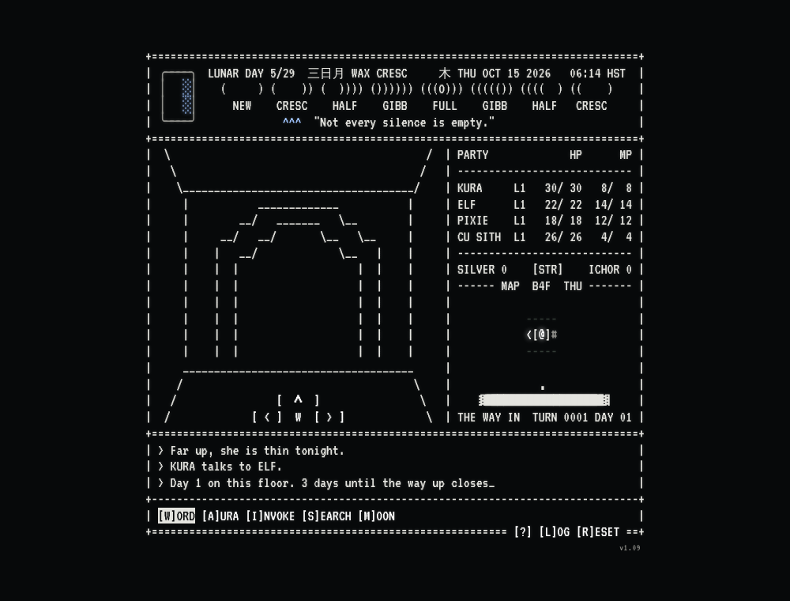

Game commit `c83147f`. Rules, page, Worker (the Worker needs one redeploy for the new keys).

- **Dead-end names (`NAMES_BY_KIND.dead`)**: "Dead end" and "Sealed end" are now Beacon, Lamp room, Uplink, Waystation, Signal room, Comms nook (11 characters at most). "Lamp room" is also in the plain list; the no-repeat rule means a floor never shows it twice. `roomName()` renames a dead end that was saved as "Dead end" or "Sealed end" (`oldDead`, no kind) on its next look; every other saved name stays. The exchange list stays, still off (`EXCHANGE_ON = false`).
- **Party lines on entering a dead end (`ENTER_BY_KIND.dead`)**: ELF `"Others have stood here. You can feel it."` / `"The way ends here, and it is not unkind."`; PIXIE `"Ooh, cozy! Somebody was here before us. Hi, somebody!"` / `"Nobody's chasing us in here. I like it."`; CU SITH circles once and lies down by the wall / noses the end wall, tail slowly wagging.
- **AURA door read (`AURA_DOOR.dead`)**: `"Small vibes, the good kind. Someone saved me a seat."` / `"It's giving cozy corner. Lowkey a hug of a room."`
- **Arch description (`ARCH_DESC.dead`)**: "is small and snug, with a light left on" / "feels lived in, and quietly glad of company".
- **Demon drops (`win()`)**: a beaten demon drops `R(1, 2)` of its pocket items (was `R(1, 3)`).
- **Party offers (`wordParty`)**: the offer roll is now `offerOdds = p.words >= 2 ? 0.12 * y : 0`. The first WORD with a member never offers; the second is 12%, the third 6%, the fourth 3% (`WORD_YIELD = [1, 1, 0.5, 0.25]`). Was `0.3 * y` from the first WORD. The confide window is unchanged (`[0.3y, 0.3y + 0.12)`); rolls below it that no longer make an offer fall through to banter. Checked in Node over 4,000 runs: no offer on a member's first WORD, about 9% on the second.
- **Title feed**: the rumors `refused`, `asked` and `silent` and the "Gifts refused" card are gone (nothing fires them since v1.06; the Worker still accepts the keys). "Answered [S]ILENT" stays: the party's yes/no/silent banter question still fires it. An `ago(ts)` helper now serves "Last fall" and the new "Last climb out".
- **New cards**: Average run (turns / runs), Demons beaten per run (beaten / runs, one decimal), Doors per player (unlocks / players, one decimal), The moon's answer rate (moonYes / moon, capped at 100%). These four need no Worker change. Last climb out (`lastOut`), Things traded, Demons that went their own way and Moon offers taken need the redeployed Worker.
- **New counters** (`tally`, posted in `summary().stats`): `traded` (`offerDone`, party and demon offers, swaps included), `peace` (`departs`, a demon leaving after a WORD, with or without a gift), `moonTook` (`moonTake`). Worker `STAT_CAPS`: traded 300, peace 300, moonTook 100 a run.
- **New events** (`ev`): `traded` (`offerDone`), `parted` (`departs`), `moonpick` (`moonTake`). Worker `EVENT_TAGS` gets all three; the page has three wordings each in `RUMORS`. An old Worker answers 400 to the new tags and ignores the new stat keys, so nothing breaks before the redeploy.
- **Worker `/feed`**: new `lastOut` (the newest `news` row of type `out`). Redeploy with `npx wrangler deploy`; no schema change.
- **`VERSION`** to v1.09. README screenshot to v1.09.
- Sheet: the two dead-end door reads replaced.

## v1.08.1 - Full Stop - Oct 15 2026, 00:47 HST

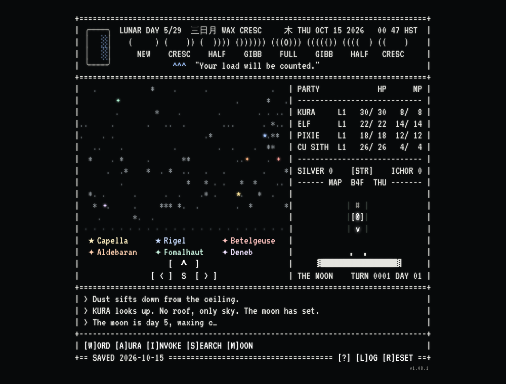

Game commit `1fd71e0`. Page only.

- **`PERIOD_STOP = 1000`** is now a top-level `var` (used by the ticker before the rest of the script runs).
- **Ticker (line 3)**: a period not followed by another waits `PERIOD_STOP` (other punctuation still 420 ms).
- **Line 2 AURA beat**: the third dot waits `PERIOD_STOP`, and each period in the typed result does too.
- **Line 2 search beat**: after the dots (or the last extra "good find" dot) waits `PERIOD_STOP` before the result types; sentences still get `BEAT_MS` (1000) between them.
- **Altar terminal**: typing (not the scroll-in) freezes about 1 s (18 ticks at 55 ms) at each period.
- **End-of-fight screen**: a revealed line ending in a period waits `PERIOD_STOP` instead of 700 ms.
- **`VERSION`** to v1.08.1.

## v1.08 - Say It Slowly - Oct 15 2026, 00:45 HST

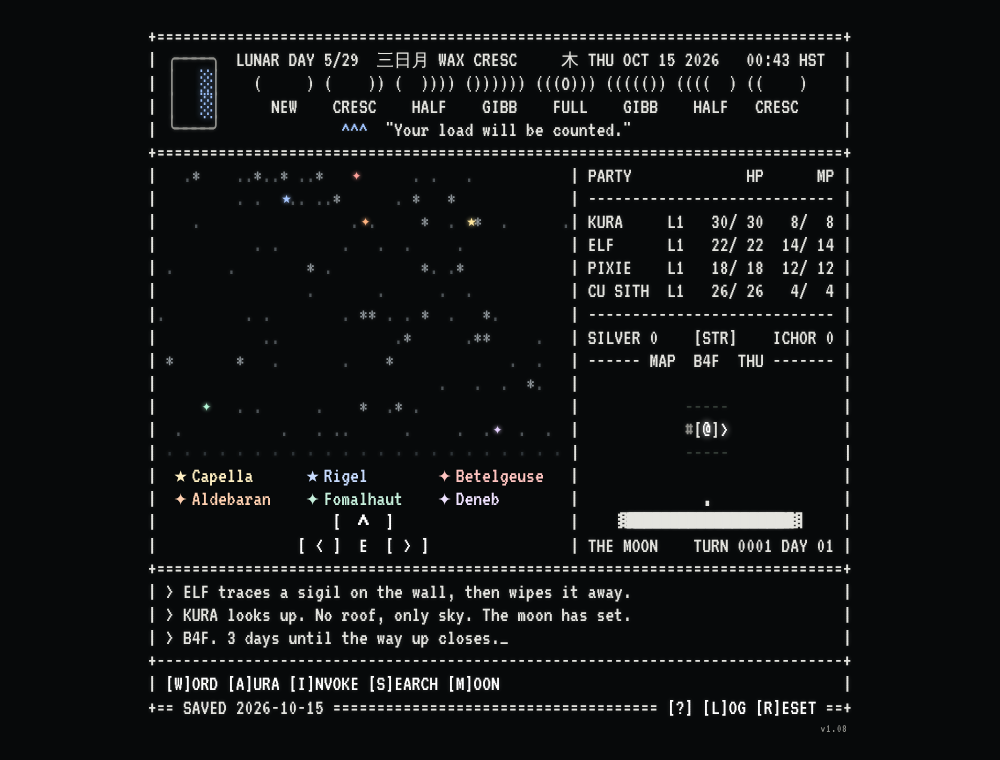

Game commit `785b71f`. Page, rules, screen and sky.

- **Voices (`speak`, `voiceOf`, page)**: each fight-box and APPEARS line is spoken into its row elements. Head = `NAME: ` or a leading name (demon, `The DEMON`, `DEMON's`, KURA, members); shown at once, then `NAME_BEAT` 450 ms. Kinds: `dm` demon speech/actions decode (scramble from `#%@!&$*?/\\<>=+~`, 0.6 chars per 40 ms tick); `dhit` demon line with `-N` decodes at 0.35, then `.flash` (white to normal, no glow); `ku` KURA and other lines type at 30 ms; `pt` party speech types at 42 ms; `hit` (`The party strikes.` or a non-demon `-N` line) shows the action whole, waits (1 s if it ends in a period, else 450 ms), types the damage at 170 ms a char, flashes. Every period not followed by another is a 1000 ms stop (`PERIOD_STOP`), mid-line. After a line: `lineBeat` = 600 + 35 ms per char, at least 1 s if it ends in a period. Click/Enter finishes the line (`speaking`), or brings the next in. AURA reads: rules set `st.roundVoice = "KURA"` (cleared by `act()`), so every read line types in KURA's voice with the demon name as head.
- **Fight replay**: auto-advances (was click-to-advance), every line including the last and single-line rounds; `replayToken` guards stale timers; no `_` cursor anywhere in the fight box. APPEARS: `introNext` lets a click bring the next line in; clicks elsewhere on the box only finish/advance while unfolding.
- **Rules**: party strike line is `The party strikes. -N HP`.
- **Sky**: no box; rows 0-11 sky (radii 23x1.3 by 6.5x1.3, x 0-46), row 12 a dim dotted rule (`.sky-rule` #2c3236), rows 13-14 the key: up to six named stars, brightest first, three columns of 15. Named stars drawn at 72% scale (`.skystar .g`). No N/E/S/W on the sky; the turn controls show `[ < ]  N  [ > ]` (the facing letter, looking up or not). The breath-dots row (screen row 20) now runs through `skyLeft` too, for the key's second row.
- **`VERSION`** to v1.08.

## v1.07.1 - Clear Skies - Oct 15 2026, 00:20 HST

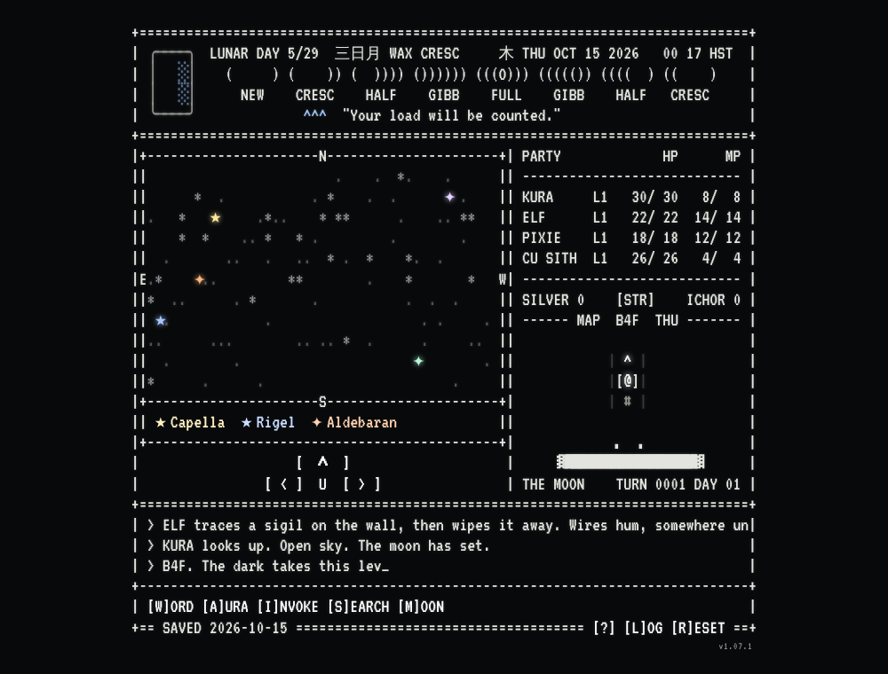

Game commit `53be89e`. Page only.

- **Sky stamp removed**: `skyLeft()` no longer adds the `.skystamp` (the header has the time). `SKY.render` still returns `stamp`, unused; the CSS stays for now.
- **`VERSION`** to v1.07.1.

## v1.07 - Look Up - Oct 15 2026, 00:18 HST

Game commit `eb33ca4`. New file `sky.js`, plus rules, screen and page.

- **`sky.js` (`window.SKY`)**: `render(date, tz, facing, moonIdx)` draws a 47x15 box (rows 1-11 sky, row 12 rule, row 13 guide, row 14 bottom) over the turn controls. 21 named stars (mag < 1.6, `★` under 0.5, `✦` otherwise) with pastel guide colors; 385 catalog stars from d3-celestial `stars.6.json` (BSD), mag 1.6-3.8, `*` under 2.8, `.` otherwise. Alt/az from GMST/LST; moon from the low-precision L/M/F series; sun alt > -6 is day (no stars, "Daylight. No stars."). Projection: zenith-centered, horizon at 85 deg out, radii 22x1.35 by 5.6x1.35 so the corners have sky; stars under 5 deg alt are dropped. Top of the box is KURA's facing, with east and west mirrored (looking up). Moon disc 3 rows at her real alt/az. Location: `PLACES` table of ~70 zones, else lon = UTC offset x 15 and lat 35 N (or -33 for southern zones). `moonPos(date, tz)` for the rules. About 0.25 ms per render.
- **Screen**: `renderScreen` uses `SKY.render` when looking up and stores it on `SMT.lastSky`; the old broken-rim sky is the fallback.
- **Page**: `skyLeft()` colors the view columns of the run screen while looking up: named stars inline color (pastel x1.6 toward full, `strong()`) with a 6 px glow, `.sky-mid` #8a9196, `.sky-far` #4d5357, `.sky-moon` #ece6cc; guide names in their pastels with no glow; a 0.6 em place-and-time stamp at the bottom-right of the sky. Redraws every 30 s while looking up. `sky.js` loads before `screen.js`.
- **Rules**: turning while looking up keeps looking up (no breath) and turns the sky; `sight()` says "The moon has set." / "The moon hasn't risen yet." when she's below the horizon for the player.
- **Fight box and APPEARS**: 2 lines (was 3), new lines at the bottom; `rollUp()` slides kept rows up by the dropped rows and fades new rows up from one row below, 420 ms. APPEARS beat 1100 ms (was 450), no blank lines between lines, one blank above the stance row.
- **INVOKE**: ICHOR always listed (0 at none; using it at 0 says so); empty bag shows `1  The bag is empty` and the foot comes up; blank above the item rule unless its description is 2+ rows; 0-9 uses at once; "Enter: choose who gets it." removed.
- **Line 1**: `act()` no longer blanks a party member's `talkLine`.
- **`VERSION`** to v1.07. README credits d3-celestial.
- Sheet: moon sight lines added.

## v1.06 - A Word With the Moon - Oct 14 2026, 23:35 HST

Game commit `9e1d891`. Rules, page and screen.

- **WORD (`word()`, key W)** replaces TALK and BEHOLD. Old `talk`, `chat`, `itemMove`/`movePick`/`wantAnswer`, the demon questions (`DEMON_ASK`, `demonHears`, `afterAnswer`, `sizeUp`), gifts (`gifts`, `give`, `offer`, `offerGive`) and the room-heat talk tables (`PARTY_HEAT`, `FAMILY_HEAT`) are gone. `api.talk` is an alias of `word`.
  - **Party (`wordParty`)**: costs 1 breath (`WORD_BREATH`). Voice from the dark 5% (12% full moon), or always when alone. Picks a member weighted x3 at patience <=2, x0.3 when talked out. `p.words` counts today's WORDs; yield `WORD_YIELD = [1, 1, 0.5, 0.25]`, then `WORD_SPENT` lines. Order: patience <=2 gets a check-in (+round(3y), min 1); a LAW/CHAOS pair (alignGap 2) gets a truce 60% (+round(2y), min 1, both); offer `0.3*y` (`memberOffer`: 70% give from pockets via `twoOf`, else ask via `bagWants`); confide `+0.12`; else banter (30% an `AURA_PARTY`/`AURA_FAMILY` line about her aura, else `PARTY_TALK`/`FAMILY_TALK`), 20%*y heals KURA ceil(hpmax/10) if hurt, +1 patience at full yield. `p.words` resets in `sync()`.
  - **Patience** no longer drops from talking (the `chats > 6` wear is gone). Nag, fidget, dissonance and stray blows still wear it.
  - **Demon (calm)**: `e.round++`. Listen roll as before (`LISTEN[moon]`, corrupt x0.7, omen talk, `STANCE_TALK`), programs always, and once heard (`e.heard`) always. Fail: scorn, 50% angered, demon strikes. Heard: `wordEnds`: corrupt restores 60% (85% with PATCH), then join 60% or depart (70% gift); programs join 70% or depart (60% gift). Otherwise weights: offer 0.4 (pockets >=2), notice 0.2 (a bag item with verdict good), join 0.15 x stance (1.5 same, 0.5 opposite; 0 for CHAOS or HAUGHTY), gift-depart 0.25, plain depart the rest.
  - **Demon (angry), `wordShow`**: best `affinity` item in the bag; verdict good, it stops mid-swing and asks for one of the top two (`e.offer.hostile`); otherwise "KURA holds up X", insult/ignore line, and it strikes.
  - **Offers**: `e.stage = "offer"` with `e.offer = { dir: "give"|"ask", items, hostile? }`; party ones in `st.offer = { who, dir, items }`. `offerPick(i)`, `offerTrade(j)` (full bag swap: `o.pick`, stage `trade`), `offerLeaveConfirm(yes)` (demon give offers only: stage `leave`). Demon give taken: like line; CHAOS runs off laughing, else 20% join, else satisfied and leaves. Demon ask taken: love line, 40% gives a pocket item back, CHAOS runs off, else 35% join. Hostile ask taken: accept line, calms (`angered = false`). Leaving a demon ask: calm leaves, hostile strikes. Party: +1 patience on a trade; leaving costs nothing.
  - Old saves: `show()` resets stages `chat/want/gift/pick/ask` and an old `offer` with no `e.offer` to null.
- **Pockets (`pockets()`, `pocketRoll()`)**: 3-5 things, filled on first look (covers old saves). Tier: MYTHIC `0.005*depth`, RARE `0.04+0.015*depth`, UNCOMMON to 0.4, else COMMON (depth capped at 5); never MOON. Item weight = family nature (`POCKET_NATURE`) x alignment gap [3, 1.5, 0.5] x 0.2 if already held. Recruits keep their pockets. `nightFinds()`: each standing member adds 1 (60%) or 2 up to `POCKET_CAP = 7`; a `NIGHT_FIND` line goes on line 1 at wake (unless deadline or STANDBY omen).
- **Drops**: `win()` drops 1-3 random pocket items (rest cleared). No SILVER, no `rollItem`, no moon drops. End screen shows the `It drops` lines.
- **AURA**: out of a fight never reads the party (`AURA_FARM`, `AURA_SELF_TALK` gone). Wall: `ROOM_READ[band][min(2, heatTier)]`, 50/50 fun/plain, quoted, her voice. Door: hunch as before. New reads cost `AURA_BREATH = 0.5`; repeat door free. `auraLine(leads, result, also)` picks a random lead that fits 77, fallback `KURA feels...`. In a fight: "comes off as", lead from `AURA_ON`, plus `carryHint()` (`AURA_CARRY`: none, majority nature, or 50% "good" if RARE/MYTHIC held); not for ATOM SLASHER.
- **MOON**: `turn("U")` up spends 1 breath and runs `moonLook()`; down is free. `askMoon` and SCRY are gone; SEARCH while looking up lowers her gaze and searches. Per night (`st.moonNight`): look 1 offers at `MOON_OFFER = [0, .25, .45, .65, .85, .65, .45, .25]` (x1.2 loud), looks 2-3 get `MOON_AGAIN(_SASS)`/`MOON_QUIET(_SASS)`, 4+ get `MOON_DONE`. Pairs (`moonPair`): hunch vs breath (if a locked door kind is known), LAW vs CHAOS (`lean` LAW/CHAOS), hush vs breath; gibbous/full add moon item vs hush/breath, full adds moon item vs moon item; near full, 35% (60% full) forces an item pair. `hush` sets `st.hushDay`: aura band 0 all day. Now or never: leaving asks "LEAVE HER OFFER?" first.
- **Breath**: `BREATH_MAX = 8`, `BREATH_BACK = [7, 6, 5, 4, 3, 2, 2, 2]`, `BREATH_WAIT = 1500`, `BREATH_NUDGE_MAX = 7000` (worst wait about 8.5s). `st.breathMax` lets the screen scale the strip and dots to the old six-step look. `breathNext(st, below)`; the page counts down to each of the next three breaths after she runs out, then hides.
- **Page**: `[W]ORD` row and fight row `[F]IGHT [W]ORD [A]URA [R]UN`; offer views in the fight box and a member/moon offer box (`offerBox`, the moon's sits low under the sky); keys 1/2/Esc, 1-9 in a swap, Y/Enter to confirm leaving. APPEARS screen and fight box show 3 lines, newest on top. Help page updated.
- **`VERSION`** to v1.06. README updated.
- Sheet: removed noise warnings, demon questions, BEHOLD wants, unused voice keys (ask, meh, hate, no, hold), final-chance and walk-away rows, and the party aura-farm/self-talk rows; renamed aura-farm reactions to WORD banter and the moon's repeat lines; added WORD lines (spent, check-in, truce, offers, trade, thanks), night finds, demon offer/want lines, moon offer and quiet lines, room reads, carry hints and new leads.

## v1.05.3 - True Colors - Oct 14 2026, 20:33 HST

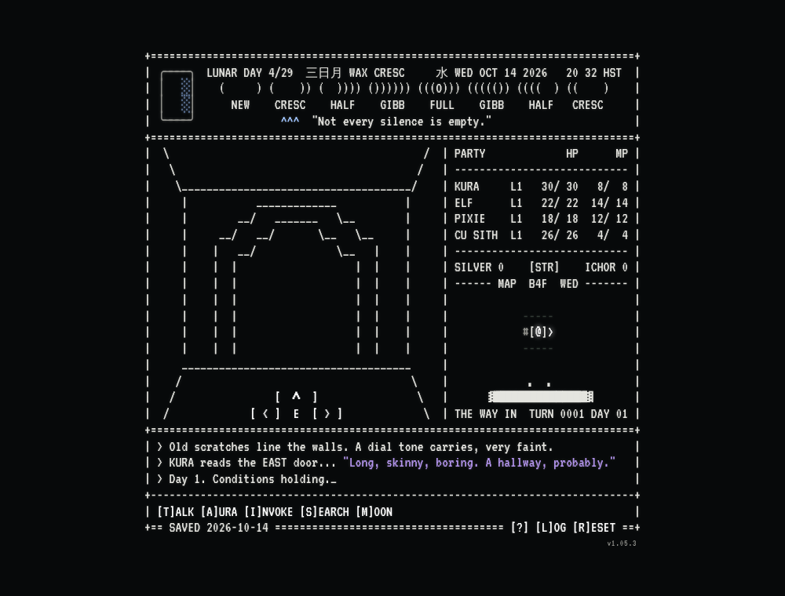

Game commit `9baaaad`. Page-only.

- **`auraColor()`:** the `.q-aura` result on line 2 gets an inline color from `save.alignScore`, which runs -6 (LAW) to +6 (CHAOS). It's a straight blend between `#a990f5` (violet) at -6, `#e3a6c4` (soft pink) at 0, and `#ff7aa8` (hot pink) at +6. It stays clear of demon red. The LAW end is close to the moon item lavender `#c9b6ff`, and the moon color may get tweaked later.
- **Intro unfold fix:** `introShown` now counts the groups above the stance row that are already on screen, and it grows as each one unfolds. A redraw of the same demon (after AURA, or mid-unfold) keeps those, clears the old timer, and unfolds the rest at 450 ms each, ending with the stance row. Before, any second `encounterBox` call rebuilt the box fully visible.
- **`VERSION`** to v1.05.3.
- No creature lines changed.

## v1.05.2 - Reading the Room - Oct 14 2026, 20:26 HST

Game commit `727f26d`. Rules and page.

- **AURA out of a fight is one line 2**, built by `auraLine(lead, result)`: `> {lead}... {result}`. If that runs past 77 columns, the lead becomes `KURA reads`, and every result fits after that (checked against the longest demon name, STATIC BANSHEE). `st.extra` is no longer set, so line 1 stays ambient.
  - Room: the lead is from `AURA_FARM` (now without a period). "KURA checks her aura. And everyone else's." became "KURA checks everyone's aura", since the old one almost always fell back. The result is the party, dungeon or self line.
  - Door: the lead is `KURA reads the {DIR} door` (`... again` on a repeat). The result is the quoted hunch. `RS(d).auraDoors[dir]` now stores the bare hunch, and `said()` strips the old `> KURA: "..."` form from v1.05 saves.
  - The self lines lost their `KURA: ` prefix (it's her line), and the plain one starts with "She".
- **Page beat:** `act("aura")` runs the read at once (`auraGo`), then holds line 2 back. The head shows with 3 dots, 200 ms apart, then the result is typed at 30 ms a character.
  - It uses `searchBeat`, so `act()` ignores everything until it ends (mashing A runs exactly one read). `typeHush()` keeps line 3 waiting until it's done.
  - The v1.05.1 line-1 beat (800 ms `auraBeat`) is gone.
- **Color:** `.q-aura` is `#e3a6c4`, soft pink. The colorizer matches `KURA (aura-farms|checks everyone|takes a read|vibe-checks|reads)...` on line 2.
- **`VERSION`** to v1.05.2.
- Sheet: the KURA aura reads rows are updated (the lead lines, self lines and door lines are now line 2, without `KURA:`), and a row for the `KURA reads` fallback is added.

## v1.05.1 - Pack Light - Oct 14 2026, 20:16 HST

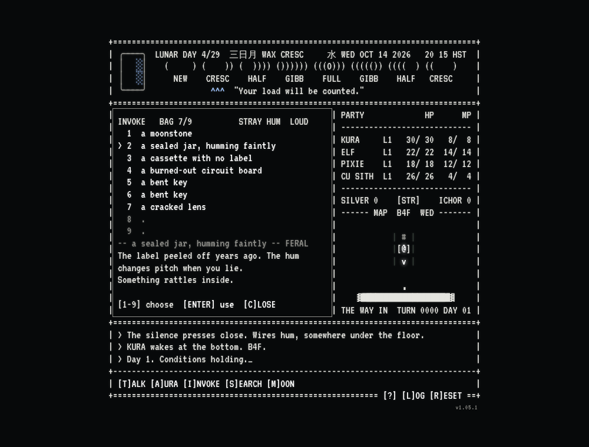

Game commit `b349828`. Rules and page. Also carries the README fix (renaming is only at post time now).

- **Bag cap:** `BAG_MAX = 9` (ICHOR isn't a thing).
  - `gain()` into a full bag pushes onto `st.overflow` instead, with no tally, codex note or alignment lean until the thing is kept.
  - `keepItem(st, drop)` resolves the first waiting thing: `drop` is an index in `st.items` to leave behind, and `null` leaves the new thing. Leaving the last copy of a thing clears its `wear`.
  - On the page, `bagBox()` runs at the end of every `draw()`. It opens the `bag` mode of #found only when #found and the inv/log/board/codex/about/exch windows are all closed, so it waits behind a fight's end screen or a find box. Keys 1-9 leave that thing, N leaves the new one.
  - `overflow` and `hollow` are cleared on a new run.
- **INVOKE compact:** one line per thing (the page un-groups `inventory()`). The header is `INVOKE   BAG n/9` plus KURA's aura. ICHOR is row 0, chosen with key 0. Empty slots show as dim dots. The bordered card became a dim rule (`-- name ---- tag`) with the wrapped description below it. The "No use here. Something down here might want it." line is gone (it pointed at BEHOLD). 16 rows with a full bag plus ICHOR; the longest description is 2 lines, so it never overflows.
- **Fiddle reveal:** `REVEAL_AT = { COMMON: 5, UNCOMMON: 6, RARE: 10, MYTHIC: 20, MOON: never }` tries, about half of `BREAK_MIN`.
  - At the first try at or past that, `st.hollow[name]` is rolled with `insideOdds(tier, moon)`: COMMON 10%, UNCOMMON 1/12, x1.5 at the new moon, RARE and up never.
  - It's kept, and the break uses it instead of rolling, then clears it. So the reveal is always true for the copy that breaks.
  - `inventory()` exposes `hollow`, and INVOKE shows "Something rattles inside." or "Solid, all the way through."
  - The random fiddle line "Something rattles." became "Nothing new.", so it can't fake a reveal.
- **AURA on the APPEARS screen:** `introGo("aura")` runs `act("aura")` without setting `seen`, so `encounterBox` redraws the intro with `save.round` (the read) under what was already there.
  - Only the new groups unfold: `introShown` and a key from `e.introAt` (the step it appeared at), which no longer changes with each step.
  - AURA dims once used (`auraUsed`), and FIGHT/TALK/RUN go on as before.
- **AURA beat out of a fight:** `act()` holds back `save.extra` for 800 ms, so line 2 shows alone first. If another step happens before then, the held line is dropped.
- **KURA always:** `screen.js` no longer swaps `playerName` into party row 1. The in-panel name field (`editName`, `.pname`, `#pnamefield`) is removed, and the post row is the only place to type a name.
- **BEHOLD pick list:** the alignment tag is dropped, the loudness dots stay.
- **Line 3 after a fight:** `typeStep` waits in its gap while #found is in `done` mode, refreshing `line3Calm`, so the 3 s count starts at `[ OK ]`.
- **`.q-plain`** is `#a3a3a3`, neutral grey; it was `#b4b4b0`.
- **`VERSION`** to v1.05.1.
- No creature lines changed, so the sheet is unchanged.

## v1.05 - Aura Farming - Oct 14 2026, 19:42 HST

Game commit `ac8fa23`. Rules and page; no Worker or database changes.

Terms (decided this build): **AURA** is the party's and KURA's temperament. **VIBES** is the dungeon's temperament (the heat), which TALK's party lines carry. TALK out of a fight is unchanged.

- **`[A]URA` out of a fight:** `readAura` now calls `auraOut` when there's no encounter. In a fight it's unchanged.
  - **Facing a door** (`dir in room.doors`, not looking up): `auraDoor`. It costs 1 breath (`spendBreath`) and counts `auraReads`. Out of breath, it gets the usual refusal and `nudgeBreath`. The hunch comes from `AURA_DOOR[kind]`, where kind is the open room's `kind` / `hall` / `dead` / `plain`, or `FLOOR.kindBehind` for a locked door. It's stored in `RS(d).auraDoors[dir]`, so a repeat read replays it free, and a reroll is impossible. A sealed door gives a fixed line, free. The pairs overlap on purpose: den/forge are "warm", bay/altar "soft", vault/relay "cold". It's always given, unlike searching a locked door (55% for a `KIND_HINT`), but vaguer than a dead-end scrap or SCAN.
  - **Anything else:** `auraOut` aura-farms. Line 2 is from `AURA_FARM`, and it costs no breath. Line 1 rolls `r`:
    - r < 0.2, or no party and QUIET: self-reflection (`AURA_SELF_TALK`, 1 in 5 plain).
    - Band > 0 and r < 0.4, or band > 0 with no party: the dungeon notices, from the `NOTICE_LINE` up1 / up2 pools (dry voice).
    - Otherwise: a random living party member reacts. It's `AURA_PARTY[name]` for ELF, PIXIE, CU SITH and the five programs, or the `AURA_FAMILY` fallback by family. Pool index 1 is LOUD, 0 is QUIET or NOTICED.
  - **Line 3:** the rules set `st.line3 = "She reads as {aura().name}. Quiet./Noticed./Loud."`. `act()` moves it into `line3Next`, so it's the next line typed.
  - Bottom bar: `[T]ALK [A]URA [I]NVOKE ...`, with key `a` out of a fight. There's a help row for "[A]URA otherwise".
- **Names:** `needName` is gone.
  - `reset` calls `named(st, true)`: a chosen name carries over, and a placeholder rerolls (never the same one twice in a row). The placeholders are `AUTO_NAMES` (UNTITLED NEWFOLDR TEMPFILE GUEST NO NAME DRAFT 2 READONLY DEFAULT BADSECTR ORPHAN STALE PENDING REDACTED), checked against in-game demons and programs. NULL, DEADLINK, CACHED, LOSTPKT, LOWBATT, UNSAVED and NO SIGNAL were left out. They aren't checked against the Worker's BLOCKLIST, which lives in env.
  - `start()` runs `RULES.named(s)`, so an old save waiting on a name keeps its last one.
  - The "WHO ARE YOU?" box (`nameBox`, `confirmName`, the `name` mode of #found) is deleted. Clicking `.pname` (row 8, columns 50-58) puts the `#pnamefield` input over the name and level. Enter keeps a valid name, an invalid one gets `.bad` (a red border), and Esc or blur drops it. It works in a fight too.
  - The post row is `POST AS [#postname] [P]OST`. `submitScore` runs `setName` on the field first.
  - Name inputs stop key propagation, so letters never fire commands.
- **Board:** a row whose name `isAutoName` gets `#board .auto` (var(--trail)). `boardHead` now takes nodes.
- **`.q-plain`** is `#b4b4b0`, light grey. It was sand `#cbbf9f`.
- **Line 3 hold** after typing is 4000 ms, was 5000. `typeSay` is still 6000.
- **`VERSION`** to v1.05.
- The sheet has the new lines: Party & programs, Enemies (by family), KURA aura reads, Dungeon.

## v1.04.4 - Sand and Moonlight - Oct 14 2026, 19:10 HST

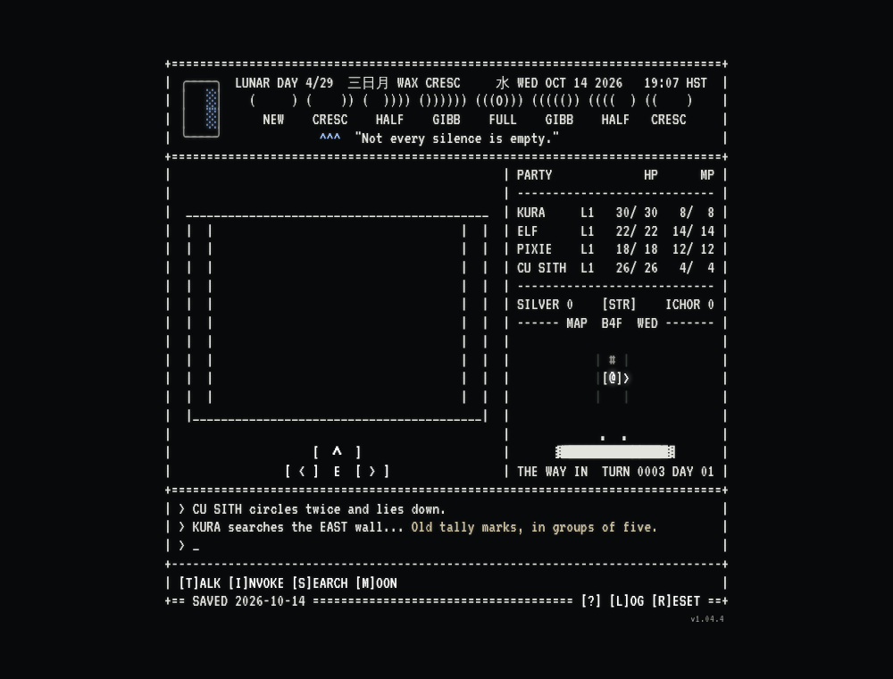

Game commit `f4cbaef`. Page-only.

- **`.q-plain`** (nothing, COMMON, UNCOMMON search results on line 2) is `#cbbf9f` sand, was `var(--trail)` grey.
- **Flavor moved to line 1** (`save.extra`), line 3 is status only:
  - `moonChatter` left the ticker's round; `flavor()` now returns a moon chatter line for r in [0.55, 0.64).
  - `line3After` puts the `noticeLine` (aura band change) and the post-fight `moonReact` (35%) into `save.extra`.
  - After a good find, `searchEcho` goes to `save.extra` instead of `typeSay` on line 3.
- **`OW` removed** (and the KURA-hit check). In a fight, line 3 stays quiet.
- **`VERSION`** to v1.04.4.

## v1.04.3 - Don't Mind Me - Oct 14 2026, 19:02 HST

Game commit `f6e65cd`. Page-only.

- **`typeHush()` no longer clears line 3;** it only sets `typeQuiet`. `typeStep` checks `typeQuiet` / `searchBeat` only in the gap, so a line being typed, held or deleted carries on through a search; a new line waits until the beat ends plus 3 s (`line3Calm`). A demon's arrival still cuts the line off.
- **`VERSION`** to v1.04.3.

## v1.04.2 - A Moment's Peace - Oct 14 2026, 18:55 HST

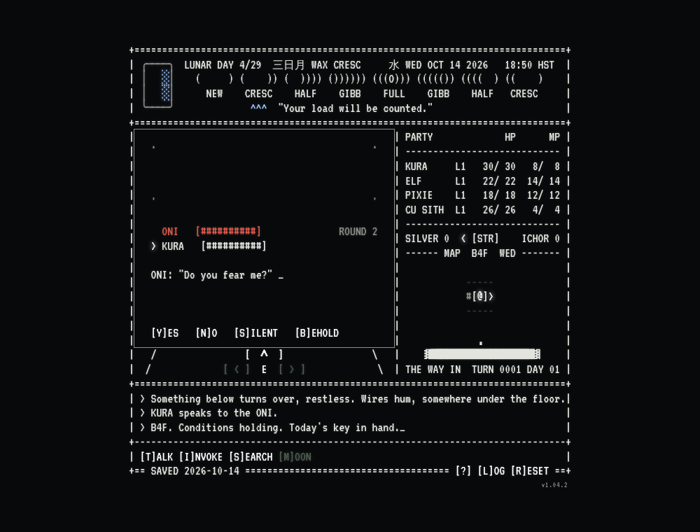

Game commit `ebfdaf3`. Page-only.

- **Line 3 waits:** `line3Calm` is set at the top of `act()`; `typeStep` won't leave a gap until 3000 ms after it. While a search beat runs (`typeQuiet` or `searchBeat`), `line3Calm` keeps refreshing, so the 3 s count from the end of the typed result. A line already being typed when an action comes in finishes as usual.
- **`VERSION`** to v1.04.2.

## v1.04.1 - Show, Don't Tell - Oct 14 2026, 18:50 HST

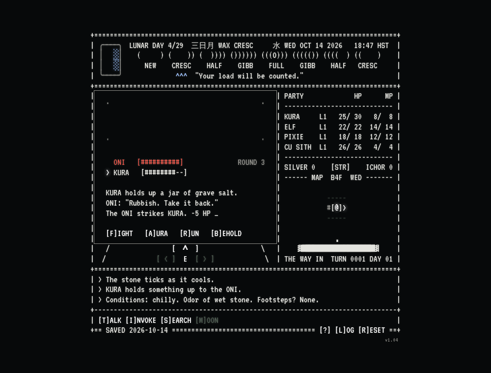

Game commit `0853936`. Page-only, no Worker change.

- **BEHOLD is the only item move.** `GIVE` and `PEACE` are gone from fights (`talkGive`, `hostileBack`, the `hostile` stage removed). `[G]IVE` at the altar and the demon-asked gift list (`stage: "gift"`) stay.
  - `itemMove(st)` opens `stage: "pick"` from `chat` (calm, answering its question) or from no stage when `e.angered`. `movePick` scores with `affinity` (unchanged); `verdict` good >= 2 (an angry GRUFF >= 3), bad <= -1.
  - **Good:** `stage: "want"` with `e.wantItem`; the demon asks in its family's way (`WANT_ASK`). `answer()` routes to `wantAnswer`.
    - YES: the item goes (relic lean as a gift, tallied `gifts`). Calm: "love" line, mood +2, then `afterAnswer`. Angry: "accept" line, `angered` off, it will talk.
    - NO: KURA keeps it. SLY 40% snatches it anyway. Angry: "ignore" line and a blow. Calm: mood -1 then `afterAnswer`; a GRUFF one (20%) hits her first.
  - **Angry, not good:** "insult" (bad) or "ignore" (meh) and one blow (the old double blow is gone). **Calm, not good:** "insult" mood -1, or a shrug, then `afterAnswer`.
- **Rows** (one line each): calm stance `[F]IGHT [T]ALK [A]URA [R]UN`; angry `[F]IGHT [A]URA [R]UN [B]EHOLD` (TALK on an angry demon just says it won't hear words, free); chat `[Y]ES [N]O [S]ILENT [B]EHOLD`; want `[Y]ES [N]O`. Keys follow; B on the stance row only when angry.
- **AURA once a round:** `e.auraRound = e.round`; a second read says "KURA already read X." and the button dims (`RULES.auraUsed`). Talking doesn't advance `e.round`, so it stays dim through a talk until a blow or a BEHOLD.
- **AURA lines name the demon:** hints all start with `{n}`; the loudness line is `{n} reads as NAME. ...`; CU SITH's lines say CU SITH; ATOM SLASHER "{n}? Nope. Nope nope nope."
- **Intro screen:** the stance row replaces `[ OK ]` and shows last, once the intro has unfolded. `introGo(name)` (click or F/T/A/R) needs the same 400 ms and no running unfold as `[ OK ]`, sets `seen`, then acts. Enter still just closes it. The art slot now counts its blank row (`iArt` -1), and a crowded intro drops the blanks between lines (`tight`).
- **Fight box shows 3 lines** (`maxLines` 3, was 2).
- **Line 3 in fights:** a new demon cuts off whatever was being typed; while `save.encounter`, the gap only types `line3Next`, which is set to an `OW` line ("Ow...", "That hurt.", "Rude."...) when KURA's HP dropped on that action.
- **Line 3 out of fights:** `line3Next` jumps the queue. `save.auraBand` tracks KURA's band; a change sets a `noticeLine` (`NOTICE_LINE` up1 / up2 / down). After a fight ends, 35% a `moonReact` line ("fight", or "run" when she left through a door). `tickerFeed` adds `moonChatter` (one phase line from `MOON_CHAT` bright / dim / none, plus 50% a `loud` line when LOUD) to the others' round.
- **`VERSION`** to v1.04.1.

## v1.04 - Read the Room - Oct 14 2026, 18:30 HST

Game commit `b76d3bf`. Page-only, no Worker change.

- **Every item has an alignment and a nature** (`ITEM_ALIGN`, `ITEM_NATURE` in rules.js). COMMON and UNCOMMON are 4 LAW / 4 NEUTRAL / 4 CHAOS each; RARE and up keep their old values. Nature is `tech` / `spirit` / `both` (`plain` is gone: matches and medicine are spirit, fiber cable tech, cassette both). `BOTH_NAME` overrides the pair for the circuit board (STRAY STATIC) and the cassette (FERAL HUM).
  - **Relics:** only RARE+ move the lean (`relicAlign`): finding, giving, altar offerings and breaking behave exactly as before. Gift worth's alignment bonus is relic-only too.
- **Names:** `MACH` SIGNAL/HUM/STATIC (data, hardware, programs, tech items), `NAT` KEPT/STRAY/FERAL (folklore, spirit items, KURA's lean); hybrids and both-items take `NAT MACH` (both tidy LAW, both wild CHAOS, else NEUTRAL). 3-letter: SIG HUM STC KPT STR FRL. Codex shows `alignment: NAME (VALUE)`; item and demon tags use the name.
- **Aura** (`aura(st)`): piles per alignment = 2 for KURA's lean + item strength by tier (COMMON 1, UNCOMMON 2, RARE 3, MYTHIC 5, MOON 8). Machine half = biggest pile (any tie = HUM); natural half = her lean. Bands by total: QUIET 0-5, NOTICED 6-11, LOUD 12+. Shown in the bag header (`STRAY HUM  LOUD`) and each item's box tag.
  - **Noticed effects:** encounter chance x1.15 NOTICED / x1.35 LOUD; `pickDemon` rerolls a non-matching demon toward her dominant pile 30% / 50% of the time; moon answer odds x1.3 when LOUD (cap 0.95).
  - **Remarks:** on a demon's arrival, 60% NOTICED / 90% LOUD chance of a family-voice remark (`AURA_REMARK`); carrying a MOON thing, half of those are the MOON line (`MOON_ITEM_REMARK`). Never programs or ATOM SLASHER.
  - **Demon loudness** (`demonBand`): corrupted or unique LOUD, programs QUIET, else floor 1 QUIET, 2-3 NOTICED, 4+ LOUD.
- **`[A]URA`** (`readAura`, key A in the fight box, replacing `[G]IVE` on the stance row): free, no demon turn. Three lines in KURA's voice: what she does, `NAME. loudness`, personality hint. Each pool is 80% jokey / 20% plain (`pickMix`). CU SITH and ATOM SLASHER have their own hint lines. Tallies `auraReads`, codex notes `read`.
- **Talk rows.** Chat stage shows `[Y]ES [N]O [S]ILENT` over `[G]IVE [B]EHOLD [P]EACE`.
  - **GIVE mid-question** (`talkGive`): opens the gift list with `e.fromChat`; `[B]ACK`/N/Esc returns to the question for free. From a hostile demon it's the old mid-fight GIVE (`offer`).
  - **Hostile stage:** TALK on an angered demon (not ATOM SLASHER) opens `stage: "hostile"` for free: words dimmed, item moves live, Esc backs out (`hostileBack`).
  - **BEHOLD / PEACE** (`itemMove` -> `stage: "pick"` -> `movePick`): list of carried things with name tag and one dot per aura point. Score (`affinity`): alignment gap 0/1/2 = +2/0/-2; family taste hated -2, loved +1; GRUFF +1 COMMON/UNCOMMON else -1; HAUGHTY COMMON -1, RARE +1, MYTHIC/MOON +2; SLY +1 both-nature or MOON; PRIM +1 same / -1 opposite; DREAMY +1 non-tech and a random +-1. Good >= 2 (PEACE on GRUFF >= 3), bad <= -1.
    - **Hostile:** spends the round. BEHOLD good: no blow, then 40% (GRUFF 20%) it calms (`angered` off). PEACE good: item spent, calms, no blow. PEACE bad: insult, two blows. Else one blow.
    - **Talking:** answers the question (`afterAnswer`, split out of `demonHears`). BEHOLD mood +1 / 0 / -1. PEACE good: item spent, mood +2; bad: mood -2; meh nothing.
- **Moon moods** (`moonLine`): phases 0, 1, 7 solemn; 3-5 sassy; 2 and 6 coin flip. New pools `MOON_QUIET_SASS`, `MOON_AGAIN_SASS`.
- **KURA's tag** is her natural half: KPT / STR / FRL (screen.js; the pull-arrow regex in index.html and the flip lines in `lean` follow).
- **Disguise** is built and switched off (`DISGUISE_ON = false`, `wear()`): mirror reads SIGNAL, VR visor STATIC, glove HUM, for one encounter; `stance` and `aura` honor it.
- **Exchange parked** (`EXCHANGE_ON = false`): `exchDir` returns null (dead ends are plain, plain names), `ecoScan` stops reporting finds (no Worker rolls, MOON things stay in the bag), market lines leave the title feed. Worker, D1 tables and stashes untouched.
- **Hold Omen hidden** (`HOLD_OMEN_ON = false` in index.html): no button, no H, gone from help. The rules still have it; a banked omen can't be released while it's off.
- **`VERSION`** to v1.04.

## v1.03 - A Name Over the Gate - Oct 13 2026, 20:31 HST

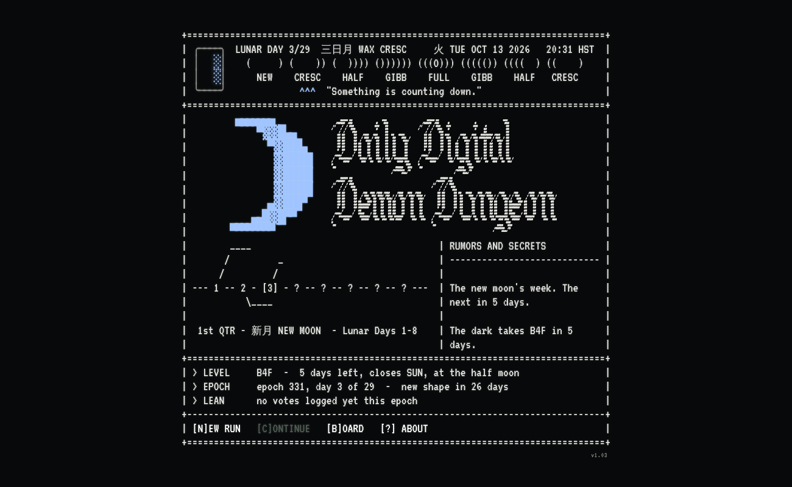

Game commit `8464e35`. Page-only, no Worker change.

- **Title logo is an image now:** `title-logo.png` (2828x1411, about 2:1, transparent; white `#e4e4df` letters), cut from the dev's own `#`/`/` ascii-art lettering, two lines ("Daily Digital" over "Demon Dungeon"). The strokes were thickened (a 7 px max filter) so they don't fade to gray when shrunk.
  - **Placement:** `` right after `#screen` in `.frame`, sized in the screen's own units (`.titlelogo` uses the pre's font-size clamp): top 6.5 rows (half a row into the banner), 8 rows tall, left at frame column `1 + SMT.LOGO.col` (27) and centered in `SMT.LOGO.cols` (42). Shown by `drawTitle`, hidden by `leaveTitle`. Dialogs sit later in `.frame`, so they still cover it.
  - **The old block-letter `MARK` is gone** from `renderTitle`; the banner rows carry only the crescent.
- **Crescent:** redrawn 15 columns wide (was 13) and 8 rows tall (was 7), then shifted half a row up with the half blocks, so `CRESCENT` is 9 rows from banner row 0 (`CRES_ROW = 0`, `CRES_COL = 8`). Moon, 4-column gap and logo are centered as a group. `colorizeTitle` boxes banner rows 6 to 14 (was 13) to cover the crescent's ninth row.
- **`VERSION`** to v1.03.

## v1.02 - Hold Your Breath - Oct 11 2026, 17:37 HST

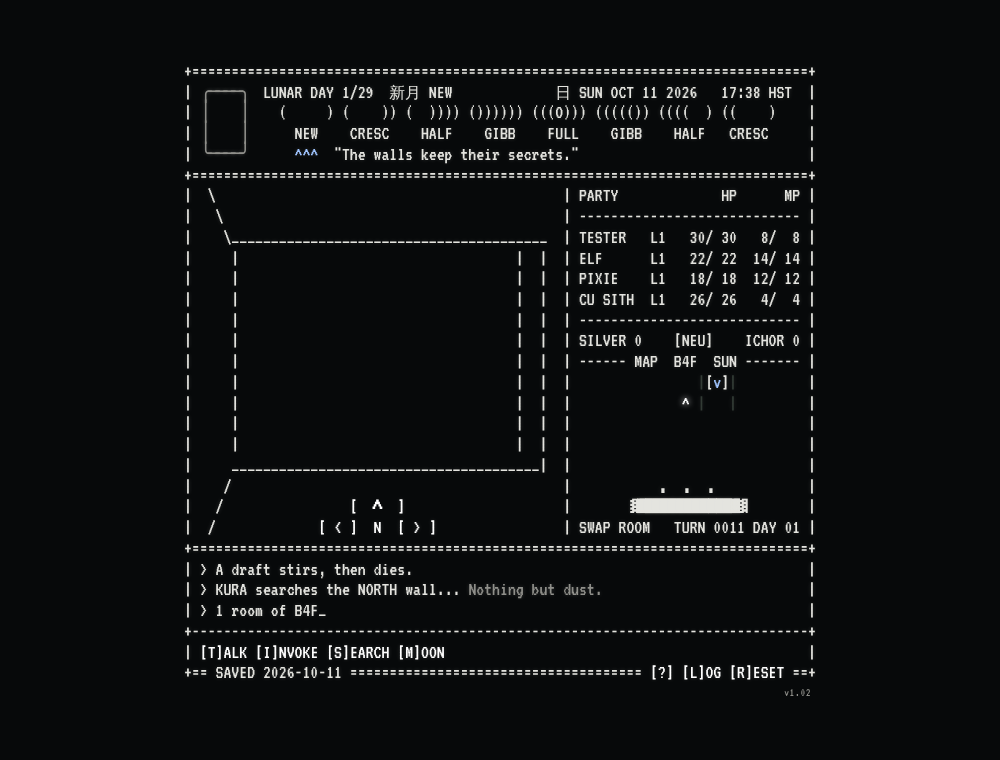

Game commit `898bd20`. **Needs the Worker redeployed** for `[H]ERE` (`worker.js` only; no schema change). Everything else is page-only.

- **The search beat** (`act`, the `searchBeat` step):
  - **Dots:** the usual three dots (200 ms each), then the search runs. For a good find, more dots follow at 260 ms each (`WEIGHT`): 3 for a RARE thing or the stairs, 5 for MYTHIC or MOON.
  - **Typing:** the result after the head is typed at 30 ms a letter, sentence by sentence, with a 1000 ms beat between sentences (was 550 ms, shown a sentence at a time).
  - **The box waits:** `holdFound` makes `foundBox` keep its call (`heldFound`) until the typing ends.
  - **Early exits:** a demon, a question, the altar, a door or the exchange screen leave it as before, whole.
- **Line 1 (party):** for a good find, `beatLine1 = partyLeans()` replaces line 1 while the extra dots run: a standing member other than KURA, five wordings ("PIXIE leans closer.", "ELF goes quiet."...), or "KURA holds her breath." with nobody. `draw` uses it over `extraToShow()`; `act` clears it on her next action.
- **Line 3 (the typed line):**
  - **Quiet:** `typeHush()` at the start of every search beat clears it to a bare `>`, and `typeQuiet` stops its round.
  - **After a good find:** `typeSay(searchEcho(best))` shows one line whole, held 6 s (`typeHoldUntil`), then deleted as usual.
  - **The lines:** MOON "The moon looks down a little longer."; stairs "Cold air comes down from above."; with others on her level right now (`liveNow`) "On this level, someone else stops to listen."; alone "Somewhere above, the dark shifts." (2-3 wordings each).
  - Otherwise the line resumes after the result.
- **Found box for good finds only:** `foundBoxNow` returns unless the lines include a RARE, MYTHIC or MOON thing or the log says the stairs. Common and uncommon things and loose SILVER (and fight drops of those) are told on line 2 alone. A good find's box still lists everything found with it.
- **Breath dots** (`screen.js` row 20):
  - **Count:** `7 - floor(breath)` dots, 3 columns apart, centered on the bar's middle (column 13.5 of the panel row), so one when rested and seven when out. They grow from the middle as the bar closes.
  - **On the page:** each dot is a `.bdot` scaled 1.5 (tried 2.2, too big) and nudged `.65ch` like the bar, `1.15ch` when the count is odd (the middle dot falls on a half column).
  - The old 1-3 dot marker over today's phase is gone.
- **Exchange wall arrow:** re-evaluated every 14 beats (~1.5 s, was 20). Tried and dropped: the same arrow at the end of the window's ticker row.
- **Admin presence:** Worker `GET /admin/here` (admin key) returns the counts (right now without bots, the last day, this moon) and up to 60 rows (a 6-character piece of the id, level, seconds since seen, bot), newest first, never the sender hash. In the X-mode board, `H` toggles it (`showPresence`, `boardView`); D and the arrows act only on the board view.
- **`VERSION`** to v1.02 (v1.01.1 was never pushed on its own).
- **Testing (light):**
  - Line 3 hushed for a search and resumed after.
  - A result typed out letter by letter.
  - The dots at 6/5/3/1/0 breaths, 80 columns each.
  - `/admin/here` on a local SQLite copy (403 without the key).
  - Chromium screenshots, no page errors.
  - Not checked: a good find's full cadence (party line, extra dots, the pit's line, the held box) end to end.

## v1.01 - The House Rolls - Oct 11 2026, 17:15 HST

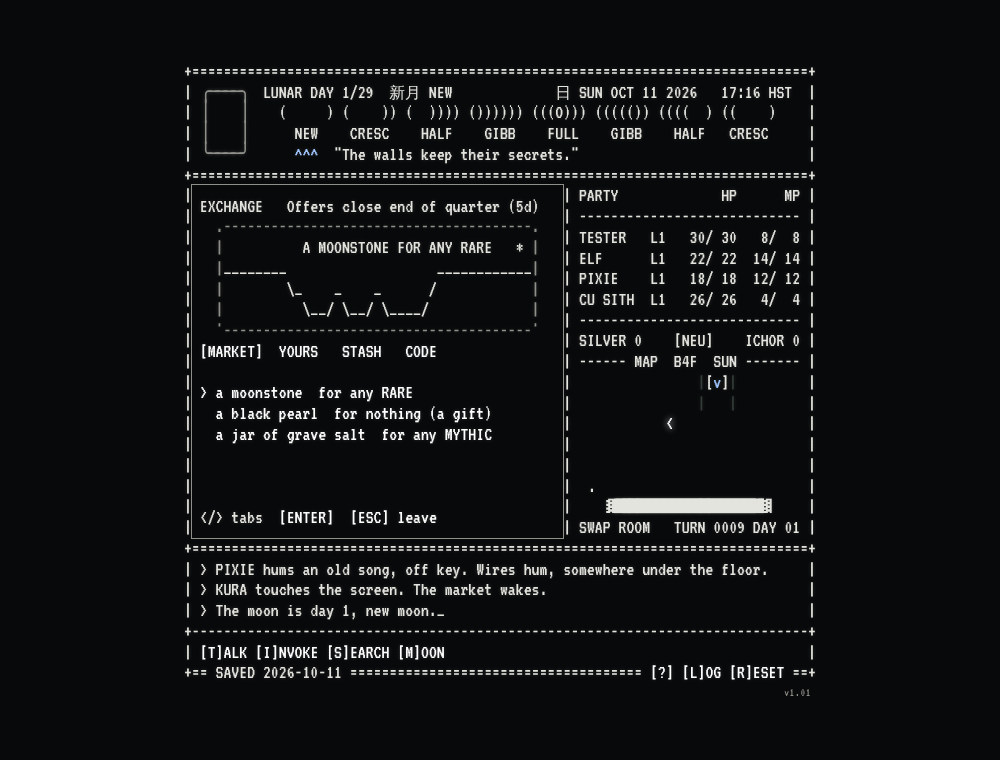

Game commit `41d7581`; bots `9366e68`. **Needs the Worker redeployed** (`worker.js` only; no schema change). Folds in the v1.00.2 changes, which were never pushed on their own.

- **The Worker picks the thing (option A).** `/eco/find` keeps the claimed tier but rolls `crypto.getRandomValues` over that tier's catalog for which thing it is, stores that, and returns it as `name`.
  - **Page:** `ecoScan` renames the bag's copy (and `ecoSeen`, and the log line that named it). `foundBox` waits for pending finds (`ecoWait`), at most 1.2 s, then shows the Worker's pick. A stashed MOON thing is listed as "(kept in the stash)".
  - **Bots** rename the same way, so the next `/eco/mine` doesn't count the renamed thing as gone.
  - A cheater can still claim that a find of a tier happened, but can no longer choose which thing.
- **Tighter limits.**
  - Per key a day: RARE 3 / MYTHIC 2 / MOON 1 (was 4/2/1). Per sender a day: RARE 6 / MYTHIC 3 / MOON 2 (was 8/4/2).
  - New: at most 2 MOON finds a lunar month per key and 3 per sender (`ECO_MOON_MONTH`, counted from `epochStart()`).
  - Refusals say "enough today" / "enough this moon"; the find stays a plain local item.
- **Exchange window.**
  - **Header:** "EXCHANGE   Offers close end of quarter (Nd)", falling back to "Offers close end of quarter" when the days don't fit (43 columns).
  - **Loading:** until the market first answers (`ex.loaded`), the list shows "..." in its place. Before, an extra "..." line sat over "Nothing on offer right now." (said before the answer came), and everything moved up when it went away.
  - **STASH tab:** empty reads "Special things go here."; the withdraw prompt and a used cap ("This quarter's one from someone else is used.") no longer name MOON. The cap text is swapped on the page, so the Worker's own message is not shown.
- **Room names:** a dead end with no kind takes `NAMES_BY_KIND.exchange`: Exchange, Xchange, Trade floor, Market end, Ticker room, Trading gap, Swap room (Bourse and Trading pit tried and dropped). A dead end named "Dead end"/"Sealed end" before v1.00 is renamed from this list.
- **The wall screen's arrow** (`EXW.up`) re-evaluates every 20 beats (about 2.2 s), comparing now with six steps back, and keeps its way on a tie. Before, it followed each step.
- **Breath bar** (`screen.js`): `PHASE`'s moon shapes are no longer used for it. It is `▓` + `█`×n + `▓` over columns 3-22 (20 wide), closing in up to 10 columns a side (`shut = round((6 - breath) / 6 * 10)`), and what is left keeps a `▓` at each end. The dot above still marks today's phase. On the page, row 21's strip is wrapped in a span nudged `left: .65ch`: measured, the bar's middle sat 5 px (about two thirds of a column) left of the panel's, and now matches it to the pixel.
- **`VERSION`** to v1.01.
- **Testing (light):** the Worker's pick and the new limits on a local SQLite copy (MOON claims came back as other MOON things; a key's third MOON find in a month refused; a fourth RARE in a day refused); the page parses; Chromium screenshots of the exchange window, the room name and the bar, no page errors. Not checked: the found box's wait against the live Worker, the bots' renaming.

## v1.00.1 - Where the Moon Things Go - Oct 11 2026, 16:55 HST

- **The stash line** (`ecoScan`, when the Worker counts a MOON find and it leaves the bag) read "... goes to the stash. [E]XCHANGE keeps it." from before the exchange moved into the dead ends and lost its button. It now reads "... goes to the stash. The exchange screens keep it." (76 columns at the longest name, "A shard of pale moonlight"). A stale `[E]XCHANGE` code comment renamed too. Commit `384721a`. No Worker change.
- **`VERSION`** to v1.00.1. **Testing (light):** the line on the run screen in Chromium, no page errors.

## v1.00 - 100 - Oct 11 2026, 16:42 HST

Live presence and the exchange (the player economy). Game commit `42515ad`; bots `716f464`. **Needs the Worker redeployed** with the new `schema.sql` run against D1 and `BOTS_PUBLIC = "1"` added under `[vars]` in the dev's own `wrangler.toml`.

- **Live presence.**
  - **Page:** `pingLive` sends `/here` every 3 min (`LIVE_EVERY`) only while a run is on screen, the tab is visible and a key or click came in the last 10 min (`LIVE_IDLE`); checked every 30 s and on `visibilitychange`. The daily ping is unchanged and writes the same row.
  - **Worker `/here`:** a known id costs one row read and is rewritten only when its level changed or it is 2+ min old (`PRESENCE_WRITE_GAP`). Only a new id pays for the 40-ids-a-day sender check (now indexed, `present_who_idx`) and the 60-day cleanup.
  - **"Right now"** = `at` within 300 s, ids not starting `bot`, worked out at most once a minute per Worker instance (`liveNow`, in memory) and returned by every `/here` reply and by `/feed` as `here.now`. Bots keep counting in the daily totals.
  - **Title cards** (plain): `In the pit right now: N`, `On B3F right now: N`.
  - **Typed line** (sentences, `PRESENCE.nowMine` / `todayMine`): four wordings for right now and two for today, rotating every 10 min, small numbers spelled out, her own device not counted ("Three others are on this level with you.").
- **The key:** `ddd.key` in localStorage (48 hex), copied into every save as `save.key`, so the password carries it. A loaded password's key becomes the browser's; the REPLACE THIS RUN box says so when it differs. The PASSWORD box warns "whoever has it has your stash". The Worker keeps only `SHA-256(key + ":daily-dungeon-exchange")`.
- **Finds (`/eco/find`):**
  - `ecoScan` (on every save) diffs RARE/MYTHIC/MOON names in the bag against `save.ecoSeen` and posts each new one; a new run (`ecoRun !== runId`) starts counting from its kit.
  - **Limits:** per key per UTC day RARE 4 / MYTHIC 2 / MOON 1; per sender (IP hash) RARE 8 / MYTHIC 4 / MOON 2; MOON only at moon phases 3-5; at most 5 new keys a day per sender. Bots skip the sender limits.
  - An accepted MOON find goes straight to the stash and leaves the bag ("... goes to the stash. [E]XCHANGE keeps it."). Refused or offline finds stay plain local items. Cheated runs send nothing; a dead run sends `/eco/end` once.
- **Ledger (D1):** `eco_owners`, `eco_items` (states `bag` / `stash` / `escrow` / `gone` / `dead`), `eco_offers` (open / taken / cancelled / closed / dead), `eco_retired`.
  - A key has one run at a time; a request from a new run retires the old (bag things die, offers die, an escrowed MOON thing goes back to the stash). A retired run is refused.
  - `/eco/mine` takes the bag's names and marks ledger bag things no longer in the bag as `gone`; returns stash, bag, open offers, deliveries (`fresh`), news of taken offers, `moonCap`, `quarterEnd`.
- **Offers:** one thing, asking `""` (gift), `tier:X` or `name:...`; codes `XXX-XXX` from a 31-letter alphabet, typed loosely (case and dash ignored).
  - At most 3 open per key.
  - **Close strictly at quarter end** (`ecoQuarter`, the same math as `quarterOf`). The thing comes back: MOON to the stash, the rest to the run's bag if that run still lives, else it dies.
  - An offer dies with its run (rule A: a RARE/MYTHIC in an offer is lost like the bag).
  - Taking moves the offered thing to the taker (MOON to the stash, else into the run's bag) and the payment to the maker the same way (a delivery to their run).
- **MOON cap:** `withdraw` (stash to run, one-way, the thing leaves the economy for good) is limited to one MOON thing a quarter that someone else found (`eco_owners.moon_q`). Own finds are not capped.
- **Bots:** `BOTS_PUBLIC = "1"` puts bot offers in everyone's market and lets bots take players' offers (all anonymous). `"0"` keeps them to a bots-only market the admin key can see (X inside the exchange window asks for the admin key without turning the testing cheats on).
  - `bot.js` gives each bot an exchange key, reports finds, picks up deliveries and trades by temperament (`TRADE`), with a new Exchange column in SUMMARY.md.
  - Bot presence ids start `bot`. The summary header names the pinned/latest versions and the newest real turn on file.
- **The exchange room:**
  - **The wall:** every dead end with no kind (`exchDir`: not a door wall, not the stairs wall, `(seed + i*13) % free`) has a screen in one wall, view end `exchange`. `walls()` hides nothing there.
  - **Older dead ends:** a dead end laid out before v1.00 that still hides something behind that wall searches normally until it's empty (`exchHere`).
  - **Opening:** SEARCH or [^] at it is free, even out of breath, with the lead "KURA reaches for the screen" and the log "KURA touches the screen. The market wakes." The rules set `st.exchangeOpen`; the page opens the window.
  - **The wall screen:** 27 by 7 with two slots under it. Its inner cells are drawn as U+2800 and swapped by the page for `EXCHANGE ^/v  N ON OFFER` and a 4-row market line.
  - **The market line** is a random walk (`EXW`, a step every 3 beats of 110 ms), decoration only. The window shows the same line, 3 rows, under a right-to-left ticker of the market's offers (one letter every 220 ms).
- **The window:** tabs MARKET / YOURS / STASH / CODE, as INVOKE's box (43 columns of text). [ESC] leaves. The bottom bar has no exchange button and no E key.
- **Bonus room and THE VOID** now take a wing's passage (`floor.js` `bonusSlot = P`), never the dead end and never the stairs wing.
- **Title feed:** `market` in `/feed` (newest 3 public offers, last 3 trades, open count). Cards: `MARKET: a moonstone, for any RARE. Code K7Q-2MX`, `Traded: x, for y`, `Given away: x`. They also ride the typed line's news.
- **`VERSION`** to v1.00.
- **Testing (light):**
  - The Worker on a local SQLite copy (29 checks: finds and limits, gifts and swaps by code, deliveries, the MOON cap, the bot market, quarter-end closing, retired runs).
  - In Chromium with that Worker: a find, a swap, the stash, a withdraw and the other side's delivery.
  - The dead-end screen and window opening.
  - Live pings with a fake clock.
  - Not checked: the bots' trading against a real Worker, other browsers, a full run.
- **Known softness:** the page still decides what a find is; the Worker only decides whether it counts (forged finds are capped by the limits, not stopped). Worker-rolled finds are planned for v1.01. A cheater's save can still use a thing locally and keep it locally; nothing in the ledger is created or doubled.

## v0.99.4 - One Line for the Moon - Oct 11 2026, 13:45 HST

- **`levelBones` drops the floor row above the moon line** (the LEVEL line under the frame already shows it, as the dev noticed). The heading is the one moon line, pinned to the second row from the foot of the 8-row panel with a blank row under it (`8 - rows.length - 2` filler rows, then the line, then ""). The branches below the line stay one row deep from v0.99.3 (the dev chose to keep them). Net effect: one more blank row between the line of days and the heading than in v0.99.3.
- **`VERSION`** to v0.99.4. **Testing (light):** `renderTitle` for 1,772 days (about 60 lunar months) with the strict 80-column check, the line on one row with a blank above and below each time; a Chromium screenshot, no page errors. Not checked: other browsers.

## v0.99.3 - Room Below the Moon - Oct 11 2026, 13:40 HST

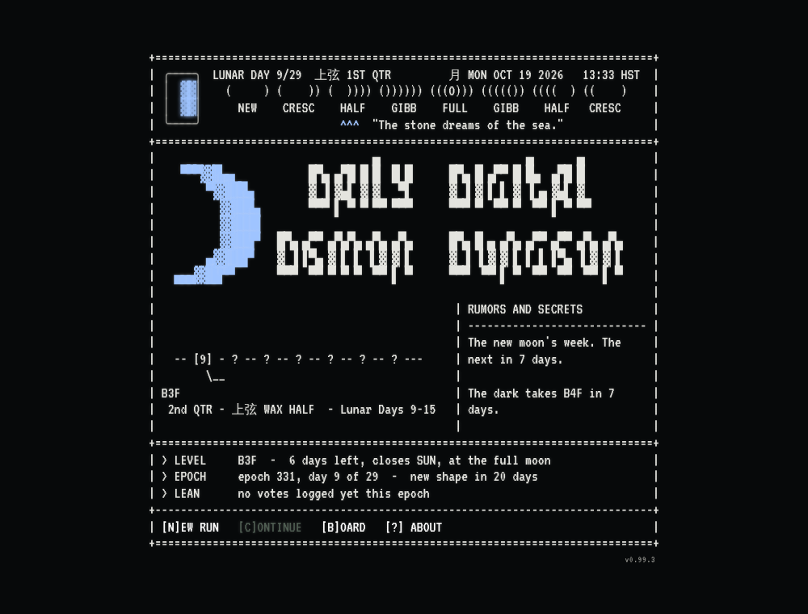

- **`levelBones` keeps a blank row under the two heading lines** (the dev wanted one open row between the moon line and the rule below). The drawing used up to 6 of the panel's 8 rows (4 above and including the line, up to 2 below), which left none, so the branches **below** the line are now always one row deep with no twig (`put(y0 + 1, x + 1, "\\")` then the `_` run at `y0 + 1`); the rolls (`h`, `twig`, `t2`) are still made, so the branches above the line are unchanged and no player's shape moves above the line. The drawing is now at most 5 rows; the filler is `8 - rows.length - 3` blank rows, then the floor, the moon line, and one blank row, so the heading is on the same row every day. Commit follows v0.99.2's `6be62be`.
- **`VERSION`** to v0.99.3. **Testing (light):** `renderTitle` for 1,772 days (about 60 lunar months) with the strict 80-column check, the heading on one row with its blank row each time; a Chromium screenshot, no page errors. Not checked: other browsers.

## v0.99.2 - Two Lines for the Moon - Oct 11 2026, 13:35 HST

- **`levelBones`'s heading is two rows pinned to the bottom of the left panel (8 rows under the wordmark):** ` B3F` (left-aligned, one column in), then `2nd QTR - 上弦 WAX HALF - Lunar Days 9-15`, a fixed 43-column block centered (name padded to 9, days to 5, so "- Lunar Days" lines up for every quarter). Names are now NEW MOON / WAX HALF / FULL MOON / WANE HALF (was the long forms), prefixed by `1st`..`4th QTR`. Blank rows between the drawing and the heading fill to keep the last two rows fixed; before, the heading moved up a row on days with no lower branch (86 of 1,182 days tried). Tried and dropped: a one-line heading (49 columns against the 47-column panel; dropping a space or the comma was too cramped).
- **`VERSION`** to v0.99.2. **Testing (light):** `renderTitle` for 1,182 days (about 40 lunar months) with the strict 80-column check, the heading on the same row every time; Chromium screenshot of the 2nd quarter, no page errors. Not checked: other browsers.

## v0.99.1 - The Twenty-Sixth Night - Oct 11 2026, 13:10 HST

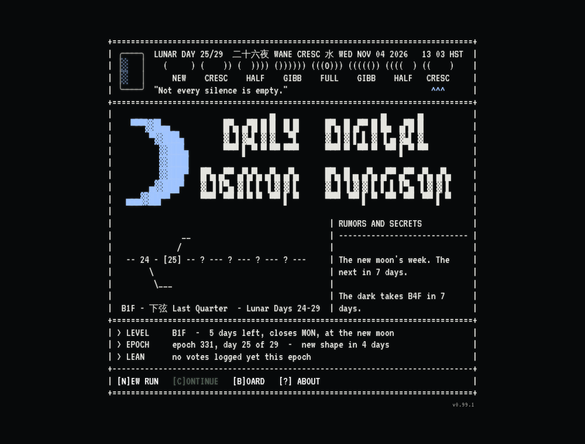

- **`PKANJI`'s last entry is 二十六夜** (was 有明月, which the dev found has no dictionary entry; 十三夜 and 十六夜 were confirmed there). 二十六夜 is the traditional night-count name for the waning crescent (the 26th-night moon vigils, 二十六夜待ち; ja.wikipedia 月待塔). Header reads `LUNAR DAY 25/29  二十六夜 WANE CRESC`; the strict width check passes for all frames. `VERSION` to v0.99.1.

## v0.99 - Moon in Kanji - Oct 11 2026, 13:00 HST

- **The header (`headerLines` in `screen.js`) reads `LUNAR DAY d/29  <kanji> <PHASE>`** instead of `MOON  n/8  <PHASE>`. Commit `dc3b577`. No Worker change.
  - **Day:** new `epochDay(now)` gives the day of the lunar month (1 to 29; the 29.53-day month rounded down to a steady 29, as the title's EPOCH line already did) and `epochLine` now uses it, so the header and the title cannot disagree. "LUNAR DAY" is exactly as long as the old "MOON  DAY", so nothing else on the row moved. The reason: the old `0/8` was the phase number (0 = new) and sat beside the title's "day 1 of 29" and "Lunar Days 1-8", which read as a mismatch.
  - **Phase kanji** (`PKANJI`): 新月, 三日月, 上弦, 十三夜, 満月, 十六夜, 下弦, 有明月, indexed by `moonIndex`. Picked with the dev from a table they supplied (新月 shingetsu, 三日月 mikazuki, 半月 hangetsu, 満月 mangetsu), with 上弦 and 下弦 for the two quarters so each has its own word, and the traditional night-count names (十三夜 and 十六夜 for the gibbous phases, 有明月 for the waning crescent) for the three the table lacked. Those last three are to be checked against a source. The dev's first paste had 親月 (a typo for 新月) and called 上弦 and 下弦 crescents; the header names 上弦 as the first quarter and 下弦 as the last. (A quarter-of-the-month kanji for the header was built and dropped: next to a phase name it read as a contradiction on days like 8 and 21.)
  - **Width:** each kanji is one character but two columns, so the header's padding subtracts the kanji's length; `finishFrame` (strict in node) passes for every phase across two lunar months. Three-character names fit with room to spare.
- **The title's heading names its quarter in kanji** (`levelBones`): `B3F - 上弦 First Quarter - Lunar Days 9-15`, using 新月 / 上弦 / 満月 / 下弦 for the four quarters. The heading is one fixed-width block (name padded to 13, days to 5, then centered by columns with the new `colsOf`), so "- Lunar Days" starts in the same column (28) for all four quarters. `renderTitle` pads the left panel's rows by columns now, not characters.
- **Kanji at 80%** (`.kanji .g { font-size: 0.8em }`): the weekday, the phase and the quarter. The box stays two cells wide, so the frame is unchanged. The page wraps every CJK character on the title (`/([一-鿿])/g`) and in the header, not just the weekday.
- **`VERSION`** to v0.99. **Testing (light):** the title and header for every phase and quarter in node (the strict width check), and in Chromium for a waxing gibbous day, no page errors. Not checked: a full run on every phase, other browsers or fonts (the kanji fall back to the system's Japanese font; the sandbox's was Noto Sans JP).

## v0.98 - Short of Breath - Oct 11 2026, 12:40 HST

- **Mashing while out of breath lengthens the wait** (`rules.js`, `index.html`). Commit `8c9e73d`. No Worker change.
  - **Rule:** every refused try (a search, a step into another room, using the bag; never a fight's bag use, which is never refused) calls `nudgeBreath`, which moves `st.breath.at` back `BREATH_NUDGE = 500` ms, to at most `BREATH_NUDGE_MAX = 10000` ms past `now + BREATH_WAIT`. So the extra is capped at ten seconds on top of the usual wait (the usual wait from empty is about 12 s: the 2 s hold plus 10 s to climb from 0 to 1, so the worst case is about 22 s). The two clamps in `breathNow` and `breathNext` (`Math.min(b.at, now + BREATH_WAIT)`, which stopped a jumped-back clock stranding her) were loosened to allow it.
  - **Held keys count once:** `RULES.holding(e.repeat)` is set around `act(k)` in the keydown handler; a repeat press is ignored by `nudgeBreath`. Clicks on buttons always count.
  - **Tested** in the browser: timer 11.3 s then +0.5 s a press (less the 0.25 s between presses); one press plus eight repeats adds one nudge; thirty more presses stop at about 21.9 s. The bots wait out their breath rather than press on, so they are not affected.
- **The marker over the breath bar counts the breath the other way** (`renderScreen` in `screen.js`, `colorizeTitle`'s row 20 in `index.html`). One dot when `breathNow > 4`, two for 1 to 4, three (". . .") when under 1 (out of breath, the same moment the timer shows). The first dot stays at the old single dot's column (`1 + 3*idx + DOT`) and the others follow to its right, two columns apart. The page's half-column shift for the quarter phases now applies to every dot (`/\./g`).
- **Search lines:** the opening is `KURA searches the SOUTH wall...` with three dots typed one at a time and no spaces (was ` . . .`), the result follows on the same line (`... A TRACER wanders in!`), and the heading the page splits the result from (`/^> KURA (searches|scries) the [^.]+\.+/`, in the beat code and in `colorizeTitle`) takes the longer run of dots. `rules.js`'s `where` is `...`; the short form is `KURA searches NORTH... text`; scrying the moon or sky ends in `...` too. Door listening still shows only its result.
- **The `>` and `<` on the breath bar** (shown for a second after a search) were covered by the bar's blocks, which are drawn 1.3x wide. They are now `.mk` spans (`position:relative; z-index:1`), the `>` nudged 0.25 ch left and 1 px up and the `<` 0.5 ch + 2 px right and 1 px up, so they clear the bar, sit level with each other and have the same gap on each side.
- **`VERSION`** to v0.98. **Testing (light):** the run screen in Chromium, no page errors; not a full run, not other browsers.

## v0.97 - Plain Words - Oct 11 2026, 11:59 HST

- **The `[?]` page (`showAbout` in `index.html`) has a new intro and a boxed THIS RUN.** Commit in the game repo (see its log). No Worker change.
  - **Intro:** the dev wanted the old paragraph ("Each level is four wings. Three times, two locked doors offer two rooms... dead ends hold the big clues") to explain less. Now seven lines: "A dungeon crawler you play on the real lunar calendar." / you wake at the bottom of a pit and the dark rises with the moon / everyone shares the same floor, each floor closes when its quarter of the moon ends, find the stairs / the moon and the demons are real, some talk, some fight / search all you like, but be careful digging too deep / "Come back tomorrow." Wording went through several rounds: "one key a day" and "one door a day" were dropped from the first line because they sit oddly beside "climb" (a run only climbs once a level closes); "about a week", "KURA" (now "you") and "some are lying" were cut.
  - **THIS RUN** is a box in the page's frame characters (`framed()`: `+- THIS RUN ---+`, `|` rows, `+---+`), 71 columns like the divider. The rows are the same `two()` lines as before.
- **`VERSION`** to v0.97. **Testing (light):** the page with a run open (no errors, all box lines 71 wide); the title and run screens untouched.

## v0.96 - Crescent Over the Gate - Oct 11 2026, 11:40 HST

- **A fixed waxing crescent on the title screen** (`screen.js` `renderTitle`, `index.html` `colorizeTitle`). Commit `e12aa13`. No Worker change.
  - **Art:** seven rows by thirteen columns of `▀ ▄ █ ▓` (lit on the right, the northern-sky waxing side the header's moon box already uses), generated once from a disc minus an offset disc at the screen's real cell shape (a column is about 0.38 of a row), then hard-coded as `CRESCENT`. The two cells along the inner edge of each row are the lettering's own dotted block `▓`.
  - **Layout:** the moon, a three-column gap and the 56-column lettering sit as one group in the 78-column band (`CRES_COL = 3`, so the lettering moves right by 19); the two lettering lines are still centered on each other. The moon takes banner rows 1 to 7 (`CRES_ROW = 1`), the rows the lettering fills. `SMT.CRES` (`w`, `row`, `col`, `rows`) tells the page where it is.
  - **Page:** the moon's cells get `.cres` (the moon blue, flat). The dotted ones are also `.wm`, boxed like the lettering's own. No glow and no animation (the header box's `.lit` breathes; this does not), so the dots are exactly the lettering's dark.
  - **Same every day.** The phase-following version (new, full and the rest, each with its own art) was offered and left for later.
- **Also:** `VERSION` to v0.96. The header and banner images (a larger header and a 1920x480 itch banner of the crescent beside the lettering) are not in the repo.
- **Testing (light):** the title renders with no page errors and every line still passes the 80-column check; a screenshot at 1000x760. Not checked: a full run, other browsers.

## v0.95 - The Locked Drawer - Oct 11 2026, 10:51 HST

- **The X testing cheats ask for the admin key.** Commits `270d6ad` (game) and `432d050` (Worker). **Needs a Worker redeploy** (worker only; no schema change).
  - **Page (`index.html`):** `X` (infinite steps) and `Shift+X` (the clock a day ahead) go through `adminGate()`. It reads `dd-admin` from `localStorage` (the same slot the board's delete uses) and asks the Worker `GET /admin` with it. A right key keeps the cheats unlocked for the page load (`adminOK`); a missing or rejected key shows `prompt("Admin key:")`, a wrong answer shows "That key was not accepted." and the key is dropped; no answer from the Worker shows "Could not reach the board." A right key is stored. Until the Worker is redeployed the check 404s, so the keys fail with "not accepted".
  - **Worker:** `GET /admin` (header `x-admin-key`): 200 `{ok}` when the key equals the `ADMIN_KEY` secret and the page's origin is allowed, otherwise 403. No attempt limit, so the key should be long.
  - **Cheated runs are marked.** `st.cheated` is set by `freesteps()` (when turned on) and `next()`. It stops the score post (the page's `submitScore`, and the end page shows "THIS RUN USED A TESTING CHEAT AND CAN'T BE POSTED." in place of the post button) and suppresses events and the presence ping, as infinite steps already did. It is page-side: a direct POST to the Worker is still possible, as it always was.
  - **Old saves:** on load and each tick, with no unlocked admin, a save with infinite steps still on has it switched off and the run marked (`sweepCheats`); a leftover clock offset marks the run and stays until reality catches up, as before.
  - **New run (`reset`):** the flag is cleared, unless infinite steps (the one cheat that carries over) is still on.
  - **Deleting a board row** (`D` in the board) still needs X mode and the key; it now has the key stored from unlocking.
  - **Bots** are unchanged: they call the rules directly and never use the cheats.
- **Testing (light):** the Worker's `/admin` with a fake environment (right key, wrong key, no key, another website, no secret set); browser checks with a mock Worker of a wrong key, cancel, the right key, the same session (no second prompt, `Shift+X` moves the clock), a reload (silent re-check), and a stale stored key (asked again); a cheated dead run (no post button, the message) against a clean one (post button); and `reset`'s flag. Not checked: Firefox, and the real Worker (not redeployed when this was written).
- **Also today, no game change:**
  - `README.md` rewritten for the wing-based game (`83ce1f4`).
  - **Bots are off the board** (`584675b`, Worker): `/top`, a player's rank and the "names carved" count skip names ending in `-bot`; their scores still feed the season, counters, deepest and last fall, and their events and presence are untouched. A person named "...-bot" only hides themselves.
  - **itch.io:** `ALLOW_ORIGIN` also lists `https://html-classic.itch.zone`, the host itch serves the HTML5 build from. A score posted from the itch page ranked 8th.
  - **The itch build is a separate zip, not the repo's files:** `index.html` carries VT323 loaded from bytes with the FontFace API (a Firefox extension that blocked fonts had broken the page's font file, which is what first looked like an itch problem), and the testing cheats are blocked outright (`X` and `adminGate` return at once: no prompt, no admin request). Every itch zip needs that lock.
- **No new design-doc changes yet** (the doc is only updated on request).

## v0.94 - The Name in Lights - Oct 11 2026, 09:15 HST

- **Wordmark in block letters, full width** (`screen.js` `renderTitle`). Commit `0ab1a92`. The dev pasted their own lettering for DAILY DIGITAL / DEMON DUNGEON (44 and 54 columns wide; the left panel is 47). Tried first as a mockup with the gap closed to one space and the wide line overlapping the frame bar and the divider: rejected. Built as the full-width layout: the first nine rows of the main area are one 78-column band (`TOP = 9`: four rows, a blank, three rows, a blank) with both lines centred; the remaining eight rows are split as before, the level line on the left and the rumor sidebar on the right.
  - The sidebar's card window is now `VH - TOP - 2` = 6 rows (was 15). The tagline "a daily dungeon crawl" is gone.
  - The level line exactly fills its eight rows (three above the spine, the spine, two below, a blank, the heading). It cannot grow taller.
  - **Page:** rows 6 to 13 box each of `▀▄█▓▌▐` into a one-cell span (`.cell.wm`), as the moon's glyphs are, with the fallback font's glyph scaled to 0.82 wide. VT323 has none of these characters, so their exact weight depends on the machine's fallback font.
- **Heading under the drawing,** worded "B4F - New Moon - Lunar Days 1-8" (`86d1dd1`, `2b0473f`): title case, "Lunar Days", and placed one row below the lowest branch showing, so it can sit a row or two lower later in a quarter.
- **Testing (light):** the title printed as text for several dates (every row 80 wide); a browser screenshot of the real title; a new run still starts from it. The mockups were images only.

## v0.93 - The Line of Days - Oct 11 2026, 08:57 HST

- **The level as a branching line on the title** (`screen.js` `levelBones`). Commits `e3c6bff`, `9552d47`, and the heading commit. From the dev's sketch: a dashed spine with a branch off each day, above and below in turn. Heading: "B4F  -  new moon  -  days 1-8" (level, the moon the quarter opens with: new moon / first quarter / full moon / last quarter, and the lunar day range). The wordmark moved up to rows 1, 2 and 4; the heading is on row 7 and the drawing on rows 9 to 15.
  - **Days** are lunar days by the same count as the EPOCH line (`floor(days into the epoch) + 1`, 1 to 29): quarter q runs from `ceil(q * 29.53 / 4) + 1` to `ceil((q + 1) * 29.53 / 4)` (8, 7, 8 and 6 days). Today's number is in brackets.
  - **Shape** is rolled from `(epoch, q)` only (a small mulberry generator), so it is the same for everyone and changes each quarter: each branch 1 or 2 steps high, a 1 to 4 character twig, sometimes a second small one. It carries no information: every wing has three rooms.
  - **Masked future:** a day after today shows `?` and no branch. Its rolls are still consumed, so visible branches never change as days are uncovered.
  - The line can show 8 days where a level's run has at most 7 door-days; left as is.
  - The title's quarter card now reads "The new moon's week. The next in N days." to match the naming.
- **The search beat now comes before the search** (v0.92.1, `0314797`). The dev saw a demon appear with no delay. The dots used to play only when nothing else opened. Now the page shows the lead-in (built from the facing: "KURA searches the WEST wall", "KURA listens at the door", "KURA scries the moon / sky"), adds three dots at 200 ms, and only then calls the rules; a demon, a find or the terminal opens at about 0.8 s. With no popup, a multi-sentence result still follows a sentence at a time. Out of breath: no beat.
- **`[F]IGHT` removed from the bottom bar** (`f77f311`): the bar is `[T]ALK [I]NVOKE [S]EARCH [M]OON`. The fight box keeps its own button and the F key. The dev considered STANDBY, GIVE, REST and LISTEN for the slot and chose to leave it empty.
- **Typed line:** a finished line holds 5 s (was 3.2); every line ends in a full stop unless it already ends in one or a quote; six kinds trail off with " . . ." (the dark taking the level, walking alone, a member fallen, badly hurt, running out of patience, an omen in reserve).
- **Testing (light):** the title line printed for several dates and quarters (two-digit days, the mask on days 1, 4 and 7) and seen in a browser screenshot; a browser run that waited for both an ordinary result and a demon (its box opened 0.81 s after the key). Not checked in the browser: the typed line's endings and hold, the bar after `[F]IGHT` left, a find or the terminal after the dots.

## v0.92 - In Color - Oct 11 2026, 08:38 HST

- **Result colors.** Commits `f40e594` to `b6d36cd`. `resultClass()` picks a class for the result text: `q-plain` (`--trail` grey: nothing, or a COMMON or UNCOMMON item), `q-silver` (`#d6e8ff`: SILVER), `q-rare` (`#6aa6e8`), `q-mythic` (`#f5c542`: a MYTHIC item or the deep find), `q-moon` (`#c9b6ff`: a MOON item). No glow. Settled with the dev over several swatches: rare was tried in green and went back to the traditional blue; mythic went from the border gold `#e3b341` to a brighter gold ("more shiny"); moon went from the header's moon blue to lavender (cyan was the other finalist); silver was made cooler and brighter after it proved nearly identical to the log's off-white.
- **Where the result shows changed three times and ended on the action line.** v0.91.1 put it on the top line; a popup had been tried before that (v0.88). Final (`6abf4ff`): the middle line reads "KURA searches the WEST wall. RESULT" and only RESULT is wrapped in the quality's span (`colorize`, row `lines.length - 5`). The top line is untouched. `resultBox()` and the result popup are removed. **The find popup ("KURA FOUND") stays**, at the dev's explicit request.
- **The beat is dots, then sentences** (`6abf4ff`, `504be0b`). After a search with a breath to spend and nothing else opening: the line shows the lead-in without its full stop, adds " ." three times at 200 ms, then the result one sentence at a time, 550 ms apart ("A crack." ... "It goes nowhere."). Input is ignored until the last sentence. A one-sentence result takes 0.8 s, two about 1.4 s. At a door, where the log has no "KURA searches" sentence, the lead-in is "KURA listens at the door" and the whole line then appears uncolored. A search that opens the find popup has no beat.
- **"Coins" is gone** (`c91ba19`): `reveal` now says "N SILVER, loose in the rubble."; the find popup's check for that line was updated to match.
- **Typed line:** letters 80 to 150 ms (about eight a second), 120 ms on a space, 420 ms after punctuation; a 2.2 s pause on a bare `> _` (blinking) between lines.
- **Testing (light):** browser checks of the class and computed color for dust, a common item, a rare item, SILVER, and the deep find; of the dots and the sentence-by-sentence reveal with timings; and that the top line is unchanged by a search. Not checked: a MYTHIC or MOON item by name, a find popup after the SILVER rewording, the typed line's new pause.

## v0.91.1 - A Slow Hand - Oct 11 2026, 08:16 HST

- **Search result on its own line.** Commit `4926ceb`. In `draw()`, when the saved log reads "> KURA searches/scries the X. RESULT", the middle line is drawn as the first sentence and RESULT is drawn on the top line in place of the flavor text. Display only: `save.log` is restored at once and the history keeps the whole sentence. Not split during the 0.8 s beat, for a dead run, or while a party question holds the top line. A find (`KURA finds`, `A locker holds`, `Coins in the rubble`, `Deep in the stone`) sets `resultGold` and the top line gets `.logline.gold` (the popup gold, no glow).
  - The result sits **above** the action because the line below is the typed news. Flagged to the dev as possibly reading backwards; the alternative is to swap the two.
- **Typed line.** Slower: letters 110 to 200 ms (about six a second), 170 ms on a space, 520 ms after punctuation; deletion one character per 45 ms (was two per 18 ms); gap 0.7 s. A persistent `> ` prefix. Width 72. It never says KURA: status lines have "KURA is" / "KURA" rewritten to "She is" / "she".
- **Run news rewritten** (`0f38d44`). Dropped as shallow or already on screen: SILVER, lean, bare day and turn. About thirty lines, each only when it applies: rooms of the level walked, days before the dark takes it, today's key, who walks with her, who has fallen, who is badly hurt, who is running out of patience (patience 2 or less), pacts holding, demons met / beaten / run from, talks, gifts and refusals, silences, party remarks, confidences, searches and finds, longest stay at one wall (5 or more), rare finds, things broken, doors and rooms, levels climbed, STANDBY nights, a held omen, fixtures, offerings, ICHOR, the moon, out of breath, things in the bag.
  - **Mix:** two of hers, then one of the others' (others on her level today, then located rumors), repeating; the shorter list wraps. The others' list is only three or four items until located events accumulate.
- **Testing (light):** browser checks of the split lines, the gold class, the typing rate (13 letters in 2 s) and the feed list with made-up counts. The slower delete was not watched on screen.

## v0.91 - Typed - Oct 11 2026, 08:08 HST

- **Typed line in place of the ticker.** Commit `d72f8e1`. The dev tried a gliding scroll (`37e9b11`, built and never pushed alone: sub-character `translateX` on every animation frame) and then asked for a terminal instead. A `setTimeout` state machine (`typeStep`) cycles gap, type, hold, delete: letters at 35 to 90 ms, 70 ms on a space, 260 ms after punctuation; the finished line holds 3.2 s with the `_` blinking (`.wait`); it is deleted two characters every 18 ms; 0.5 s gap. Lines are cut at 74 characters. Only `#ticker`'s HTML is rewritten. Content is unchanged from v0.90: a new status report goes next whenever one is waiting, otherwise `tickerFeed()` in turn.
  - The first build broke the page outright: a leftover `}` and `requestAnimationFrame(tickerFrame)` from the scroll code stopped the script loading, and `tickerHtml` as a `const` was read before its declaration on the first frame. Caught by the browser check; fixed (a function declaration and `var`).
- **A beat before a search's result** (`6d302e5`): with instant results the popup felt too fast. The search runs at once, but for 0.8 s the middle log line shows only the lead-in ("KURA searches the SOUTH wall.", "KURA scries the moon.", or "KURA listens at the door." where the log has no such sentence) with a blinking `_`; then the full line is restored and the result box opens. Keys are ignored during the beat; the minute timer skips its save.
- **`[M]OON` fixed in place:** `[S]CRY` is padded to `[S]EARCH`'s width in `screen.js`.
- **Worker** was redeployed for v0.90 at about 07:59; `/feed` then showed presence at 11 (the dev and ten bots), no names in any event, and only old-style events so far. The `news` table has not been seen to take a write yet.
- **Testing (light):** browser checks of the beat (lead-in with cursor, a key ignored, then the box; the scry version; the bar text in both states) and of one full type, hold, delete, type cycle (about 6 s for a 40-character line). Not checked: the typed line during a fight or under a popup.

## v0.90 - News From This Level - Oct 11 2026, 07:58 HST

- **Events carry where and who.** Commit `598c5b1`. **Needs a Worker redeploy (schema and worker).**
  - **Game (`rules.js` `ev`):** every event now also has `lv` (level height), `d` (day on the level), `k` (room kind, or hall / dead / plain), `a` (lean: L, N, C), `p` (party members standing, not counting KURA), `c` (levels into the run), `dm` (the demon in the room, if any), `m` (moon phase 0 to 7) and `n` (the run's name).
  - **Worker:** a new table `news (id, type, v, made, who, x)`; `x` is a JSON object of the fields that passed their checks (each is validated against a fixed shape and silently dropped otherwise; the name also goes through the leaderboard's blocklist). `/event` writes to `news` and rate-limits against it; the newest 20 per tag are kept as before. `/feed` reads `news` and tops up from the old `events` table while `news` fills. **The name is stored but never returned by `/feed`**: the dev wants it "for later".
  - A new table instead of new columns on `events`, so `schema.sql` stays safe to run again (no ALTER).
  - **Cost:** no extra requests and no extra rows; a row grows from about 50 to about 120 bytes and the table stays at a few hundred rows.
- **The ticker's content changed** (v0.89.1, `e6f4c31`, never pushed alone): no month totals or calendar lines. It alternates one item about this run (name, day, turn, level; who is with her; demons met, beaten and fled; pacts; searches and finds; doors; levels; SILVER; lean; the moon; out of breath; each only above zero) with one about others (how many others are on her level today, then the rumors). Status reports still join the tape as they change. Speed 200 ms a character (5 a second), was 140.
- **Located rumors on the ticker:** `rumorCards(level)` sorts events from her level first and prefixes "On this level, day N:" or "On B3F, day N:"; a fall with a demon reads "A CHROME ONI struck a traveler down." Events without a level (the old rows) show as before. The title screen's rumor cards are unchanged.
- **Bots** send the new fields automatically once pinned to this commit.
- **Testing (light):** the Worker file loads; a node run produced an event with all the fields; one browser check with a stand-in feed showed the located lines and the slower speed. The real Worker is untested until redeployed; until then `/event` posts with extra fields are still accepted by the old Worker (it ignores them), so nothing breaks.
- **No new screenshot;** the entry reuses v0.89's.

## v0.89 - The Ticker - Oct 11 2026, 07:50 HST

- **The log's three lines are reordered** (`screen.js`): top, the flavor line (`extra`: atmosphere, party and demon lines, tells, and a question with its `[Y]ES [N]O [S]ILENT`); middle, the action log; bottom, the status report. The page's question buttons moved to the top row (`lines.length - 6`).
- **The bottom line is a ticker** (`index.html`). Commits `56ff272`, `61ba9db`. A tape string is extended as needed and shown through a 76-character window in ``, advanced one character every 140 ms (about 7 a second). Only that span's text is rewritten; `draw()` re-renders it at the current position, so nothing jumps. It does not pause for popups or fights.
  - **What goes on the tape:** each new status report (`save.status`, as it changes), and between them the title feed's lines in turn (`worldLines`: number cards, rumors, moon lines), separated by `   //   `. The dev chose `//` over `+++`, a centered dot and others.
  - `report()` no longer mixes "Elsewhere:" lines into the status line, and the page no longer writes `save.world`.
  - In node and for the bots the bottom row is simply the status line: the ticker is page-only.
- **The "searching . . ." moment is removed** (v0.88.2, `a8d343d`, never pushed alone), at the dev's request "for now". Every search lands at once and its result box opens straight away (about 18 ms in the check). `searchWait` is gone.
- **Noted by the dev:** the out-of-breath countdown is rarely seen, because the result box stops rapid searching and the bar refills meanwhile. Left in.
- **Testing (light):** one browser check of an instant search, and one of the new layout with a stand-in feed (rows in the new order, the ticker advancing over several seconds, every row 80 wide). Not checked: a party question on the top line, the ticker during a fight, the `//` separator on screen (a string change after the check; the screenshot still shows `+++`).

## v0.88.1 - Plain Boxes - Oct 11 2026, 07:39 HST

- **Popup text.** Commit `b3336f6`. `resultBox()` strips a leading "KURA searches the X wall." / "KURA scries the moon / the sky." so only the result shows; the log line keeps the full sentence. A first version printed a literal "null" line (the absent moon line went through `String()`); fixed before push.
- **No glow on any box.** The `box-shadow` on `.foundbox` (the floating find, break, confirm and result boxes) is removed; the gold border stays. The in-frame fight box never had one. Part of the dev's standing "no visual effects" rule.
- **Countdown meaning changed.** `RULES.breathNext` now returns the time until she has one whole breath, and only while she has less than one; otherwise null and the cells are blank. The dev asked for "seconds until the player is allowed to take the next breath"; read as "until she can search again". With half-breath steps she can still step at 0.5 while the countdown shows.
- **Testing (light):** one browser check: the box has no shadow and reads "Nothing but dust." / "No moon tonight. No one to ask."; the timer is blank at 5 breaths, 11.8s at zero and 8.8s three seconds later. The other boxes were not opened after the glow was removed (a one-line CSS deletion).
- **Screenshot** reuses v0.88's file, retaken with the plain result box.

## v0.88 - Half a Breath - Oct 11 2026, 07:34 HST

- **Steps cost half a breath.** Commit `00cba0e`. `STEP_BREATH = 0.5`; `spendBreath(st, amount = 1)`. `st.breath.n` can now sit on a half. Regeneration climbs to the next whole number, taking that share of `BREATH_BACK[floor(n)]` (`breathStep`): from 5.5, one second after the 2-second wait. A step is refused below 0.5; a search, a scry and an item still need and take a whole one. The bar's `round((6 - breath) / 6 * 9)` copes with halves.
- **Countdown.** `RULES.breathNext(st)` returns the milliseconds until the next breath is back (null when full). The page writes it into a five-cell `` at the right end of the strip's row (panel columns 24 to 28) as `2.8s`, and a 100 ms timer updates only that span's text: the screen is not redrawn for it. Blank at full breath, on the title, and for a dead run.
- **`>` `<` for every breath** (v0.87.1, `e593c87`, never pushed alone): `draw()` compares `save.breathNow` with the last frame's and calls `squeeze()` on any drop, and also when a new out-of-breath line appears at zero. So steps and items press the bar too, and anything made to cost breath later will.
- **Result popup replaces the waiting cursor.** The dev found the swallowed key press broke the flow and asked to try a popup. `resultBox()` reuses the find box (`mode = "found"`, closed only by its `[ OK ]`: Enter or a click): the log line wrapped at 38, plus the moon's own line after a scry when she answered or kept her counsel. Not shown when the search opened something else (a find, a fight, a question, the terminal), and not for an out-of-breath refusal, which only shows its line. `contWait`, the `_` rendering and its capture listeners are removed.
  - It is the same number of presses as the cursor was; the difference is that only Enter or a click closes it, and it covers part of the view. To be judged in play.
- **Testing (light):** browser checks of a step (5.5, the marks, the countdown 2.8 / 2.1 / 1.4 / 0.5, then full) and of the popup (a wall result, another key leaves it open, Enter closes it, a scry result). After the last fix (dropping a stray atmosphere line from the scry box) it was not re-run. Not checked: the bag's refusal line, a refused step, the out-of-breath case with the popup code.

## v0.87 - Scry - Oct 11 2026, 07:27 HST

- **`[M]OON` and `[S]CRY`.** Commit `f559147`. The bar reads `[F]IGHT [T]ALK [I]NVOKE [S]EARCH [M]OON`; `[M]OON` (key M) toggles `st.look`, replacing `LOOK_[U]P` / `LOOK_[D]OWN` and the U and D keys (down arrow still looks level). While looking up the search button reads `[S]CRY`, same S key, and the log says "KURA scries the moon / the sky". The dev considered PURSUE, AUGUR, WISH, CHERISH and DIVINATE; chose MOON "for now" and SCRY.
- **Breath is spent on more things (`rules.js`).**
  - **Steps** (`2ebc2ab`'s sibling `40f899f`): every `go()` that moves her to another room, and climbing the stairs, calls `spendBreath`. At zero the move is refused ("KURA is out of breath. She stays where she is."). Unlocking a door is not a step and costs none. Running from a demon is never refused; it takes a breath if she has one.
  - **Using an item** (`2ebc2ab`): `useItem` takes a breath and is refused at zero ("The bag can wait."), except in a fight, where it is never refused. ICHOR, gifts and altar offerings are separate actions and cost none.
  - Fighting, talking, turning and looking cost none.
  - **Balance:** six breaths now cover searching, scrying, items and walking. Crossing a wing and back is four or five. Untested by a human; the bar size (`BREATH_MAX`) and the refill table are the levers.
- **Every search waits and every door search takes the moment** (`b8e0438`, `324aa70`). Page-side: any non-look search with a breath to spend shows "KURA is searching . . ." ("listening" at a locked door), including open archways and sealed doors. Every other search (scrying, out of breath) lands at once and waits with the `_`. No cursor when the search opened a popup, a fight, a question or the terminal.
- **Breath bar centred** (`324aa70`): the strip and its phase dot start one column into the panel instead of three, so the drawn part (the strip's columns 5 to 21) sits mid-panel.
- **The level on the end-of-run page** (`324aa70`, `f3ab1fe`, `7940fa4`): `RULES.levelMap(st)`, shown under the stats when the run is dead. One column a day: `[v]`, `< >` per two-door day, `[?]`, `[^]`; "seen" is rooms entered out of the wing's three (`-` if never reached); "took" is the feel word of the room she opened that day; "left" is always `?`; "^ here" marks the wing she ended in.
  - The dev's mockup had a "rooms" row with varied counts; in the real floors every wing has exactly three rooms, so that row became "seen".
  - First build showed both offered rooms for every day; the dev pointed out that dying early would reveal the week's shared offers, so it now shows only the room she took.
  - Also removed a leftover call to the deleted `RULES.pathView`, which logged a caught TypeError every time the log opened (since v0.80).
- **Shared-map mockups** (title screen, tree and readout versions) were tried and set aside twice today; nothing built.
- **Testing (light):** node checks of the bar text, breath draining on item use and on steps (with refusals at zero), and the map from generated runs; browser checks of M / S / Enter / the MOON button, of an archway search (the moment, then breath 6 to 5), and of the end page. Not checked in the browser: the bag's refusal line, a refused step.
- **Bots:** the 06:50 re-run failed at "Save the day" (it was a re-run of the first run, so it started from a snapshot with no saves and collided). The workflow now checks out `main` and rebases with the bots' files winning. A fresh forced run was started at about 07:07; result not seen yet.

## v0.86 - Wait For It - Oct 11 2026, 07:03 HST

- **Click to continue after a search.** Commits `141a3e2`, `2e52611`. Page-side (`index.html`): after a wall search or a listen lands, `contWait` is set and the log's middle line ends in a blinking `_` (the existing `.wait` class), drawn in place of one trailing space so the row stays 78 wide. Any click (a capture listener on `document`) or key (except Shift, Tab and F-keys) clears it and does nothing else. Not set when the search opened a popup, started a fight, or raised a question.
  - **Out of breath** now takes the same path: the refusal shows at once (no "searching" moment), then waits with the `_`.
  - Still instant with no cursor: an open archway, and asking the moon.
- **`>` `<` on the breath bar for one second.** `screen.js` draws them at either end of what is left of the strip only when `st.squeeze` is set; the page sets it for a frame inside `draw()` while `Date.now() < squeezeUntil` and deletes it straight after, so it is never saved. `squeeze()` starts the second when a search lands (or is refused) and schedules the redraw that removes them. First built as always-on while the bar was closed; the dev wanted them only as a brief pop on the key press.
- **Cost in presses:** a search is now press, 1 to 2 seconds, press. Noted for balance.
- **Testing (light):** the strip printed at each breath; one browser check of the cursor (first key only dismisses, second acts; rows stay 80 wide) and one of the marks (absent during the wait, present on landing, gone 1.2 s later; out-of-breath line waits with the cursor). The marks on an empty bar were not observed, only the code path.
- **Screenshot** was taken before the marks became momentary; it shows the waiting cursor.
- **Also today (dungeon-notes only):** the bots workflow moved to `actions/checkout@v5` and `actions/setup-node@v5` after a Node 20 deprecation warning; untested until the next run.

## v0.85 - Word From Elsewhere - Oct 11 2026, 06:47 HST

- **Presence, daily version.** Commit `9fe611c`. **Needs a Worker redeploy (schema and worker).**
  - **Page (`index.html` `pingHere`):** once per local day, a device with a living run POSTs `/here` `{ id, level }`. `id` is 24 random hex characters kept in `localStorage` (`ddd.device`); `ddd.here` holds the last day pinged. Nothing personal; not sent while the testing cheat is on, or for a dead run. Called from `flushEvents`, so it rides the first save of the day.
  - **Worker:** new table `present (id PRIMARY KEY, level, at, who)`, one row a device, overwritten. `/here` validates `id` (`[a-z0-9]{12,40}`) and `level` (1 to 60), allows a sender at most 40 other fresh ids in 24 hours (the bots share a sender), and prunes rows older than 60 days. `/feed` adds `here: { month, today, levels: [{ level, n }] }` (rows since the epoch began; rows in the last 24 hours, by level), `names` (distinct names in `scores` since the epoch began), and `deadliest: { name, n }`.
  - **Live presence later** is the same ping on a shorter interval plus a "last five minutes" count; `at` is already a timestamp.
- **"Players seen" now means devices seen this moon** (`here.month`). The old count (distinct senders that posted a score) is no longer shown; "Names carved on the board" replaces it for finished runs. The `players` counter and `seen` table are still written, unused.
- **New counts reported with a score (`rules.js` `score().stats`):** `beaten`, `talks` (demonTalks), `joined` (recruited), `unlocks`, `standby`, `climbs` (floors), `moon` (moonAsked), `moonYes` (new tally `moonAnswered`), `breath` (new tally `breathOut`, once per run of blocked presses), `silver` (silverFound), `rare` (new tally: any RARE, MYTHIC or MOON item gained). Worker caps added to `STAT_CAPS`. `killer` (the demon that struck KURA down, `st.killer`) goes at the top level and becomes a `k:NAME` counter; the feed returns only the top one. The counters read limit went from 40 to 400 rows.
- **New title cards:** Players seen, In the pit today, On B4F today (per level, up to four), Names carved on the board, Pacts that lasted (percent), the counts above, Most falls. With no network: the moon's quarter and days to the next, "The dark takes B4F in N days", days to the full moon, "The moon is new. She answers no one tonight." on a new moon, and "LAW/CHAOS omens, three days running." on a streak. Day counts use whole calendar days, the same as the LEVEL line. Cards still hide at zero.
- **Log line 1 carries the feed.** The page lends its card lines to the run as `st.world` (moon lines as they are, everything else prefixed "Elsewhere: ", 74 characters at most). `report()` uses one a quarter of the time it isn't an air report or the last day's news. The lines are from the last title-screen load, so they are as old as the session.
- **Bots:** they also send `/here`, each with its own id, once the pinned build is moved to this commit.
- **Testing (light):** the Worker file loads; one browser check with a stand-in `/feed` showed every new card, one `/here` ping with a 24-character id, and a world line on log line 1. The real Worker was not exercised: it cannot be reached from here and is not redeployed yet. Until it is, the new cards simply don't show and the ping gets "not found".

## v0.84 - Searching . . . - Oct 11 2026, 06:18 HST

- **The searching line.** Commits `f12face`, `1243590`, and the stretch commit. Page-side only (`index.html` `act`): a search at a bare wall shows "> KURA is searching", adds " ." three times, then runs the real search; at a locked (or painted) door the word is "listening". Step time is `250 + (6 - breath) * 50` ms, four steps: 1.0 s in all at full breath, 2.0 s on the last breath. Input is ignored meanwhile; the breath and minute timers skip their redraws. The line is drawn only: never saved, never in the history.
  - Instant, with no line: an open doorway, looking up (the moon), out of breath, in a fight, with a question pending.
  - **Standing rule from the dev: no dimming or visual effects, ever.** Only the log line changes. Written into the code comment too.
  - The rules and the bots are untouched: bots still search instantly.
- **Bug fix (`rules.js` `search`, present since v0.62):** searching an open arch twice could filter its single line out of the pool and log "> undefined". The pool now falls back to itself when nothing else is left.
- **No new screenshot:** nothing visible changed except a log line in motion; the entry reuses v0.83's.
- **Testing (light):** one browser check of the dots sequence, and one that timed it: searching 1013 ms at full breath, listening 1216 ms a breath down, searching 1406 ms two down; arches and out-of-breath presses instant; no page errors. The arch fix was not re-run in the browser.
- **Bots went live this morning** (dungeon-notes `bots/`, commit `1edc847`): ten scripted players on a daily GitHub Actions timer, seven pinned to `088df27` (v0.83), three canaries on latest. First run started by hand by the dev; result not yet seen.

## v0.83 - Breath - Oct 11 2026, 05:46 HST

- **Breath: KURA's own tiredness, shown on the moon strip.** Commit `088df27`. Replaces v0.81's use of room heat for the strip; the dev wanted "click fast 5-6 times and the bar disappears, then regenerates", personal to KURA, named BREATH.
  - **Rules (`rules.js`):** `BREATH_MAX = 6`. `st.breath = { n, at }` (absent when full): `n` breaths as of instant `at` (ms), which is when the next starts coming back. `spendBreath` sets `at = now + BREATH_WAIT` (2000 ms). `breathNow(st, write)` catches up: climbing from `n` to `n + 1` takes `BREATH_BACK[n]` seconds, `[10, 8, 6, 4, 3, 2]`, so emptier is slower. From empty: 12, 20, 26, 30, 33, 35 seconds for breaths 1 to 6 (measured). Real time, so it also refills while the page is closed.
  - **What spends one:** every `search()` (walls, listening at a door, waking a terminal, using a fixture, `[ ^ ]` at a bare wall) and asking the moon (only when she is actually asked). Not moving, turning, looking, talking, fighting, or searching during a fight (already refused).
  - **At zero:** `search()` returns early with "KURA is out of breath." / "KURA needs a moment." / "Not yet. KURA catches her breath." No turn is spent.
  - **The strip (`screen.js`):** `st.breathNow` (set in `show`) closes `round((6 - breath) / 6 * 9)` columns a side around the drawn middle; nothing left at 0.
  - **The page (`index.html`):** a 250 ms timer compares `RULES.breath(save)` (read-only) with what is shown and redraws when it changes. `RULES.breath` is new in the api. `breath` is cleared on reset.
- **Heat reverted to v0.80 behaviour.** `cool()`, `COOL_MS` and `rs.heatAt` are removed: heat only halves overnight again and is not shown. Asking the moon adds no heat.
- **The search pause is removed.** Commit `0224bcb`. The dev did not like it; the "KURA searches..." line went with it.
- **Balance note:** breath caps the rate of searching (about 6 in a burst, then roughly one every 2 to 4 seconds if kept near full), not the total. Heat is still the cost of total searching.
- **Testing (light):** one node check (six searches drain it, the 7th and 8th are refused, refill times above) and one browser check (seven fast presses empty the strip and block; it reopens with no input; searching works again; no page errors).

## v0.82 - The Key - Oct 11 2026, 05:34 HST

- **"Charge" is "key" again; doors "unlock".** Commits `da121a3`, `ffff04e`. Every player-facing line in `rules.js` and `index.html`: the door prompt ("UNLOCK THE NORTH DOOR?", "This uses today's key."), the unlock and refusal log lines, the painted-door lines, STANDBY's prompt, the status report ("Today's key spent / in hand"), the About text, and the debug row (`KEY spent/ready`). Code names are unchanged (`today.stepped`, `freeSteps`). "Recharge Bay" keeps its name.
- **The [?] page rebuilt.** KEYS is generated from a list so every label is dot-padded to one column (the `[H]` line had no dots); the two `[G]IVE` lines merged; `[Y]ES [N]O [S]ILENT` on one line; the password entry on one line; a MARKS section for `+`, `#`, `x`, `[v] [^]`. All lines fit the 71-column box. "Each floor" is "Each level".
- **v0.81.1, folded in here (never pushed alone):**
  - `b150111`: the moon strip closes around the middle of what is drawn (columns 5 to 21 of 24), `round(heat / 24 * 9)` columns a side, so it no longer looks lopsided.
  - `134ec11`: the dimming and wait cursor during a slow search are removed at the dev's request ("no dimming, no reload; please ask before you add things like that"). The middle log line shows "> KURA searches..." for the wait instead; it is drawn only, never saved or added to the history.
- **Process note:** ask before adding any visual effect that wasn't requested.
- **Testing (light):** the strip printed at nine heat levels; one browser check of the search line (shown during the wait, opacity 1, replaced by the result); one browser look at the [?] page. The renamed log lines were not played through, and the public screenshot predates the last line trims.

## v0.81 - The Moon Closes - Oct 11 2026, 05:24 HST

- **Heat is now visible, cools in real time, and slows searching.** Commit `9d9c12f` (plus `b9bb753`, the end-screen wording). The dev asked for "tiredness" shown on the moon strip; we reused room heat so nothing new is tracked beyond a timestamp.
  - **Cooling (`rules.js` `cool`, called at the top of `sync`):** every room with heat loses 1 point per 60,000 ms of real time (`COOL_MS`), using `rs.heatAt` (ms of the last point lost; set in `heatUp` when a room first warms). Works while the page is closed; the page's once-a-minute `tick` applies it while open. The overnight halving and the STANDBY clear are unchanged and stack with it. A full room (24) is calm in 24 minutes.
  - **The strip (`screen.js`):** `st.heatNow` (set in `show`) blanks `round(heat / 2)` columns, capped at 12, from each end of the 24-column phase strip. The dot over today's phase is untouched. Note the strip already has blank cells at the new-moon end, so the closing can look lopsided at low heat.
  - **The pause (`index.html` `act`):** a search in a room at heat 5 or more waits `min(2000, (heat - 4) / 20 * 2000)` ms before it lands; input is ignored meanwhile and the screen dims slightly (`body.tired`). No pause in a fight, while looking up, or below heat 5. `[ ^ ]` at a bare wall counts as a search. The pause is page-side only: the rules and the bots are unaffected.
  - **Asking the moon** now calls `heatUp(st, 2)` when she is actually asked (not on a new moon, not on a repeat the same night).
  - **Not changed:** heat still caps at `HEAT_MAX + 4` = 24 and the top tier is still named "wrong"; both were checked at the dev's request and are as designed (same in v0.62).
  - **Balance note:** cooling at 1 a minute is far faster than the old overnight-only halving, so heat is much less of a threat than it was. Rate chosen by the dev "for now"; raising heat per search is the lever if it proves too easy.
- **Testing (light):** one node check (strip at heat 0/6/12/22, 5 minutes of cooling takes 22 to 17) and one browser check (searches took about 0.5s, 0.9s, 1.3s, 1.7s as the strip closed; no page errors). The moon's 2 heat was not observed: it is a new moon today, so she can't be asked.

## v0.80 - Back to the Wings - Oct 11 2026, 05:06 HST

- **Rolled back to the wing floor, keeping the newer layers.** Commit `f2f511c`. At the dev's request: "roll back the one room thing and go back to the wing-based, shared floor multiplayer version". Floor format `v: 11`; older saves are refused and start fresh.
  - **How it was built:** branch from `63fabda` (v0.62.2), cherry-pick `5647f1b` (v0.73), `0b6f2e8` (v0.74), `ab10448` (v0.75), `fda09bf` (v0.77) and `fe47609` (fight opening), skipping `5d2dee8` (v0.70) and `3ab00ec` (v0.72), resolving each conflict toward the wing code; then the four code files were copied onto `main` as one commit. `leaderboard/` came out identical to main's.
  - **Back from v0.62.2:** `floor.js` whole (wings, passages, dead ends, false doors, wildcard, bonus/void placement), movement and `go(st, dir)` by compass direction, the room minimap with its per-player rotate/mirror, room names in the slot under the map, `[  ^  ]` as `forward` (walk through the faced door; a bare wall searches), stairs found in their wall via `stairsDir`.
  - **Kept from v0.70-v0.78:** pit levels and `st.height` / `st.climb` / `levelName`; quarter deadlines (`arrive(st, height, n)`, `startSlot`, `quarterDeadline`), with `streak` passed to `FLOOR.generate` again; title numbers, rumor cards, `/feed`; fight-end and fight-opening pacing; Dissonance `{1:0, 2:1}` once per fight won; greyed Hold Omen button; a blocked run through a locked door keeps the charge (`today.stepped` set only on getting through).
  - **Sky and moon, re-fitted:** `st.look` is only `"U"` now. `turn(st, "U")` toggles; turning or moving clears it. `show` returns `view: { look: "U" }` and `renderLook` draws it. SEARCH (or `[ ^ ]`) while looking up calls `askMoon`: same odds `[0, .15, .5, .85, 1, .85, .5, .15]`, once per run-day; it picks from the kinds behind this room's still-locked doors, or failing that any locked door of a visited room. The map slot reads THE SKY / THE MOON. Bottom bar `LOOK_[U]P` / `LOOK_[D]OWN`; keys U, and D or down arrow to look level again.
  - **Bonus room and THE VOID are on again:** there is no `BONUS_ROOMS` flag in this code; the streak guarantee and the moon-weighted roll run as in v0.62.
  - **Removed:** two-door wall (`renderDoors` is left in `screen.js`, unused), floor view, `actLabel` / `facingLabel`, `[ ENTER ]` labels, choice-path minimap, `pathView` / `floorPath` / `st.path`.
  - **Wording:** map marks flipped for the climb (`[v]` where she came up, `[^]` found stairs); death line "The moon turned. The dark rose and closed over KURA."; About text rewritten.
- **Testing (light, as asked):** one node run (25 random runs with free steps, 2,500 actions each, 9 seconds: no exceptions, every screen row 80 wide, levels climbed, the moon asked 946 times) and one browser pass (new run, search, look up, ask the moon, turn, walk into a locked door and get the charge prompt; no page errors).
- **Not checked:** actually opening a door and walking wings in the browser, a fight in the browser, the bonus/void rooms, a deadline death, the title screen beyond loading. Balance is as v0.62 plus quarter-length levels (3 to 7 days).
- **Docs are now behind:** `daily-dungeon-design.md` was rewritten for one-room at v0.77 a few hours ago and no longer matches. To be redone when asked.

## v0.78 - A Word on the Button - Oct 11 2026, 04:52 HST

- **The action word moved inside the button.** Commits `5c73e80`, `4bd90eb`, `09239fb`. `screen.js`: row VH-2 draws `[ ${st.actLabel} ]` centred on column 23 (fallback `[ ^ ]` with no label); the separate word on row VH-3 is gone. `index.html` wraps `/\[ (LISTEN|OPEN|ENTER|SEARCH|USE|OFFER|CONSULT|CLIMB|\^) \]/` on rows 21-22 as the `do` button. The `.caret2` enlarged caret is no longer used (the CSS rule remains).
  - `[ < LEFT ]` / `[ RIGHT > ]` stay on row VH-3: they don't fit beside the wider button.
  - **Opened door:** for an L or R door in state `open`, row VH-3 shows `[ ENTER ]` under it (col 9 or 28), wired to `go-L` / `go-R`. While that is showing, the centre button is a plain `[ ^ ]` (still `do`, still enters) so there aren't two ENTERs. The lone C door has no label under it, so the centre button keeps `[ ENTER ]` there.
- **The fight's opening unfolds in beats.** Commit `fe47609`. `encounterBox` intro mode groups its rows (art slot, `NAME APPEARS`, each said line, `[ OK ]`) and reveals them 450ms apart via `visibility`, same technique as the end screen (700ms there). `introTimer` blocks `introOK` until the last beat; after it, a 100ms guard. Only the first showing unfolds (`introSeen = runId:steps:name`); a redraw shows it whole. Not skippable, at the dev's request.
- **Testing:** one short browser check per change (labels at doors/sky/wall; beats in order and an early press ignored; ENTER under the right door). The plain `[ ^ ]` beside ENTER was not seen on screen by the check, only inferred from the code.
- **Docs:** the design doc and theory notes were brought up to v0.77 just before this (dungeon-notes `24e3197`).

## v0.77 - Out of the Pit - Oct 11 2026, 03:03 HST

- **The theme turns over: a climb out of a pit, on the moon's clock.** Commit `fda09bf`. There is no v0.76: a wording-only climb (floors `1F`, `2F`...) was committed locally under that number and folded in here once the dev asked for B4F at the bottom and the quarter rule. Floor format `v: 10`.
  - **Why:** the dev noticed the map and THE PATH grow upward while a dungeon implies going down, and that a sky overhead makes no sense underground. Of six directions offered, they chose "escape": you are at the bottom and trying to get out; the deadline is the dark rising behind you.
  - **Levels (`rules.js`):** `st.height` is levels up from the bottom of the pit (1 = B4F ... 4 = B1F, 5 = the surface, `1F`, and on); `levelName(h)`. `st.climb` is how far into the run she is (1 on the level she woke on, +1 per climb), and `floorNum(st)` now returns it: every difficulty formula, the demon ladder and `score().floor` follow the run, not the level's name, so a late start isn't thrown in at the deep end.
  - **Quarters (`screen.js`):** `quarterOf(date)` / `quarter(n)` give `{ n, q, epoch, end }` from the same new-moon reference as `epochIndex`, with `QLEN = 29.530588853 / 4` days. `QUARTER_END = ["the half moon", "the full moon", "the waning half moon", "the new moon"]`.
  - **Deadlines:** `quarterDeadline(st, n)` is the local day the quarter ends on, and a level's last day. `arrive(st, height, n)` stamps `st.floorEpoch = quarter(n).epoch` (so a level's shared offers follow the month its quarter is in) and `dungeon.quarter = n`. `sundayOf`-based deadlines and `firstDeadline()` are gone; `nowMs(st)` keeps the X cheat's day offset working.
  - **Where a run wakes:** `startSlot(st)` takes the current quarter, or the next one if fewer than two days of it are left; `height = q + 1`. So first quarter B4F, last quarter B1F, and a start in the last two days of the month wakes on next month's B4F. This is the "late starters get a shorter pit" rule and it retires the late-week start rule noted for revisiting.
  - **Climbing:** the next level is always `dungeon.quarter + 1`, so leaving early banks the rest of the quarter (a clean climb from the bottom reaches the surface with days in hand, and the bank keeps growing past it). Climbing from `height` 4 logs "KURA climbs out of the pit, into open air. 1F." and raises the ambient event `out` (new Worker tag; needs a redeploy to be accepted). Nothing ends: past the surface the run carries on, quarter by quarter, across months.
  - **The stairs up** are in a bare wall: `walls()` unshifts `stairs` onto one of the room's bare walls and records `stairsDir`; `atStairs(st)` is "found, and facing that wall" (`D` only as a fallback when a room has no bare wall). The view's old `stairs` end art is back in use; `actLabel` gives `CLIMB`, the label slot `STAIRS UP`. Internally the way is still id `"D"`.
  - **Wording:** "the way up closes", "climbs to", "Stairs lead up", summary "floors climbed"; lines about things "below" are kept, since the dark is below now. Map and THE PATH: `[v]` where she came up, `[^]` where she went up.
  - **Title screen:** the WEEK line is LEVEL: `B4F  -  7 days left, closes SUN, at the half moon`, or `closes tonight. New runs wake a level higher.` The card is "Most levels climbed: N". **Board (stopgap):** the column is LEVELS and shows `score().floor`, the levels climbed in a run.
  - **Tested lightly:** Node: where a run wakes across a whole month, a full climb from B4F past the surface with the days banked at each step, the status lines, a short strict-width fuzz; one Playwright load of the title and a new run. Zero page errors.
- **Decided with the dev, not built yet:** one run in two parts. The climb out is the monthly game and can be won; past the surface is the endgame with no top (endgame and "endless mode" are the same thing; such runs carry on across months). Two boards: this moon (who got out and how fast, then levels climbed; resets each lunar month) and all time (highest past the surface). A late starter can get out but ranks below a longer climb. Also open: what is at the top, and drawing the moon larger the higher she is.

## v0.75 - The Path - Oct 11 2026, 02:42 HST

- **Commit `ab10448`.** A v0.74.1 with most of this sat locally through several rounds with the dev and was folded in here before any push; there is no v0.74.1.
- **THE PATH (`rules.js` `pathView(st)`, shown at the top of `[L]OG`).** The four-week / whole-run view from the bot-testing notes, built as a forking tree at the dev's ask.
  - **Recording:** `floorPath(d)` walks back from her room through `room.from`, giving `[{ s: side, k: kind }]` (both absent for a floor's first room). On taking the stairs, `go()` pushes `{ f, a: arrived, e: deadline, left, rooms }` onto `st.path`; the floor she is on is read live. About 100 bytes a floor (a simulated six-floor run: 991 bytes), so every floor is kept. `path` is cleared by `reset()`.
  - **Drawing:** four floors to a row, 19 columns each (76 wide, the worst case of seven steps one way fits). Rooms on even rows from the bottom, two columns left or right of the last by the side taken; on the odd row between, a `\ /` fork under each offer room (a `|` under the lone wildcard door); an `x` on the child's row where the other door would have led. `[^]` first room, `[@]` her room, `[v]` the last room of a finished floor.
  - **Marks, never names:** `"` warm (den), `~` quiet (bay), `:` signal (relay), `$` cold (vault), `*` ash (forge), `&` glow (altar); the legend lists only the marks that appear. The current room and a floor's last room show `@`/`v` in place of their mark.
  - **To move later (dev):** to the end-of-run screen only. A sideways version was considered and dropped.
- **Controls, settled after four passes:** compass letter between `[ < ]` and `[ > ]` again; `st.actLabel` centred above `[ ^ ]` on row `VH - 3`, flanked by `[ < LEFT ]`/`[ RIGHT > ]` while both doors are locked; the `[ ENTER ]`/`[ OPEN ]`/`[ DESCEND ]` overlays removed (the word is a `do` button). Looking moved to the bottom bar: `LOOK_[U]P`, or `LOOK_[D]OWN` while she looks at the sky (underscore by the dev's ask). Keys: U cycles, D looks down, Q/E the left/right door (they were A/D for one release), W/Enter enter, up arrow `do`.
- **`minimap()`:** doors on row 0, her room on row 2 (`ME`), two rooms behind her; the facing mark has row 1 to itself when she faces the doors.
- **Dissonance retuned (`rules.js`):** `DISSONANCE_FIGHT = { 1: 0, 2: 1 }` (was `{ 1: 1, 2: 2 }`), and `wearTension()` is called from `fight()` only when the demon falls (was every round). Gap 1 now costs nothing anywhere (linger and skip were already 0 at gap 1), so NEUTRAL is the bridge and the starting party (CHAOS, NEUTRAL, CHAOS beside a NEUTRAL KURA) takes no tension wear. Checked: four long fights with a NEUTRAL KURA leave all three at 5; with KURA held at LAW, ELF and CU SITH drop about 1 per fight and PIXIE stays at 5. The dev's report that prompted it: PIXIE left after being talked to once (two fights had zeroed her).
- **Hold Omen:** `showInv()` falls back to a greyed, inert `Hold Omen` button whenever none of the live states applies (the charge is spent, a demon is here). Before, the button vanished once the day's door was opened, which read as the feature being gone.
- **Fight-end screen:** the click/Enter skip added in v0.74 is removed; `closeFound()` returns while `doneTimer` is running, so it closes only from `[ OK ]` after the last beat.
- **README screenshot** points back at v0.72's in-game shot (v0.75's is the log).
- **Tested lightly:** Node prints of the tree and the Dissonance check; three short Playwright passes over the controls, the bag and the log. Zero page errors.

## v0.74 - Whispers - Oct 11 2026, 02:12 HST

- **Title screen stage 5: rumor cards and the ambient-events channel.** Commit `0b6f2e8` (committed 01:56, amended several times, pushed 02:12). **The Worker changed again: `schema.sql` re-run and a redeploy are needed for `/event` and `/feed`.** The dev deployed v0.73's Worker at about 02:10 (`/stats` confirmed answering); until this one is deployed too, the title falls back to `/season`, `/top?n=1` and `/stats`, and events are posted to a 404 and dropped.
  - **`rules.js`:** `ev(st, t, v)` pushes `{ t }` or `{ t, v }` onto `st.events` (the last 8 are kept). Eleven tags: `refused` (gift thrown back), `asked` (a demon's first question of an encounter), `restored`, `trickster`, `altar` (a "good" mood offering), `joined`, `silent` (to a demon), `deep`, `left` (both snap-and-leave paths), `fall` (KURA struck down), `words` (a beaten demon's last words; `v` is the index into `ALL_WORDS`, exported as `RULES.lastWordsList`). The rules never touch the network.
  - **`index.html`:** `flushEvents()` runs at the top of `persist()`: takes `save.events`, deletes it, and posts up to four of them to `/event` with `keepalive`, fire-and-forget. Nothing is sent with the X cheat on. `rumorCards()` turns the feed's events into lines from `RUMORS` (three or four wordings per tag, chosen by `made` plus position) and `The dungeon whispered, "..."` with four lead-ins for `words`; unknown tags and out-of-range indexes are skipped; at most eight, no duplicates. `buildTitleCards()` interleaves two number cards, then one rumor.
  - **Worker:** `events (id, type, v, made, who)`. `POST /event`: origin check, tag must be in `EVENT_TAGS`, `v` absent or an integer 0-199, 30 an hour per sender hash, then prune to the newest 20 of that tag (rows under an hour old are kept regardless, so the rate count is honest). `GET /feed` returns `{ epoch, law, chaos, counts, lastFall, deepest, events }` in one response, each part wrapped so a missing table just leaves it empty.
  - **No free text anywhere in the channel** (last words travel as an index), so it can't carry a message. The "last words" are a demon's: KURA has none in the game yet.
- **Fight-end screen:** laid out whole, then revealed in beats 700ms apart (art, last words, verdict, each result line, `[ OK ]`) by toggling `visibility`, so nothing shifts. Only the first showing of a given ending unfolds (`doneSeen` keyed on run and step count). A click anywhere in the box or Enter during the reveal shows the rest; the next closes.
- **Controls, three passes in one evening with the dev:** `[ ^ ]` is now the "do" action (found stairs underfoot: descend; an open door ahead or the lone door: go through; otherwise search, which also listens, consults the moon and wakes the terminal). The up arrow is the same. Between `[ < ]` and `[ > ]`, `st.actLabel` (`actLabel()` in `rules.js`: LISTEN, OPEN, ENTER, SEARCH, USE, OFFER, CONSULT, DESCEND) replaces the compass letter and is itself a `do` button. Looking is a separate button at the right of that row whose label is the next state (`[ UP ]`, `[ DOWN ]`, `[ AHEAD ]`); U cycles, the down arrow looks down. The caret is the same button style as the turn arrows, scaled 1.35x by transform. `[S]EARCH` stays on the bottom bar by the dev's call.
- **Title WEEK line:** with under two days left it reads `closes tonight/tomorrow. New runs get next week's.` The dev had read "0 days left" on the title against "7 days" in a fresh run as a bug; the run was right (`firstDeadline()`'s grace week).
- **To come back to (dev's ask):** the late-week start rule itself. A run begun on Saturday or Sunday gets next week's floor and so a full 7-8 days; whether that should stay is open.
- **Tested lightly:** the Worker against `node:sqlite` (valid and invalid events, the rate limit, `/feed`), and three short Playwright passes (feed with sample events, the fight-end reveal and skip, the new buttons). Zero page errors.

## v0.73 - Rumors and Numbers - Oct 11 2026, 01:51 HST

- **Title screen stage 4: the hard-number cards.** Commit `5647f1b`. **The Worker changed: it needs `schema.sql` re-run and a redeploy before any of the new cards can show** (until then `/stats` is a 404 and the feed shows the three old cards; scores still post).
  - **Client, `rules.js`:** `score(st)` now carries `stats: { pacts, ended, broken, trips, refused, silent, wall }`. `pacts`/`ended` come from `st.pacts`; `broken` and `trips` were already tallied. Three new tallies: `silent` (in `lastChance()`, `reply()` and `demonHears()` when the answer is silence), `refused` (a demon throwing a gift back, the `hate` branch), and `stats.maxWall` (in `act()`: the longest unbroken run of searches at one face, from `st.loop.n`).
  - **Worker:** `tallyStats(db, b, turns, who)` runs only when the score row is new (same guard as the season tally). Upserts into `counters (period, key, count)` with `period = epochIndex()`: `runs` +1, `turns` (capped 100,000), and each of `STAT_CAPS = { pacts: 30, ended: 30, broken: 200, trips: 50, refused: 200, silent: 500 }` capped per run; `wall` uses `MAX(count, ?)` (capped 9,999); `players` +1 only when `INSERT OR IGNORE INTO seen (period, who)` adds a row (the same sender hash the rate limit uses). Missing or junk `stats` (an older client) just adds `runs`, `turns` and `players`.
  - **`GET /stats`** returns `{ epoch, counts, lastFall }`: one indexed read of this epoch's counter rows (`LIMIT 40`) plus `MAX(made)` over `scores` (new `made_idx`).
  - **Both flavor tallies are wrapped in try/catch** in `POST /score`. Before, a missing `faction_season` table made the Worker answer 500 after the score row had already been inserted, and the retry then skipped the tally.
  - **`schema.sql`:** `counters`, `seen`, `made_idx`, all `IF NOT EXISTS`.
  - **`index.html`:** `loadTitleExtras()` fetches `/stats` into `titleStats`; `buildTitleCards()` adds, each only when above zero: `Last fall: N min/hours/days ago`, `Runs ended`, `Players seen`, `Turns logged`, `Pacts: N made, M ended`, `Items broken`, `TRIPs reported`, `Longest wall search: Nx`, `Gifts refused`, `Answered [S]ILENT: Nx`.
  - **Design notes:** period is the lunar epoch (matches the EPOCH line; the design doc's "weekly counts" used calendar weeks). Totals only include runs that were posted to the board. Forgeable like everything on the board; the per-run caps bound the damage.
- **Doors widened** to 11 columns each (at columns 9 and 27, knob at +8). **Map facing mark:** `^` on the top row ahead, `v` below her, `<`/`>` replacing her bracket at the sides; hidden while she looks up or down; a door's own mark stays on top. A v0.72.1 with these two existed locally and was folded in here before any push.
- **Decided:** every room keeps facing north ("deeper is always north"); the compass stays.
- **Tested lightly:** the Worker run against `node:sqlite` with the real schema (new post, retry, capped and junk stats, an old client, and all three flavor tables dropped: the score still posts); one Playwright load of the title with sample totals. Zero page errors.
- **Not built:** stage 5, the rumor cards and the ambient-events channel.

## v0.72 - Left or Right - Oct 11 2026, 01:43 HST

- **Three asks from the dev's first look at one-room, shipped together as one release.** Commit `3ab00ec`. (A v0.71 with the sky, moon and label existed locally for a few minutes and was folded into this before any push; there is no v0.71.) Floor format `v: 9`.
  - **Two doors on one wall.** `floor.js`: a room's doors are keyed by side, `{ L, R }` for an offer, `{ C }` for the last room's lone wildcard door, none in the wildcard room. Every room faces the same way: `ahead: "N"`, `back: "S"` (no back in the start room), leaving east and west bare. The grid (`pos`, `cells`, the self-avoiding wall choice) is gone; `floor.exits[x] = { from, kind, side }`, and a room records `from` and the `side` it was entered by. Which kind is left and which right is still private (`pseed`).
  - **`rules.js`:** `isLocked`/`isSealed`/`go`/`exits` take a side. `doorStates(d)` gives each door's state (locked/open/sealed); `show()` sets `view.end = "doors"` with `view.doors` when she faces the door wall of an offer room, and keeps the old single-door view for the lone door and for the way back. `available()` now returns `doors` (state and `can` per side), `ways` (every way out usable now, with `locked`), `stairs`, `look`, `facingDoors`; the old per-compass fields are gone. Searching the door wall alternates doors (`st.listen` counter) and prefixes which: `"The left door. ..."`; an open arch describes the room beyond.
  - **`screen.js`:** `renderDoors()` draws two 9-wide doors over the plain wall view at columns 10 and 28: `+` knob locked, `x` sealed, rounded top and no knob when open. Row `VH - 3` carries the walk-through buttons: `[ < LEFT ]`, `[ RIGHT > ]`, `[ ENTER ]` under an open door, `[ OPEN ]`/`[ ENTER ]` for the lone door, `[ DESCEND ]` when looking down at found stairs. `[  ^  ]` is the look control now; the `[U]P` overlay is removed.
  - **`index.html`:** row 20 turns those labels into buttons (`go-L`, `go-R`, `go-C`, `go-D`); the caret button is `look`. Keys: up arrow and U look (sky, floor, level), down arrow looks down (`turn(st, "D")`, toggles back to level), A/D the left/right door, Enter/W whatever stands open (arch, lone door, or stairs underfoot). The old `forward` action is gone. RUN picks from `available().ways`. Door buttons are dimmed and inert in a fight.
  - **The sky and the moon.** `renderLook("U")` is a broken rim of wall, ten fixed stars and a five-row moon disc lit by phase (`k = (1 - cos(2*pi*idx/8))/2`, lit from the right while waxing, from the left while waning; new moon is an empty outline). Nothing hides overhead: `walls()` lays things over the bare walls and `D` only, and a room laid out with a `U` face (v0.70) drops what was left there to the floor.
  - **`askMoon()`:** searching while looking up. Free (`act(st, "moon")`, no heat, no encounter roll). New moon: nothing, and it doesn't use the night's ask. Otherwise once per run-day (`st.moonDay`): with probability `MOON_ANSWER = [0, .15, .5, .85, 1, .85, .5, .15]` by phase, line 3 gets a `MOON_SAYS` line for the kind behind one of the room's still-locked doors (never which door); otherwise a quiet line. **A full-moon item drop was built and removed the same hour at the dev's call; the odds stand "for now".**
  - **The label slot.** `st.roomName` is now `facingLabel(st)`: TWO DOORS, LOCKED DOOR, OPEN ARCH, WAY BACK, BARE WALL, TERMINAL, FLOOR, STAIRS DOWN, THE SKY (new moon), THE MOON, or a found fixture (GEAR HEAP, CABLES, DISH, DRAWERS, WORKBENCH). The room's flavor name still exists (`roomName()`), said once in the step-through line.
  - **`minimap()`** is the path of choices: doors ahead on the top row (`#` locked, `x` sealed, `'` open), her room on the second, then back down the chain of `from`, each room two columns left or right of the next by the side taken, with an `x` where the other room would have been. Five rows show her room and three behind it. No facing arrow.
  - **Tested lightly, by agreement:** one Node pass (views, listening, opening, labels, a short strict-width fuzz with 16 descents) and one Playwright pass on the real page (look by arrows, listen, click RIGHT, both confirms, ENTER, A after the charge is spent, DESCEND). Zero page errors.
  - **Known:** hidden things now share two bare walls and the floor (three faces, same as v0.70's one wall plus ceiling and floor). The design doc still describes wings and has none of v0.70-v0.72; not updated, per the update-only-when-asked rule.

## v0.70 - One Room - Oct 11 2026, 01:20 HST

- **The one-room rebuild, steps 1 and 2 (core loop + path map, old maze code deleted). Step 3 (the shared room, things players leave behind) is not built.** Commit `5d2dee8`. Floor format `v: 8`; `index.html`'s three shape checks (start, CONTINUE, password LOAD) now want 8, so older saves are stashed under `-old` and CONTINUE stays dim.
  - **`floor.js` rewritten.** `generate()` deals the same deck as before (six kinds twice, `pairs = days - 1` offers, a private wildcard last) but builds ROOMS, not wings: `buildRoom(floor, k, from)`. A room is `{ r, c, doors, hidden, stage, exits, clueKind, back?, from?, kind? }`. `stage < pairs` gets two locked doors, `stage === pairs` gets one (the wildcard), `stage === pairs + 1` (the wildcard room) none. So a floor is `pairs + 1` rooms on the main line plus the optional wildcard room, the same count of door choices and the same one spare day as the wing version.
  - **Door walls are private** (`pseed` stream per stage): shuffled from the three walls that aren't `back`, preferring a wall whose neighbour cell is empty, then one whose neighbour is a sealed-unbuilt cell, then anything, so the path doesn't cross itself on the map (14 overlaps in 100,000 steps walked across 20,000 floors). Which kind is behind which door is private as before. The shared seed now only decides the offers.
  - **Pile per room:** `2 + RR(3)` ordinary things from `[demon, demon, item, item, silver]`, plus `clue` whenever the room has a door onward, plus `lure` in the `lureStage` room (still 60% of floors), plus `stairs` when `stage >= pairs` (both the last offer room and the wildcard room). A bay still turns its demons into items. The old K/P/X piles averaged about 3.5 things a wing; this is 3 plus the scrap.
  - **Gone from `floor.js`:** wings, passages (`hall`), dead ends (`dead`), `symTransform`/`floor.sym`, `PAINTED_DOORS`/`falseDoors`, `floor.streak`, `floor.stairs`, `parent`/`depth`, and the placement search (`attempt`, halo, roomy). `grow()` seals the room's other exits and builds; `isSealed()` is also true for `room.back`.
  - **Six faces (`rules.js`).** `st.look` is `"U"`, `"D"` or absent; `face(st) = st.look || st.facing`. `turn(st, "U")` cycles level -> U -> D -> level; a left/right turn clears it. `walls()` now lays things over `bare walls + U + D` (LCG seeded from `pseed`, not the shared seed); the fixture always goes in a bare wall; `stairs` is `unshift`ed onto `D`, so it is always the floor's first find (5-10 points, never behind other things -- a call made so deadline day isn't a long dig). `SURF` names the faces in search lines; `MISSES_UP`/`MISSES_DOWN` are the new near-miss pools; the scrap's reveal line says where it was (pinned to the wall / behind a pipe / under a tile).
  - **Stairs are direction `"D"`.** `exits(d)` is the room's doors plus `"D"` once found; `go(st, "D")` descends; `stairsDir()` is gone. The page's forward key maps to `go-D` when looking down at found stairs, to a search when looking at a bare face.
  - **Door clues at 100%** (was 55%): `search()` on a locked door always draws from `KIND_HINT`. The senses still overlap by design, so a hint narrows it to two kinds, not one. The back door has its own lines (`BEHIND`).
  - **`go()`**: unlock still only opens (charge spent, other door seals, she stays); walking through is free and one-way (`"The door shuts behind her."`). **Rule change: a blocked run through a locked door no longer sets `today.stepped`; only getting through does.** Reason: in one room every way out is usually locked, and with one spare day a floor, two blocked runs would have ended a run. Found stairs count as a free way to run (`index.html`'s run pool and the fight box's RUN dimming both include them).
  - **Parked: THE ARCHIVE and THE VOID.** `BONUS_ROOMS = false` gates both of `sync()`'s rolls (streak guarantee and the moon-weighted roll), so `bonusCount`/`lastBonusDay` don't tick; nothing in `floor.js` places either kind; the streak telegraph line never shows. `enterKind()`'s archive/void branches are left in place, dormant. **To do: redesign both for one-room floors.**
  - **`screen.js`:** `renderLook(which, stairs)` draws the ceiling (two pipes and a caged lamp), the floor (tiles) or the floor with the stairwell; `renderScreen` uses it when `view.look` is set, shows U/D in the facing slot, and overlays `[U]P` at the top of the view (not on the dead screen). `VERSION` to v0.70.
  - **`minimap()`** is the path: one box per visited room at its real grid cell, centred on KURA; `[@]` her, `[^]` the start, `#` locked, `x` sealed (dimmed with the walls in `colorize`), a gap for the door she took. No stairs or locker mark any more (she is always in the newest room; the room name and the entry line carry those).
  - **Also fixed on the way:** `floorArrivalLine()` could join the ambient line and the family hint into 89 characters; the hint now stands alone when both don't fit.
  - **Text:** About page and key list rewritten for one-room, `[U]P` added; door-confirm boxes say the other door seals; README's How it plays and `floor.js` line updated.
  - **Tested:** scripted Node play-through of a week; an invariant fuzz (strict 80-column check every action, back-door/door consistency, one door a day, sealed sibling, descents) with 0 failures at the end in three bot modes, including one 870,000-action run; Playwright on the real page: old-save stash, look by button and key, searching ceiling and floor, listening at a door, both confirm boxes, unlock, walk, back door, second door refused, descending by looking down, blocked and successful runs through a locked door. Zero page errors. **Too much time went into repeating the fuzz; the dev called it out. Keep testing to a minute or two per release from here unless asked.**
  - **Not balanced, needs hands on it:** all of a day's searching is in one room now, so heat climbs faster and demons come more often; RUN is mostly unavailable once the charge is spent; no going back to a Bay or Forge (left as is by the dev's call for now). The starting-party Dissonance wear (v0.59) is untouched and compounds this.
  - **Design doc and README screenshot:** the design doc still describes wings (Parts 2, 3, 8, 10); not updated, per the update-only-when-asked rule.

## v0.62.2 - A Shorter Sentence - Oct 11 2026, 00:22 HST

- **`rules.js` `ARCH_DESC.bay[0]` shortened** from `"is quiet and clean, and hums like something asleep"` (50 chars) to `"is quiet, and hums like something asleep"` (40). Wrapped in `"> An arch to another room. It ${desc}."` the old one made an 81-character log line against the row's 77, so `finishFrame()` trimmed its last 4 characters on screen (and threw under Node's strict check, about once in 15 fuzz runs). Every other `ARCH_DESC` entry is 46 characters or fewer and fits. Commit `63fabda`. 500-run fuzz with `renderScreen()` every action: 0 width failures.
- **Same pass, docs only:** every entry in both changelogs got a title; the design doc and theorycrafting notes were brought up to date and de-duplicated (theorycrafting notes now v7, unbuilt ideas only).

## v0.62.1 - Loose Threads - Oct 11 2026, 00:04 HST

- **Review pass over v0.59-v0.62 by a second session, at the dev's request; fixes for what it found.** Commit `3d78bde`.
  - **Title flicker (`index.html`):** the once-a-second clock interval at the foot of the file ran `tick(); draw();` on every minute turn regardless of `atTitle`, so with a save present the in-run screen was painted over the title for up to 1.4s (until the title's own ticker redrew), and a second stray `draw()` followed a few seconds later. `draw()` now starts with `if (atTitle) return drawTitle();` (covers every stray caller: the clock, `flashStatus()`'s timeout, a closing password box), and the interval skips `tick()` while on the title -- the run only syncs once CONTINUE is pressed, same as before v0.62's auto-resume removal intended. Measured: 0 in-run frames across 70s sampled every 200ms (was 2 flashes per minute, ~1.2s each).
  - **Title keys:** the `atTitle` keydown branch called `e.preventDefault()` on every key, killing F5/F12/Tab on the title. Now only N/C/B/? are taken.
  - **Sidebar cards wrap (`screen.js` `renderTitle`):** cards were `ljust`ed to 29 columns but never cut or wrapped; 708 of 1200 sampled days have an omen longer than the 28 usable columns, which `finishFrame()` then trimmed from the right in the browser (and throws on under Node's strict check -- v0.62's "every width-sensitive piece checked" only covered a short omen). New `wrap()` breaks at spaces (hard-splits a single over-long word). 0 strict-width failures over 1200 days x 5 scroll offsets.
  - **Ligatures off (`index.html` CSS):** VT323 has `fl`/`fi`/`ff` ligatures one cell wide, so any row containing those pairs came out a column short and pulled its right border left -- measured `"flfi"` at 17.6px against 35.2px for `"abab"`. Always visible on the `Deepest floor` card once the board is reachable (never seen in v0.62's testing, where the Worker was proxy-blocked), and on any in-run line with those pairs since long before. `font-variant-ligatures: none` on `body`; all three now measure equal.
  - **Tied season:** `buildTitleCards()` printed `Faction lean: CHAOS 50%` on a tie while `leanLine()` said EVEN; the card says `Faction lean: EVEN` now. `leanLine()` reads `this season leans` instead of `this week leans` (a season is a lunar epoch; this departs from the design doc's mockup wording).
  - **Password LOAD was broken, unrelated to these releases:** `backup()`'s paste check required `s.dungeon.floor.v !== 5` to be false, unchanged since v0.37, while `floor.js` stamps `v: 7` and `start()` checks `=== 7` -- every current run's password was refused with "That password didn't work." Now checks 7.
  - **PASSWORD from the title with no run:** ABOUT shows `[P]ASSWORD` alone when `save` is null (`headLen` 10 for the build-number padding, 20 with `[C]ODEX` beside it); `backup()` no longer returns on `!save` and shows only the paste field and `[ LOAD ] [ CLOSE ]`; with nothing to replace it skips the REPLACE THIS RUN? confirm. The load-yes branch of `answerConfirm` calls `leaveTitle()` first, so a password loaded from the title lands in that run rather than behind the title.
  - **Bag footer pinned:** the Hold/Release line and the `[1-9] choose  [ENTER] use  [C]LOSE` line are one foot block now (the hold line is a child `div` of the help row), and `.viewpop pre > div:last-child` gained `position: sticky; bottom: 0; background: var(--bg)`. Before, five or more rows pushed both lines below the 47-column box's visible height (they scrolled, keys still worked). Checked with 12 item kinds + ICHOR: both visible.
  - **Log selection:** the click-anywhere close added in v0.61 also fired at the end of a drag-select (the log is the one popup with selectable text). The handler returns when the selection is non-empty.
  - **Dissonance skip wear (`rules.js` `sync()`):** was `!st.today.stepped && !held`, i.e. only whether the last day *played* ended without a step -- a step followed by any number of days away never counted. Now `skipped = (t - st.today.date - 1) + (last day unstepped and not held ? 1 : 0)`, wear once per return when `skipped > 0` (once, not per day, matching the single night's regen a return gets). Still loses to the +3 regen at current numbers; unchanged balance question.
  - **`leaderboard/README.md`:** the `faction_season` note said "before v0.59"; the table arrived in v0.60.
  - **Tested:** `node -c`; skip-wear simulation (stepped-then-absent now wears; no change to the no-step case); strict title render sweep above; Playwright against the real page with a fake clock: fresh title, wrapped card, EVEN card, key passthrough, ligature widths, password round trip (made in one context, loaded from a fresh title in another -- lands in the run, stays there), 70s minute-crossing at the title and in the run, NEW RUN decline, CONTINUE, 12-item bag footer, log drag-select vs plain click. Zero page errors. A 150-run fuzz hits one strict-width throw that predates this (see below), identical on the untouched v0.62 tree.
  - **Found, not fixed:** (1) the open-door description for a bay (`"An arch to another room. It is quiet and clean, and hums like something asleep."`) is 4 columns too wide for the log row and is trimmed on screen. (2) Dissonance wear is per fight *round* (see the v0.59 correction below) and the starting party is gap 1 all round, so a new run's three allies go 5 -> 0 patience in five rounds. (3) The Worker was not actually deployed until tonight: the dev re-ran the schema and `wrangler deploy` by hand around 00:16 HST Oct 11, after which `/season` answers `{"epoch":331,"law":0,"chaos":0}`. Until then v0.60's tally and v0.62's LEAN line had nothing behind them.
- **Changelog housekeeping in the same follow-up:** screenshots added for v0.59, v0.60 and v0.61 (taken from those exact commits: `424a72b`, `bc03654`, `8bc90a9`); v0.59 and v0.60 timestamps corrected to their commit times (20:02, 20:09). v0.59 and v0.60 shipped without bumping `VERSION`, so those two builds and their screenshots read v0.58; the number went straight from v0.58 to v0.61.

## v0.62 - The Front Door - Oct 10 2026, 21:48 HST

- **Title screen (Part 11 of the design doc), stages 1-3 of the planned build: scaffold, the three zero-new-write hard-number cards, and the scroll mechanism.** Stage 4 (new counters for the rest of the hard-number cards: pacts, items broken, TRIPs, longest wall search, gifts refused, SILENT answers, turns logged, players seen) and stage 5 (rumor cards / the ambient-events channel) are deliberately not part of this pass.
  - **`screen.js`:** the header-box builder (moon/date strip, previously inline at the top of `renderScreen()`) factored out into `headerLines(omenText, tz, now)`, and the width safety-net (the `cols()` check + strict-throw/browser-trim tail) factored out into `finishFrame(S)` -- both now shared between `renderScreen()` and the new `renderTitle(opts)`. `renderScreen()`'s own behavior and output are unchanged by this (verified by direct Node calls before and after touching `index.html`).
  - **`renderTitle(opts)`** takes `{ tz, now, omenText, lean: {law, chaos} | null, cards: string[], cardOffset }` and does pure formatting only -- no fetching, no timers, no save access. Reuses the real frame's zones: `headerLines()` for the top box; a static centered wordmark (`DAILY DIGITAL` / `DEMON DUNGEON` / `a daily dungeon crawl`) in the 3D-view slot; a pinned `RUMORS AND SECRETS` header + rule over a scrolling card ticker in the sidebar (one blank line between cards, window height 15 rows = `VH - 2`, `(cardOffset + i) % content.length` wrap so it loops seamlessly and repeats the same fixed order every cycle); WEEK/EPOCH/LEAN in the log-box's three rows; a `[N]EW RUN   [C]ONTINUE   [B]OARD   [?] ABOUT` menu bar where the free-actions row sits; a plain closing border (no embedded save-status/system-buttons -- nothing meaningful to show there on a screen with no active run).
  - **WEEK line resolved without the spec gap I'd flagged while planning.** I'd expected to need a fallback for "no `st.dungeon` yet," since the design doc's mockup ("5 days left, this floor closes SUN") reads like a personal countdown to a specific save's `st.dungeon.deadline`. On closer inspection it's pure calendar math instead: a floor always closes the coming Sunday regardless of any one save's own deadline (the `firstDeadline()` late-joiner grace extension in `rules.js` only ever pushes a *new* arrival to next week's floor -- it doesn't change what "this week's floor" canonically is), so `weekLine(now, tz)` just computes `weekday = (localDay+3)%7`, `left = 6 - weekday`, and the closing day is always literally "SUN". No dungeon needed, no personalization, and the numbers come out exactly matching the design doc's own mockup (Tuesday -> 5 days left) by construction.
  - **EPOCH line:** `epochLine(now)` re-derives day-within-epoch independently from `epochIndex()`'s own `ref`/`syn` constants (`into = ageDays - epochIdx*syn`, `day = floor(into)+1`), display denominator fixed at `floor(syn) = 29` per the mockup's "day X of 29" framing. Since the true synodic month is ~29.53 days, `day` can reach 30 on the epoch's last calendar day before `epochIndex()` itself rolls over -- clamped (`day = min(29, ...)`, `left = max(0, 29-day)`) so that rare day shows "day 29 of 29 - new shape in 0 days" for up to two real days running rather than a nonsensical "day 30 of 29" or negative days-left. Purely cosmetic (flavor ticker, not a mechanic), not worth a more precise display.
  - **LEAN line:** `leanLine({law, chaos})` reads the current epoch's Part-10 tally (now finally wired to something visible). `lawPct = round(law/total*100)`, `chaosPct = 100-lawPct`so they always sum to 100 even though the mockup's own example numbers (35/65 against an 8/17-filled bar) don't actually satisfy any consistent fill formula I could reverse-engineer -- treated as illustrative, not a spec to match exactly. Bar width 17, `filled = round(lead/100*17)` where `lead` is whichever side is ahead. `total === 0` (fresh epoch, nobody's scored yet) falls back to a plain "no votes logged yet this epoch" line instead of a 0/0 bar.
  - **`index.html` wiring:** new `atTitle` (default `true`), `titleTimer`/`titleOffset`/`titleCards`/`titleLean`/`titleDeep` module state. `start()` still loads `save` from localStorage exactly as before (same valid-shape check gating a real resumable run) but no longer auto-advances into `tick()`/`draw()`/`nameBox()` -- it calls `showTitle()` instead, which seeds `titleCards` synchronously (today's omen needs no network) so the first paint is never empty, kicks off `loadTitleExtras()` (the `/season` and `/top?n=1` fetches, each independently try/caught and silently left `null` on failure -- confirmed gracefully degrading in this sandbox, where both the leaderboard worker's domain and most outbound traffic are proxy-blocked), and starts a 1400ms `setInterval` that increments `titleOffset` and redraws (confirmed actually advancing over a real 3.2s wait in a Playwright run, not just computed-and-ignored).
  - **Entry/exit points:** `titleAction(name)` handles `title-new` (no existing `save` -> straight into `freshRun()`, which is the same `RULES.reset()` + `save.history=[]` + `remember("")` + `persist()`/`draw()`/`nameBox()` sequence `start()` used to run inline; an existing `save`, named or not, dead or not -> `resetBox()`, reusing the existing in-game reset-confirm box verbatim rather than a title-specific copy), `title-continue` (only live when `titleCanContinue()`, i.e. the same shape check that used to gate auto-resume -- runs the exact old auto-resume tail: `tick(); flashStatus(); draw(); nameBox()-gated encounterBox()/altarBox()`, with the same try/catch-and-discard-to-fresh-run fallback the old inline code had for a save that throws mid-resume), `title-board`/`title-about` (just `toggleBoard(true)`/`showAbout(true)`, no title state change -- both stay open and layered over the still-ticking title screen, confirmed harmless since `drawTitle()` only ever touches `#screen`'s own innerHTML).
  - **The one shared-code touchpoint:** `act(name)` now has `if (atTitle) leaveTitle();` as its very first line. The only path that can reach `act()` while `atTitle` is still `true` is a NEW-RUN confirm answered yes from the title (`resetBox()` -> `answerConfirm(true)` -> `act("reset")`) -- every other click/key path is gated off by `atTitle` checks before it would ever call `act()` directly. This single line is what flips the screen over to the normal in-run `draw()`/`nameBox()` tail that `act("reset")`'s existing post-reset block already runs, with no `act()` changes beyond it.
  - **Cancel path fixed in the same pass:** `answerConfirm`'s `pending`-kind branch used to always fall through to `draw(); restoreBoxes();` on a "no" answer, which (discovered while testing the title's own NEW-RUN-with-existing-save confirm) would have dropped the player into a stale/un-drawn game screen instead of back onto the title if they'd declined from there. Now checks `atTitle` first and calls `drawTitle()` instead when so; the old in-run behavior for every other confirm kind (hold, go-direction, load) is untouched.
  - **`showAbout()` made tolerant of `save === null`**, since ABOUT is now reachable from the title screen before any run exists (previously `save` was guaranteed non-null the instant the page became interactive, so this was never exercised). `THIS RUN` and `CODEX` sections are omitted entirely when there's no save rather than crashing or showing stale/undefined fields; the `{{CODEX}}`/`{{PASS}}` header buttons are likewise only included when `save` exists (nothing to codex or back up yet). Verified both the title-screen case (no THIS RUN/CODEX, no crash) and the ordinary mid-game case (THIS RUN/CODEX/CODEX-button all present, unchanged) via Playwright.
  - **`keydown`/`#screen`-click handlers:** `needsName()`'s early-return (which used to unconditionally hijack every keystroke to focus the name input) is now gated `!atTitle && needsName()` -- otherwise a save left mid-naming from a previous aborted session (a real, if rare, reachable state: `RULES.reset()` sets `.dungeon`/`.party` before naming, so such a save passes the "valid shape" resume check) would have made the title screen's own keys (N/C/B/?) unusable. A new `atTitle` branch added to both handlers, placed after the existing fbox/about/codex/inv/board/log box-specific blocks (so ABOUT/BOARD opened from the title still close on their own keys exactly as before) and before the old base gameplay keymap (which is now unreachable until `atTitle` is false).
  - **Side effect, not asked for but noted:** a corrupt or too-old save previously got silently discarded straight into a brand-new run with no visible transition (`start()`'s old `stash()`-then-reset-silently branch). It's now surfaced instead -- the title screen shows with `CONTINUE` dimmed and the raw save still stashed under `-corrupt`/`-old` in localStorage, same as before, just not auto-replaced without the player seeing it happen.
  - **Tested:** every width-sensitive piece checked by direct Node calls against `renderTitle()` first (gets the strict `finishFrame()` throw-on-bad-width for free, same as `renderScreen()` always has), confirming no regression in `renderScreen()`'s own output after the `headerLines()`/`finishFrame()` extraction. Then three separate Playwright passes against the real page over a local static server: (1) a totally fresh visitor -- NEW RUN present and enabled, CONTINUE rendered `off`, ABOUT opens with no THIS RUN/CODEX and no crash, NEW RUN with nothing to lose skips the confirm straight into the name box, naming completes into a normal in-run screen (`PARTY` visible); (2) an existing named save -- reload still shows the title first (confirms "always show title" rather than silently reverting to old auto-resume behavior), CONTINUE now rendered without `off`, NEW RUN now raises the confirm box, declining it returns to the title screen (`atTitle` stays `true`, RUMORS AND SECRETS still showing, not the stale game view), confirming it resets and opens the name box with `atTitle` now `false`, and a full fresh reload afterward resumes correctly via the `C` key into a normal in-run screen with the header/minimap/party panel all rendering exactly as before the `headerLines()` refactor; (3) the scroll ticker's `titleOffset` confirmed actually incrementing on its own after a real 3.2-second wait, and the mid-game ABOUT screen (not from the title) confirmed still showing THIS RUN/CODEX/the CODEX button exactly as before the null-save tolerance change. Zero console/page errors across all three runs, aside from this sandbox's expected proxy-blocked fetches to the leaderboard worker's domain (handled identically to any other `/season`/`/top` failure: silent `null`, graceful fallback text).

## v0.61.1 - Bottom Shelf - Oct 10 2026, 21:15 HST

- **Follow-up patch to v0.61's Hold Omen button, both dev-requested fixes made in the same pass.**
  - **Moved from the `INVOKE` header down to the bottom action bar**, as its own line directly above `[1-9] choose  [ENTER] use  [C]LOSE`, instead of sharing a line with them. Reason: the `#inv` popup is hard-sized to exactly 47 columns via `placeInView()` (it overlays the 3D view area), and `"[1-9] choose  [ENTER] use  [H] Release Omen  [C]LOSE"` alone runs 49 characters, 54 for the cooldown case with its day count (`"[H] Hold Omen (7d)"`) -- both well past the ~45-character usable width after padding. This was a real overflow bug caught only by taking an actual screenshot of the popup, not just syntax-checking or headlessly reading `textContent` (which doesn't show layout clipping). Fixed by giving the hold/release line its own `div` ahead of the existing `help` line, rather than trying to abbreviate the labels to fit -- `help` stays the flex container's last child so the CSS that pins it to the box's foot (`.viewpop pre > div:last-child { margin-top: auto }`) still works unchanged.
  - **Removed the explanatory caption entirely** (`"[H] stays put today and banks tonight's omen..."` etc. from the previous pass) -- per the dev's follow-up ask to drop the mechanic description from the Invoke screen, leaving just the button. The cooldown's day-count, previously only in that now-removed caption, is folded into the button's own label instead (`"Hold Omen (4d)"`) so that information isn't lost, just relocated onto the label.
  - **`?` menu's `[H]` line simplified twice in direct response to dev feedback**: first trimmed from a 4-line mechanic explanation down to one line with dot-padding matching the other entries' style, then -- after the dev pointed out they'd given the exact text to use in quotes -- stripped the dot-padding entirely to match verbatim: `"  [H] Hold Omen, or Release Omen once one's banked"`.
  - **Tested:** full Playwright re-run against the actual page after the layout change (not assumed-safe from the earlier pass) -- all three button states (available/release/cooling) confirmed on their own line with correct text, click and `H` both still trigger correctly from the new position, a blank click still closes the bag without false-triggering `holdAction()`, and a save state engineered so `RULES.available(save).hold` is genuinely `false` (today already spent) confirmed the `holdBtn`-null fallback renders the single plain bottom line with no leftover empty row. Zero console/page errors. Screenshot retaken post-fix and visually confirmed nothing clips at the real 47-column width (the first screenshot attempt, pre-fix, is what caught the bug in the first place).

## v0.61 - A Button of Its Own - Oct 10 2026, 20:30 HST

- **Hold Omen / Release Omen pulled out of the numbered inventory list entirely, into its own header button + `H` key, per the dev's explicit call ("should be an actual button, not take up an inventory slot!").**
  - **`index.html`:** `showInv()` no longer `unshift()`s a pseudo-item for Hold Omen/Release Omen/cooldown into `invList` -- that block is replaced with a plain `holdBtn` object (`{ label, action: "hold"|"release", cooling? }`) computed from the same `RULES.available(save)`/`save.bankedOmen`/`save.useBanked` checks as before, just not fed into the list. Rendered as a `` appended to the `INVOKE` header row (`[H] Hold Omen` / `[H] Release Omen`, `btn off` class while cooling), plus a one-line caption underneath carrying the same explanatory text the old item description used to show. New `holdAction()` function holds the actual behavior (open `holdBox()` to confirm Hold, or run `RULES.useBankedOmen()` directly for Release), called from a new `data-hold` branch in the `#inv` click handler and a new `key === "h"` branch in its keydown handler -- both checked before the generic line-select logic. `useInv()` and the per-item description ternary had their now-dead `it.holdOmen`/`it.omen`/`it.cooling` branches removed (nothing in `RULES.inventory()`'s real items ever set those fields; they only ever came from the pseudo-item this change removes).
  - **Net effect:** the numbered list (1-9) now only ever contains real found items (plus ICHOR at the top, unchanged) -- Hold/Release Omen can never again bump a found item out of a slot or off the visible 1-9 range.
  - **`?` help menu:** the `[I]NVOKE` sub-lines rewritten to describe `[H]` as "its own button, not a numbered slot" rather than a selectable bag entry.
  - **Tested:** a Playwright session driving the real page (served over a local static HTTP server, not a mock) through a genuine new-run flow: (1) fresh run -- `[H] Hold Omen` button present, clicking it and pressing `H` both correctly open the `GO ON STANDBY?` confirm box, confirming it sets `today.held = true` same as before; (2) numbered rows start cleanly at 1 with no Hold/Release text ever appearing in a `[data-i]` row; (3) a hand-crafted `bankedOmen`/`useBanked` localStorage state renders `[H] Release Omen`, and clicking it actually calls through to `RULES.useBankedOmen()` (`useBanked` flips to `true`); (4) a hand-crafted `omenCooldownDay` state renders greyed (`btn off`) with the correct days-left caption, and clicking it while cooling is a confirmed no-op (bag stays open, no confirm box, state untouched); (5) clicking blank space elsewhere in the header (not the button itself) still closes the bag via the click-anywhere-closes behavior below, without false-triggering `holdAction()`. Zero console/page errors across all runs. Inline-script syntax checked via `new Function()` on the extracted script, same pattern as prior passes.

- **`?` help menu's KEYS list reordered into straight alphabetical order by key letter**, per the dev's request. Movement arrows (`^`, `< >`), the door-state symbols (`+`, `x`), and the `1-8` gift-pick entry stay grouped at the top as before -- they aren't lettered keybinds, so there's no sensible place to slot them into A-Z order. The lettered entries now read B, C, F/T, G, G, I, L, P, R(eset), R(un), S(earch), S(ilent), Y/N -- note this does split the old YES/NO + SILENT grouping (they used to sit together as the two ways to answer a question) since SILENT's `S` now sorts ahead of `Y`; a deliberate tradeoff for the alphabetical order asked for.

- **All five full-screen popups (About, Log, Invoke, Codex, Leaderboard) now close on a click anywhere on them**, not just their `[C]LOSE` button -- previously About/Log/Invoke/Codex had an explicit comment stating a blank click does nothing ("never a click anywhere" / "no click-to-close here"), which is the behavior being reversed here per the dev's request ("all of the full-screen popups can be clickable to close"). Each handler's existing interactive targets (buttons, item/tab rows, the log's name-submit text field) are checked first and keep their own behavior unchanged; only the final "nothing matched" fallthrough now closes instead of no-op'ing. The `#found` dialog (name entry, party questions, replay) was deliberately left alone -- it's a required-decision box with no close concept, not a dismissible view.
  - **`leaderboard`'s `#board` popup** had no other interactive elements at all (admin row-select/delete there is keyboard-only), so its handler simplified to an unconditional `() => toggleBoard(false)` on any click.

## v0.60 - Taking Sides - Oct 10 2026, 20:09 HST

- **Faction seasons added, per the kingmaker design settled in `daily-dungeon-design.md` Part 10 -- picked to build first ahead of bones/ghost demons/weekly counts.** Season = one lunar epoch, reusing `epochIndex()` (re-derived independently in the Worker rather than importing game code: same `Date.UTC(2000,0,6,18,14)` ref and `29.530588853` synodic-month constant as `screen.js`, since the Worker and the client must agree on epoch boundaries without sharing a module).
  - **`rules.js`:** `score(st)` now reports `align: String(st.align || "NEUTRAL").toUpperCase()` alongside the existing `run/floor/days/demons/turns` fields. The game itself has zero knowledge of the season counters -- it just reports the one fact (final lean) the Worker needs, same separation as everything else the leaderboard already scrapes off a finished run.
  - **`leaderboard/schema.sql`:** new `faction_season (epoch INTEGER, side TEXT, count INTEGER, PRIMARY KEY(epoch, side))` -- two rows per epoch (`LAW`/`CHAOS`), additive via `CREATE TABLE IF NOT EXISTS` so an existing deployment just needs the schema file re-run once.
  - **`leaderboard/worker.js`:** `tallyFaction(db, align, floorPts)`, called from the existing `POST /score` handler (no new write endpoint, per the design doc's "piggyback" call) -- and only on a genuinely new row (`ins.meta.changes` truthy), so a client retrying the same run after a flaky response can't double-tally a season point on top of the existing `INSERT OR IGNORE` dedup.
    - **LAW/CHAOS:** a single upsert, `INSERT ... ON CONFLICT (epoch, side) DO UPDATE SET count = count + ?`. Pure blind increment, no read.
    - **NEUTRAL (the kingmaker):** first, two `INSERT ... ON CONFLICT DO NOTHING` upserts guarantee both rows exist for the epoch at 0 if this is its first-ever faction-relevant run. Then one conditional `UPDATE ... WHERE count = (SELECT MIN(count) ...) AND (SELECT COUNT(DISTINCT count) ...) = 2` -- with exactly two rows per epoch, this touches the single row sitting at the epoch's minimum when they're not tied, and writes nothing when `COUNT(DISTINCT count) = 1` (tied). Single atomic statement, avoiding the SELECT-then-UPDATE race the design doc flagged between two NEUTRAL runs landing close together.
    - Unknown/missing `align` (e.g. an old cached client without the field) just skips the tally silently -- never rejects the score post itself, since the leaderboard's real job (ranking the run) is unrelated to this cosmetic layer.
  - **New `GET /season` endpoint** (not in the original "no new endpoint" scope, which only covered the *write* path) -- returns `{epoch, law, chaos}` for the current epoch, defaulting absent rows to 0/0 (a legitimate tied state, not an error). This is what the title screen's `LEAN` bar will read from when that's built.
  - **`leaderboard/README.md`:** one-line note that an existing deployment needs `npx wrangler d1 execute daily-dungeon-board --remote --file=schema.sql` re-run to pick up the new table.
  - **Tested:** a standalone `node:sqlite` harness running the exact SQL strings used by `tallyFaction` (not a mock -- the literal query text) through 9 scenarios: blind LAW/CHAOS increments, NEUTRAL correctly favoring whichever side is behind, exact-tie no-op, the specific edge case of a NEUTRAL run being the *very first* faction-relevant post of a fresh epoch (both rows don't exist yet -- confirmed this still resolves to a tie/no-op, not a crash or a wrong default), and an unrecognized align tag touching nothing. All 9 passed. Separately, confirmed `RULES.score()` includes the new `align` field via a bootstrapped-dungeon smoke test (`RULES.talk()` → real `st.dungeon`, same pattern as the Dissonance tests below). `node -c` on both changed files.
  - **Not yet done:** anything player-visible. This is pure plumbing -- no title-screen display, no season reset/rollover notice, no reward. Those are Part 11's job (title screen, queued next) and the "cosmetic reward" line in the design doc (board title / omen-voice shift), both still open.

## v0.59 - Bad Company - Oct 10 2026, 20:02 HST

- **Dissonance added to `rules.js`, folded straight into the existing `patience` number rather than a second hidden value — the fold-in call made earlier this session in the design doc (Part 5).** Every standing member (KURA included, via `st.align`) has a gap against every other: same alignment 0, one side NEUTRAL 1, opposite LAW/CHAOS 2. A member's tension is the worst gap against anyone else currently standing (`hp > 0`), computed live rather than cached (`memberAlign`, `alignGap`, `tensionOf` — all private, module-scope, inserted right after the existing `STANCE_TALK` const).
  - Three wear sources, each table keyed by gap size (1 or 2; gap 0 is always 0 and absent from the tables):
    - **Fighting** (`fight()`): `DISSONANCE_FIGHT = { 1: 1, 2: 2 }`, applied once per fight *round* (every `fight()` call -- corrected Oct 11; this originally said "once per fight resolution") via `wearTension(st, DISSONANCE_FIGHT)` right after the existing `lean()`/`win()` calls.
    - **Lingering in a hot room** (`act()`): `DISSONANCE_LINGER = { 1: 0, 2: 1 }`, fires once per `LINGER_AT` (30) crossed, gated on `heatTier(rs.heat) >= 2` — mirrors the existing linger-tracking shape (`rs.linger++`) rather than adding a parallel counter.
    - **Skipping a real day** (`sync()`): `DISSONANCE_SKIP = { 1: 0, 2: 1 }`, fires once per `sync()` call where `!st.today.stepped && !held` — i.e. not even a STANDBY hold covered the day.
  - `wearTension(st, table)` iterates `st.party`, skips dead/missing members, floors at 0 same as every other patience decrement in the file (`Math.max(0, (p.patience ?? PATIENCE) - w)`).
  - **New tell, not a new flag:** `chat()`'s line-selection ternary gained `p.patience === 0 && tensionOf(st, p) > 0` ahead of the existing `p.patience <= 2` branch, pulling from two new tables (`PARTY_TENSE` / `FAMILY_TENSE`, same per-member/per-family shape as `PARTY_TIRED`/`FAMILY_TIRED`) instead of the ordinary zero-patience tired line. Computed live at display time — no `p.tense` flag (one was tried, then removed as redundant: nothing needs to *clear* it, since `tensionOf()` is just as cheap to call again).
  - **Known, intentional imbalance** (flagged in the design doc as TBD, not a bug): `DISSONANCE_SKIP`'s max value (1) loses outright to the nightly +3 patience regen, even at the worst possible alignment gap — a skipped day with max tension still nets +2 patience. Mechanism is wired correctly (verified it does fire); it just doesn't yet erode an unmanaged party on its own. Fight and linger wear are large enough to matter in-session; skip wear is a placeholder pending balance.
  - **Not implemented** (per the design doc's own "still open" framing): give-to-party-member easing tension, any omen tie-in, cross-alignment combo-skill payoffs, an explicit NEUTRAL bridge discount beyond its naturally smaller gap.
  - **Tested:** `node -c rules.js` syntax check. Direct `RULES` module simulation (bootstrapping a real `st.dungeon` via `RULES.talk(st)` → `ensureFloor()`, since a hand-built fake dungeon object crashes `RS()`): confirmed fight-wear scales by gap (opposite pair -2/round, neutral-adjacent -1/round, same-alignment -0/round), the `PARTY_TENSE`/`FAMILY_TENSE` line correctly replaces the ordinary tired line when tension (not talk fatigue) is the reason for zero patience, the control case (no tension → ordinary tired line unchanged) still holds, and linger-wear fires exactly once per `LINGER_AT` crossed. 200-trial × 40-action fuzz (randomized alignments, random fight/talk/go/search/turn/tick) = 8000 actions, 0 crashes — confirms the new `act()` hook, which now runs on every single action in the game, introduced no regressions elsewhere.

## v0.58 - One Slot, One Week - Oct 10 2026, 18:55 HST

- **Hold Omen / Release Omen consolidated into one morphing bag slot, with a new flat-7-real-day cooldown on holding again.** Design call made this pass: calendar-week cooldown was considered and rejected — it would let a player wait until near the week's reset to release at effectively no cost (release Saturday, back to full strength Sunday), which isn't a real cost at all. Flat 7 real days from the moment of release was chosen instead, matching the shape every other personal resource in the game already uses (patience, the rested-day search bonus, the locked-door budget) — private, self-timed, never tied to the shared weekly floor cycle.
  - **`rules.js`:** new `onOmenCooldown(st) = st.omenCooldownDay !== undefined && (st.day - st.omenCooldownDay) < 7`. `st.day` is the right clock for this — it's already real days elapsed since the run started (`st.day = t - st.startDay + 1` where `t = utcDay()`), so a skipped day still counts against the cooldown, same as it already does for everything else keyed off `st.day`. `useBankedOmen()` now sets `st.omenCooldownDay = st.day` the moment a banked omen is released (not when it was held). `available(st).hold` now also requires `!onOmenCooldown(st)`. Two new fields on the `available()` result for the UI: `omenCoolingDown` (should the bag show the greyed slot right now) and `omenCooldownDays` (how many real days left). `omenCoolingDown` deliberately excludes the case where Release Omen itself should still be showing (`bankedOmen !== undefined && !st.useBanked`) — without that exclusion, the slot would show nothing at all on the exact day of release, since `bankedOmen` isn't cleared until the next `sync()`. `omenCooldownDay` added to `reset()`'s new-run field-wipe list. `debugInfo()`'s row2 gained an `OMEN COOLDOWN Nd` entry, shown only while active.
  - **`index.html`:** the two separate `showInv()` unshifts (Hold Omen / Release Omen) collapsed into one `if (save) { ... }` block with three mutually exclusive branches in priority order: Release Omen (if one's banked and unspent) → Hold Omen (if `available(save).hold`) → a greyed Hold Omen entry tagged `cooling: true` (if `available(save).omenCoolingDown`), showing `"Spent recently. N real days left before KURA can hold again."` A cooling entry renders with the existing `.btn.off` class (same dim style already used elsewhere, e.g. sealed-door buttons) instead of inventing new CSS. `useInv()` gained an early `if (it.cooling) return;` guard so selecting it does nothing (no popup, no action) — Enter is simply inert, consistent with it being unselectable rather than an error state. Detail-text ternary gained an `it.cooling` branch (`"Not available yet."`) ahead of the `it.holdOmen` branch, since a cooling item also has `holdOmen: true` set and would otherwise fall into the "asks to confirm" text. Help menu gained a one-line note under the existing Hold Omen/Release Omen entries: `"(releasing greys Hold Omen out for 7 real days after)"`.
  - **Not changed:** the known rough edge from v0.57.3 (declining the Hold Omen confirmation drops to the main screen instead of reopening the bag) is still there — untouched by this pass.
  - **Tested:** direct `rules.js` simulation stepping through hold → sync (banks the omen) → release → day-by-day through the full window, confirming `available().hold` goes `true → false → … → true` and `omenCooldownDays` counts down `7 → 1 → 0` across exactly 7 real days (day 2 release, available again on day 9 — verified via `SMT.setSkew`). 300-run fuzz across 5 timezones and random clock-skew, randomly holding/releasing every few days, `available()` and `renderScreen()` called every turn — 0 crashes. `new Function()` syntax-check on the extracted inline script. Playwright screenshot of a mid-cooldown save confirming the greyed "Hold Omen" entry, its detail text with the correct day count, and that it's visually dimmed in the bag list.

## v0.57.3 - Into the Bag - Oct 10 2026, 03:25 HST

- **HOLD moved into INVOKE as two pseudo-items, same pattern as the existing ICHOR/THE HELD DAY entries (`index.html`).** `showInv()` now unshifts `{ name: "Hold Omen", holdOmen: true, ... }` whenever `RULES.available(save).hold` is true, above `{ name: "Release Omen", omen: true, ... }` (renamed from THE HELD DAY — same `omen:true` mechanism, same `RULES.useBankedOmen` call, unchanged behavior) and above ICHOR. Unshift order: ICHOR first, then Hold Omen, then Release Omen last, so the final list reads Release Omen, Hold Omen, ICHOR, ...items — the two time-sensitive omen actions sit above the currency-like one.
  - **Hold Omen keeps its confirmation popup, by the dev's explicit call** (bag items are normally immediate-on-Enter, this one isn't): `useInv()` special-cases `it.holdOmen` to close the bag and open the existing `holdBox()` ("GO ON STANDBY?") instead of running the action directly. The "yes" path is unchanged plumbing — `answerConfirm()` sets `holdOK = true` and calls `act("hold")`, which still falls through to `RULES.hold(save)` via the generic `: RULES[name](save)` dispatch at the end of the big action ternary, exactly as it did when STA[N]DBY was a border button. Declining returns to the main screen rather than reopening the bag (same as every other confirm box in this codebase — `restoreBoxes()` doesn't know to reopen INVOKE); noted as a minor UX rough edge, not fixed this pass.
  - Border (`screen.js`): `STA[N]DBY` text removed from the bottom-border line entirely (not just un-wired) — the earlier v0.57.2 pass had only removed `index.html`'s click/key wiring for it, which left the bare, now-dead-looking `STA[N]DBY ` label still rendering in the border until this pass caught it in a screenshot check. `const free = ..., daily = cell.padEnd(15) + "STA[N]DBY "` → just `const free = " [F]IGHT [T]ALK [I]NVOKE [S]EARCH"`, right side of that line now blank.
  - `index.html` cleanup alongside the border change: the `.replace("STA[N]DBY", b(...))` border-button wiring, the `n: "hold"` key binding, and the now-unused `.btn[data-act=hold]` CSS nudge rule are all removed. The `[?]` help menu's standalone `STA[N]DBY ....` line moved to sit under `[I]NVOKE`, split into two lines (`Hold Omen` / `Release Omen`) describing what each does.
  - Tested: `new Function()` syntax-check on the extracted inline script (still passes), 300-run fuzz (5 timezones, random skew, `renderScreen()` called every turn) at 0 crashes, and a Playwright screenshot pass confirming: the bag shows both new entries with correct detail text, selecting Hold Omen opens the same "GO ON STANDBY?" box as before, and the border's bottom-right is now blank with no leftover dead text.

## v0.57.2 - No More Cell - Oct 10 2026, 03:20 HST

- **Removed the `CELL [#]` indicator from `screen.js`'s bottom border**, per the dev's follow-up call right after v0.57.1: with the charge system itself gone, a visible gauge for it was no longer meaningful. `const free = ..., cell = ..., daily = cell.padEnd(15) + "STA[N]DBY "` simplified to `const free = ..., daily = "STA[N]DBY "` — `STA[N]DBY` now fills the space CELL used to occupy, right-aligned same as before. No `index.html` changes needed: nothing there referenced the `CELL` text (it was pure `screen.js` border rendering, not parsed/replaced elsewhere). The gate itself (`today(st).stepped`) is untouched — still exactly one locked door a day, just silent about it on screen now. `debugInfo()`'s CELL line (the hidden infinite-steps cheat readout) was left as-is; that's dev tooling, not player-facing UI.
- Confirmed the dev's mental model directly: HOLD is kept specifically because it's the STANDBY-omen-banking trigger, not a flavor button — reconfirmed this wasn't touched by either v0.57.1 or this change.
- Tested: 300-run fuzz (5 timezones, random skew) through real `go()`/`search()`/`fight()` play, now also calling `renderScreen()` every turn to exercise the border layout math directly (not just the action logic) — 0 crashes, border stays a clean 80 columns.

## v0.57.1 - Simpler Cell - Oct 10 2026, 03:15 HST

- **Removed the CELL charge/spare/discharge system from `rules.js`, per the dev's explicit "don't need it" call.** `today(st).stepped` (one boolean per real day) is still the only gate, now ungated by anything else:
  - **`discharge()` deleted outright.** It turned out to be dead code already — `index.html`'s combat key map (`{ f: "fight", t: "talk", g: "offer", i: "invoke", r: "run" }`) never included a `d` binding and no button rendered it, so the only way to trigger it was `act("discharge")` directly, which nothing in the UI called. Its `dischargeBox()`, `dischargeOK`, the `act()` branch, and the `[D]ISCHARGE` help-menu line are all gone from `index.html` too. `win(st, lines, burned)`'s now-dead third parameter (the "burned out, better drops" branch discharge used to trigger) is removed — `win(st, lines)`, flat 50%/25% silver/item odds, matching its old non-discharge values.
  - **The "spare charge" catch-up mechanic is gone.** `sync()` no longer computes `away`/`earned` or sets `st.spare`; skipping a real day is just a day with no door opened, same as any other skipped day now — no more banking a second door-open for the next visit. `go()`'s `spareUse` branch is deleted; the locked-door gate is now just `(locked || fals) && today(st).stepped && !st.freeSteps`.
  - `reset()`'s field-cleanup list, `debugInfo()`'s CELL row, `available()`'s `spent` calc, and the STANDBY summary line (`chargeLeft`-adjacent `A spare cell is stored` text) all had their spare references stripped.
  - `chargeLeft` dropped from the exported API (it only existed for the discharge button's "day's charge or the spare" wording).
  - `index.html`'s door-open confirmation popup no longer branches on spare ("USE THE SPARE CELL..." wording removed, always "POWER THE ___ DOOR?").
  - `screen.js`'s bottom-border CELL indicator is a single `[#]`/`[ ]` slot instead of two (`CELL [#][+]` → `CELL [#]`); `.padEnd(15)` already absorbs the shorter string so the border's column math didn't need touching.
  - **HOLD (STA[N]DBY) is untouched and still shares the same one-per-day `today.stepped` flag** — confirmed this is load-bearing, not just a flavor button: `hold()` setting `today.held = true` is what `sync()` reads the next real day to trigger STANDBY (banking that day's omen into `st.bankedOmen`, usable later as THE HELD DAY in INVOKE). So the day's one action is still "open a locked door, or go on STANDBY, not both" — removing CELL's complexity didn't touch that trade-off, only the spare/discharge layers on top of it.
  - Tested: 300-run fuzz across 5 timezones and random clock-skew with `freesteps` on (0 crashes, matching prior sessions' baseline), plus a second 300-run pass with `freesteps` OFF driving real `go()`/`search()`/`fight()` play — the one-door gate (`"> The door won't cycle..."`) fired 2,784 times across those runs with 0 crashes, confirming the simplified gate blocks correctly in ordinary play, not just in isolation. Confirmed `st.spare` is `undefined` after a multi-day skip (no catch-up banked) and `RULES.discharge`/`RULES.chargeLeft` are `undefined` from the module.

## v0.57 - Your Own Map - Oct 10 2026, 03:00 HST

- **Minimap/compass privacy: a fixed per-floor rotate/mirror transform, confined entirely to `floor.js`.** `generate()` now stamps `floor.sym = Math.floor(prand() * 8)` once, from the floor-level private `prand` stream (same "stamp once" slot as `lureStage`) — one of the 8 elements of the dihedral group D4 (4 rotations × optional mirror). `symTransform(sym)` (module-level, also exported for tests) returns `{ dir(d), pos(r,c) }`: `dir` relabels a raw N/E/S/W key to its transformed label, `pos` applies the matching linear map to a raw grid position. The two are kept in lockstep by construction (mirror flips the column index, then rotation steps the direction index forward by `sym % 4` in the fixed N→E→S→W cyclic order, matching a 90° clockwise vector rotation `(dr,dc) → (dc,-dr)` applied the same number of times) — verified by a 1500-trial fuzz test asserting, for every door in every generated floor, that the neighbor's transformed position equals this room's transformed position plus the transformed direction's offset, and that the neighbor's door back is the exact opposite transformed label (0 failures across 84,136 door checks, varied `days`/`streak` options).
  - All of the actual layout math — `floor.pos`, `floor.cells`, `book()`, the `attempt()`/`out()` placement search, halo/roomy packing — stays entirely in raw/untransformed terms, untouched. Only the final `room.r`/`room.c`/`doors`/`falseDoors` written into `floor.rooms[i]` at the end of `buildWing()`'s per-room loop go through `T.dir`/`T.pos` — i.e. generation (shared, seed-driven) and display (private, pseed-driven) are cleanly separated: the transform is a pure relabeling pass over what's about to be shown, never an input to how the floor is laid out.
  - One subtlety this surfaced: `buildWing`'s `back` (the wall the new wing's first room was entered through, used to seed `used.K` so the layout search doesn't reuse that wall) used to read `from.dir`, which `grow()` passes straight from the caller — and the caller is `rules.js`, calling with `st.facing`, which is now a *transformed* label by the time it reaches here. Fixed by sourcing `back` from `floor.exits[k].dir` instead (the RAW direction the parent wing recorded when it booked this room as one of its exits, already in raw terms, never read anywhere else) — `OPP[floor.exits[k].dir]` instead of `OPP[from.dir]`. `from.dir` is otherwise unused inside `buildWing` now.
  - Nothing outside `floor.js` changed. `rules.js` (`stairsDir`, `altarDir`, `isLocked`, `isSealed`, `kindBehind`, `LEFT`/`RIGHT` turning, `go`/`search`/`available`) and `screen.js`/`index.html`'s minimap rendering and FACE display all already treated door/facing labels as opaque, mutually-consistent keys with no hardcoded real-world-direction assumption — confirmed by reading every `.doors`/`.r`/`.c`/`facing` usage site before shipping, not just by testing. `arrive()`'s default facing (`Object.keys(floor.rooms[0].doors)[0]`) picks up the transform automatically since room 0 is finalized through the same per-room loop as everything else.
  - Backward compatible with zero migration: `symTransform` treats `sym == null` as identity (`sym || 0`). An in-progress floor from before this shipped has no `sym` field; any *new* wing built on that same floor (the player continuing an existing run) still renders unrotated, exactly as it already looked. Only floors generated fresh after this update (next floor arrival) get an actual 1-of-8 stamp.
  - Tested: the 1500-trial structural fuzz above, plus a from-scratch smoke run through the real `RULES` action API (`reset`/`go`/`search`/`fight`/`available`) with `freesteps` on, confirming no exceptions across floor arrivals, searching, fighting and door traversal with transformed labels live end-to-end (a bot script's in-combat deaths were its own AI shortcomings, not a code fault — same bot dies the same way on unmodified `main`).
- **Omen-streak bonus/void trigger reworked: guaranteed, not a probability boost (dev correction of the v0.56.1 note below, which had it as `+0.15` on the daily roll).** `rules.js`'s `sync()` bonus/void block now has two fully independent sources, both gated by the same `!bonusRolled && !antiRolled && !pendingBonus && !pendingAnti` guards so a floor never gets more than one:
  1. **Fresh-streak guarantee, 100%, no roll at all.** `const streakNow = omenStreak(st.omenDay), streakYesterday = omenStreak(st.omenDay - 1); const freshStreak = streakNow && streakNow !== streakYesterday ? streakNow : null;` — fires only the day a streak *first* turns true (not every day it continues holding), so once per streak occurrence, not once a day for its whole run. `freshStreak === "LAW"` sets `pendingBonus`; `"CHAOS"` sets `pendingAnti`. No monthly cap, no cooldown — a 3-day streak is already rare on its own (LAW ≈1/513 days, CHAOS ≈1/160 days, from the earlier-session simulation), independent of rule 2 below.
  2. **Ordinary roll, bonus-only (void never comes from this path), moon-weighted.** `const MOON_BONUS = [0.03, 0.04, 0.05, 0.06, 0.07, 0.06, 0.05, 0.04];` (new `rules.js` const, same shape/indexing as the existing `MOON_PULL` encounter-odds multiplier, by `moon()` phase index) replaces the flat 7%. Still capped at 1/floor, plus the two balance rules from the same session: never two days running (`st.lastBonusDay === undefined || utcDay() - st.lastBonusDay > 1`) and at most 2 a real lunar month (`st.bonusEpoch`/`st.bonusCount`, reset when `epochNow()` changes). Averages ~5% over real moon data (not 7% flat), so long-run frequency is **≈1.3/month** before the monthly cap even binds (200,000-trial standalone-logic-replica sim, not the full game loop — `RULES.hold()` in a loop hits the floor-turnover test-harness bug noted in the v0.56 session notes, where a stalled run freezes `sync()`'s day-rollover forever) — confirmed by the dev as fine ("under twice a month is perfect"), even though it undershoots the doc's original "twice a month" phrasing slightly.
  - `reset()`'s per-run field-cleanup list gained `"bonusEpoch", "bonusCount", "lastBonusDay"`. `debugInfo()`'s row 3 gained `BONUS ${st.bonusCount||0}/2` plus `+PEND`/`+PEND(void)` flags.

## v0.56.1 - The Void, Named - Oct 10 2026, 02:00 HST

- **`[U]SE DAY` removed from the bottom border; THE HELD DAY added to INVOKE instead (`index.html`).** `showInv()` unshifts a pseudo-item (`{ name: "THE HELD DAY", omen: true, ... }`, same pattern as the existing ICHOR pseudo-item) onto the bag list whenever `save.bankedOmen !== undefined && !save.useBanked`. `useInv()` branches on `it.omen` to call `RULES.useBankedOmen(save)` instead of `RULES.useItem`. The `u` global key binding is gone; it's selected/used the same way any bag item is (`[1-9]`/click, `[ENTER]`). `screen.js`'s `bankReady`/conditional `[U]SE DAY` logic in the system-button row is removed entirely — that row is back to the fixed `" [?] [L]OG [R]ESET "` it always was.
- **Anti-bonus room renamed `husk` → `void` (THE VOID), everywhere:** `floor.js`'s `ANTI_KIND`, `rules.js`'s `ROOM`/`ARCH_DESC`/`ENTER_BY_KIND` entries and `enterKind`'s branch. Pure rename, no mechanical change — flavor text untouched (fits the new name fine as-is).
- **Bonus/anti-bonus room roll cadence fixed to match the design doc (per real day, not per wing-unlock).** This was a pre-existing mismatch flagged in the v0.56 notes, not something that changed in v0.56 itself. Moved the actual probability roll out of `floor.js`'s `buildWing` and into `rules.js`'s `sync()`, on the same day-rollover branch that stamps `omenDay`/banks the omen: once per real day, if the floor hasn't already rolled (or isn't already waiting on) a bonus/anti room, roll `Math.random() < 0.07 + (streak === "LAW" ? 0.15 : 0)` for a bonus, else (CHAOS streak only) `Math.random() < 0.15` for an anti. A hit sets `floor.pendingBonus`/`floor.pendingAnti` (not `Math.random` on the floor object directly — plain `Math.random()`, not a seeded `prand`, since this is a one-shot daily event with nothing that ever needs to replay deterministically). `buildWing` no longer rolls at all; it just checks `floor.pendingBonus`/`pendingAnti` and clears the flag once placed, same slot-eligibility rules as before (`stage > 0`, needs an open X/P slot, never swaps a hinted door).
  - **Re-tuned the odds for the new cadence, not just ported the old numbers.** The old 10%/15% figures were sized for maybe 2-3 roll-opportunities per floor (once per wing-unlock). At a daily cadence a floor can see up to 7 rolls (one per day, floors last a week), so the old 10% would have made a bonus room show up on ~52% of floors — way more than the doc's "roughly twice a month" target. Picked 7%/day instead: simulated (pure probability, no game state) at 200,000 trial floors, 7%/day capped at one hit per 7-day floor lands at ~40% of floors getting one, which against ~4.3 floors/month works out to ~1.7 bonus floors/month — matches "twice a month" closely. The streak boost (+15pp on LAW days, 15% flat anti-roll on CHAOS days) is unchanged from v0.56, just moved to the daily roll instead of the wing-build roll.
  - Verified end-to-end: manually set `pendingBonus`/`pendingAnti` on a floor, fully BFS-explored it via `FLOOR.grow`, confirmed the flag gets consumed (cleared, `bonusRolled`/`antiRolled` set) and the room actually appears with the right kind. Also re-ran the 300-floor timezone/skew fuzz — 0 crashes.
- **Screenshot:** real Playwright render again, this time of the INVOKE screen open with THE HELD DAY selected, to show the new placement specifically.

## v0.56 - The Same Dungeon - Oct 10 2026, 01:41 HST

- **Shared floor shape / private contents split (`floor.js`):** `generate(seed, pseed, opts)` now takes two seeds. `seed` (shared, `seedFrom(epochIndex, floorNum)`) still drives wing topology, the room-grid layout, door positions and the floor's kind-pairing offers — same generation code as before, just explicitly fed from the shared `rand` stream. `pseed` (private per-account, `st.pseed`, rolled once in `reset()`) drives a new `prand` stream per wing (`rng((floor.pseed ^ Math.imul(stage+7, 0x9e3779b1)) >>> 0)`), used for: which paired kind lands in which slot (`shuffleWith(floor.offers[...], prand)`, was `rand`), each room's hidden-item pile (keyed off `floor.pseed` now, was `floor.seed`), the Day-7 wildcard kind, and the bonus/anti-bonus room roll.
- **Bug fixed in passing:** the Day-7 wildcard kind was being drawn from the shared `rand`, not `prand` — silently identical across every player despite the design calling for it to be private. Moved to `prand`.
- **`floor.v` bumped 6 → 7** (schema changed: added `pseed`, `streak`). **Bug fixed in passing:** `index.html`'s save-compat gate (`s.dungeon.floor.v === 5`) was already stale before this session — `floor.js` had been writing `v: 6` for a while, so the gate never matched and every page load was silently discarding the save and starting fresh, regardless of this release. Bumped the gate to `=== 7`.
- **`epochIndex(date)` / `utcDay(date)` added to `screen.js`:** `epochIndex` reuses the existing moon-phase reference-date/synodic-month math, floored to a whole lunar-month count (the design doc's "season epoch" — feeds the shared floor seed). `utcDay` is `floor(now/86400000)`, a pure UTC calendar day (feeds the omen, below). Both exported on the module API.
- **Omen: calendar-shared, not per-run-random (`rules.js`).** Dropped `st.omenSalt` entirely. `omen(t)` is always called with `effectiveOmenDay(st)` = `st.useBanked && st.bankedOmen !== undefined ? st.bankedOmen : st.omenDay`. `st.omenDay` stamps to `utcDay()` once per real-day rollover inside `sync()` — same "stamp once, hold till the next rollover" pattern as the existing `st.floorEpoch` fix — so each player's own local midnight still flips it for them, but the underlying value is one shared UTC-day sequence (`omenOf(day)`, through the existing `hash()`/`OMENS` table, unchanged). Verified via `SMT.setSkew()` two-timezone sim: max 1-day mismatch window near either player's midnight, resolves every rollover, never permanently desyncs, never touches the streak calc (which reads the date directly).
  - Test-harness gotcha hit along the way, not a game bug: `RULES.reset()` overwrites `st.tz` via `TIME.zone()` (the container's real system tz), so simulating a specific timezone means setting `st.tz` *after* `reset()`, not before.
- **Omen lean + 3-day streak:** `lean: "LAW"` on `data`/`hard`, `lean: "CHAOS"` on `folk`/`easy`/`loot` (everything else unleaned, breaks a streak — my mapping, not pre-specified). `omenStreak(day)` checks `omenOf(day).lean === omenOf(day-1).lean === omenOf(day-2).lean`, returns `"LAW"`/`"CHAOS"`/`null`, pure function of the date, nothing stored. Because CHAOS has 3 qualifying keys to LAW's 2, the streaks aren't symmetric: simulated over 20,000 days, LAW ≈ 1-in-513, CHAOS ≈ 1-in-160. Worth revisiting.
- **Streak → room odds (`floor.js`, inside `buildWing`):** the existing private per-wing bonus roll (1-in-10, once per floor, never swaps a hinted-door room) goes from flat `prand() < 0.10` to `prand() < 0.10 || (floor.streak === "LAW" && prand() < 0.15)` — a LAW streak adds a second, independent 15% roll on top, doesn't replace the base one. `antiN` (new) only rolls at all when `floor.streak === "CHAOS"`, at `prand() < 0.15`, only on a wing that didn't already roll bonus. Both cap at one per floor (`floor.bonusRolled`/`floor.antiRolled`); a floor's `streak` is stamped once at arrival, so it's never both a LAW and a CHAOS streak at once.
- **THE HUSK (`ANTI_KIND = "husk"`):** mirror of the bonus room (`archive`). Pile: strips `item`/`silver`, adds two `demon`s, reshuffles — demon-heavy, loot-stripped (the archive's pile does the opposite: strips `demon`/`item`/`silver`, adds `lure`+2 `item`+`silver`). `enterKind`'s `"husk"` branch guarantees an encounter on first entry if one isn't already set, corrupted via the same `isProgram(base) && !UNIQUE[base]` gate the rest of the corruption logic uses, HP formula matches ordinary encounters (`16 + 9*floorNum + R(0,8)`). Tell on entry: "Stripped shelves. Something shifts in the dark at the back." `ARCH_DESC.husk` and `ENTER_BY_KIND.husk` added, mirroring `archive`'s entries.
- **STANDBY omen banking:** `hold()` sets `today(st).held = true`. In `sync()`, when a new day rolls over and the previous day was `held`, `st.bankedOmen = st.omenDay` (the day just finished) before `st.omenDay` advances; cap is exactly 1 — a new held day overwrites whatever was already banked, no stacking, no decay. `useBankedOmen(st)` (new, mirrors `hold`'s shape) sets `st.useBanked = true`, consumed (deleted) the next time `sync()` crosses a day boundary. `available(st).useBankedOmen` gates on `st.bankedOmen !== undefined && !st.useBanked`. Also fixed the existing "tomorrow preview" STANDBY voice line (shown the morning after a held day) to read `omen(st.omenDay + 1).text` instead of the old salt-based expression, so it's now an accurate preview of tomorrow's real shared omen, not flavor-random.
- **`[U]SE DAY` button (`screen.js`/`index.html`):** appended to the system-button row only when `st.bankedOmen !== undefined && !st.useBanked` (`bankReady`), so most runs never see it. Verified it never breaks the strict 80-column render check in either state. Key binding `u` (`b` was already `"board"`). No dispatch special-casing needed — `useBankedOmen` isn't shadowed by any existing `if` branch, falls through to the generic `RULES[name](save)` call.
- **Fixture-wall near-miss (`search()`):** added `FIXTURE_NOISES`, a separate 3-line pool used specifically when the near-miss noise lands on the wall actually holding the floor's fixture (`w.fixtureDir === dir && pile.includes("fixture") && !found.includes("fixture")`). Ordinary near-misses elsewhere unaffected.
- **Floor-entry flavor:** new `floorArrivalLine(st)` wraps the existing `atmosphere(st)` and appends up to two extra clauses: a 50%-chance family-dominance hint (`FAMILY_HINT[dominantFamily(floorNum(st))]`, picks the LADDER weight-table's top family for the floor's depth bracket) and, when `fl.streak` is set, a fixed streak line (`STREAK_LINE.LAW`/`.CHAOS`). Wired into the three floor-arrival call sites (`ensureFloor()`, the stairs-descent branch, new-game creation); two other, unrelated `atmosphere(st)` calls (door-unlock-within-floor, ordinary room entry) deliberately left alone.
- **`debugInfo(st)`:** new `OMEN` row shows the resolved omen key plus `(banked)`/`+BANK` tags.
- **Testing:** 500-floor fuzz (random seed/pseed/streak, full BFS walk via `FLOOR.grow`) — 0 crashes, stairs always placed, avg 40.1 rooms explored. A second 300-floor fuzz at session wrap-up, scattered across timezones/skew offsets — 0 crashes. Shared/private seed comparison confirmed: same `seed` + different `pseed` → identical `offers` pairing and wing-0 topology, different slot-kind assignment, different wildcard. Changelog screenshot taken via a real headless-Chromium render (Playwright) of a hand-built save state (not a mock), specifically to show the new `[U]SE DAY` button live.
- **Known gap, not addressed this session:** the design doc's per-account minimap/compass rotate-mirror transform ("Minimap handling — decided") still isn't built. Doors' compass directions still come from the shared `rand`, so a callout like "the vault's north door" is still a real cross-player spoiler today. See the design doc's status note.
- **Save compatibility intentionally broken** this release (floor schema v6→v7, omen storage reshaped) — agreed with the dev beforehand.

## v0.55 - Tidier Screens - Oct 8 2026, 04:14 HST

- **Popups never close on a stray click:** the log, about page, codex, board and bag close only via their button ([C]LOSE / [ESC] CLOSE, a real `[data-close]`) or key; the confirm box ignores stray clicks; `#found` closes only on its [ OK ]. About links (codex/pass/board) close the page and open their target.
- **Victory screen:** shows only the "falls" line (no "party strikes", no "Something is pulling at you"); the last words no longer carry the enemy name (`"quote"` only).
- **Player name:** stored upper-case (`setName`); "POSTED AS" upper-cases too. A name that fails the rules shows a warning line with the reasons; the name popup's sine wave animates.
- **End screen post row:** `[P]OST YOUR HIGH SCORE AS NAME` (P or Enter posts), `[B]OARD` on the next line.

## v0.54 - What's Your Name? - Oct 8 2026, 04:01 HST

- **Player name:** asked at the start of every run (fresh page, old save with no name, after every [R]ESET): a `#found` popup (`mode "name"`, input prefilled with the last name, 3 to 10 of `A-Z a-z 0-9 space _ . -`, Enter or [ENTER] BEGIN). Nothing else takes keys until it is set (`needsName()`). Stored as `st.playerName`; `reset` sets `st.needName = true` and keeps the old name as the default (`RULES.setName`). The sidebar shows it as the first party row's label in place of KURA (upper-case, cut to 8 columns; stats stay KURA's); the PARTY header is unchanged. KURA stays everywhere else. The leaderboard post uses it: `POST YOUR SCORE AS NAME  [ENTER] SEND  [B]OARD`, no name box at the end.
- **Altar dialogue:** the terminal speaks before it asks. `ALTAR_TALK` has 8 scripts of 5 to 7 lines (never the same one twice in a row in a room: `RS.altarScript`), each ending in an ask to give. The terminal's own lines scroll in from the right and stop at the left (long lines scroll until their end shows); a click, Enter or Space brings the next line (`altarNext`, `st.altar.page`), B or Esc leaves. The gift list only shows on the last line. A terminal already fed today keeps its quiet screen. The answer ("THANK YOU.") still types.
- **Fight text:** the blinking `_` now also follows the last line while the box waits for your choice (and on question screens), not just between lines.
- **Last words:** `win()` sets `st.lastLine` (cleared at the next round) instead of adding it to the round text; the victory screen shows it on the line under the art with a blank line before "THE WAY IS CLEAR" (only when the screen is a win; the art slot is a row or two shorter).
- **Leaderboard Worker:** the pre-check (OPTIONS) now answers a bodiless 204 (the old one returned a body with a 204, which Cloudflare turns into a 500, so every post failed in the browser); CORS is `*` on every answer so the page can read why it was refused; `ALLOW_ORIGIN` takes several comma-separated pages and is enforced by the Worker (a refused page gets `{"error":"origin","seen":"..."}`). The game now says the real reason (page not allowed, slow down, bad name, bad score, or the HTTP status). The [B]OARD button left the bottom border; the board stays in the [?] menu, the B key and the end-of-run log.
- **End-of-run log:** the buttons ([D]OWNLOAD, C[O]PY, [C]LOSE) and the post row come first, then the epitaph and totals, then the ADVENTURE LOG heading and entries, with [R]ESET last. A run in progress keeps its heading first.
- **Painted door press:** unchanged this time (painted doors stay off).
## v0.53 - The Board - Oct 8 2026, 03:30 HST

- **Leaderboard (Cloudflare Worker + D1, `leaderboard/` in the game repo):** ranked by deepest floor, then most days survived, then earliest post. TURNS are shown as a column and never ranked (spam). One entry per run (`st.runId`, a 16-char id made in `reset`); `RULES.score(st)` gives `{run, floor, days, demons, turns}` (real `st.steps`, not the on-screen TURN). `LEADERBOARD_URL` in index.html is `https://daily-dungeon-board.ddddungeon.workers.dev`; empty means every board button stays hidden (`SMT.setBoard`).
- **Worker checks:** name 3 to 10 of `A-Z a-z 0-9 space _ . -`; run id `[a-z0-9]{8,40}`; floor 1 to 20 and not above days; days 1 to 400; demons at most 40 a day; turns at most 5000 a day; 5 posts an hour per sender (hashed IP, used only for this); `ALLOW_ORIGIN` must match the page's Origin on POST (wrangler.toml, currently `https://okayline.github.io`); optional `BLOCKLIST` of name words (empty). Scores can't be proven (saves are local), so these only stop casual junk.
- **Where it shows:** [B]OARD in the bottom border (`SMT.setBoard`), B on the main screen, a `[B]OARD` line in the [?] menu keys list (click or B). After a run ends the log shows `POST YOUR SCORE  NAME [____] [ENTER] SEND`; after posting it says `POSTED AS NAME. RANK N.`
- **Admin delete:** in X mode (`save.freeSteps`) the board lets up/down pick a row and D delete it: `DELETE /score?id=N` with header `x-admin-key` matching the Worker secret `ADMIN_KEY` (`wrangler secret put`). The key is asked once and kept in localStorage (`dd-admin`). Clicking no longer closes the board in X mode.
- **Bag (INVOKE):** closes only with `[C]LOSE` (button or C), I or Esc; clicking outside no longer closes it. `[I] closes` left the header. The ICHOR picker's Esc still goes back to the bag.
- **Adventure log:** buttons are `[D]OWNLOAD   C[O]PY   [C]LOSE` (O copies, C closes; L and Esc still close; a click on the log still closes it).
- **Text selection:** `body { user-select: none }`; textareas, inputs and `#log pre` stay selectable.
- **Floor arrival:** line 3 on a new floor and on descending is `atmosphere(st)` now (it used to repeat the deadline already on the status line).
- **Roster spreadsheet:** rebuilt with `roster/make.sh` (no sheet changes this time).

## v0.52 - Kinder Endings - Oct 8 2026, 02:58 HST

- **Painted doors parked:** `PAINTED_DOORS = false` in floor.js stops new floors from generating false doors. The code, `isFalse` handling and `FALSE_GO` lines stay; floors saved earlier can still hold them. I tried making a press spend the charge and pay a stash (15 to 50 silver times the floor, 30% an item, once per door), then took it back: too hard to balance for now. A painted door press still keeps the charge.
- **Painted door remark:** pressing one clears the stale line 3 and a living party member may comment (`FALSE_SAY`: ELF 2 lines, PIXIE "It's not a room, it's not a door, it's not anything!", CU SITH wordless 2).
- **The ? room entry line:** walking into the room holding the unfound locker (`floor.lure`, no `"lure"` in its `found`) replaces "a cleared room"/"a new room" with one of three lines ("The room feels like it is holding its breath." and two more). Only on walk-ins, not on the door-unlock step.
- **Minimap outline grid:** `.wall` opacity 0.4 to 0.6 (colour unchanged).
- **Party patience warning:** `snap()`: at 0 patience the first push only warns (`p.warned`, they show their tired line); from the second push on the old 50% snap or leave applies. `warned` clears when patience rises above 0. Applies to talking, looping and fidgeting.
- **Victory screen:** closes only on [ OK ] (click on the button, or Enter); clicking elsewhere, Space and Esc no longer close it. It also ignores any close for 900 ms after it appears (`doneAt`).
- **Run end log:** `[R]ESET begins a new run.` is now the last line of the log (and of the download and copy text).
- **Roster spreadsheet:** new `Omens` sheet (9 omens, 34 lines, each with its effect: ordinary, data x2, folk x2, heat x2, hard 0.5 find, easy 1.6 find, talk 1.6, calm 0.5 heat, loot x3). `roster/make.sh` exports `OMENS` to the dump.

## v0.51 - Last Words - Oct 8 2026, 02:34 HST

- **Fight text pacing:** each round's lines wait for a click, Enter or Space before the next one (`replayTimer = -1` sentinel; a blinking `_` marks the wait). The demon's lines come first (`round(..., demonFirst)`; `fight()` passes true), then "The party strikes. -N". Blows still resolve party first; only the display order changed. If the enemy dies, only the party/win lines show. The enemy's bar drops when "The party strikes" shows (`partyIdx`), KURA's when the demon's `-N HP` line shows (`hitIdx`).
- **CU SITH is wordless:** `VOICE.beast`, `DEMON_ASK.beast`, `beast()`, `famOf()`, `said()`: no quoted speech in fights, talks or the wild-CU SITH folklore voice. Verified over 500 simulated fights and talks.
- **ICHOR picker:** Enter on ICHOR opens a party list (name and HP, nothing on the right; up/down, 1-9 or click; Enter or a second click gives; Esc back). `giveIchor(st, idx)`: KURA (idx 0) still drinks (`drinkIchor`, 10 ICHOR, +5 HP, TAINT). A wounded demon heals 1 HP per ICHOR (3 if down). A full-health demon takes it for 3 ICHOR: CHAOS demons get `p.buzz` (+2 to its blows until the next sleep; cleared in the sleep step), everyone else just gets a line. `[D]RINK` is gone; `feedIchor` is still exported but unused.
- **Last words:** `lastWords(e)` in `win()`, after the "falls. +N ICHOR" line. `LAST_WORDS` has 5-6 lines per family (data/hardware/hybrid/folklore), plus `LAST_ANY` ("my Mom is going to be SO mad.") for every family. CU SITH uses `LAST_BEAST` (2 wordless lines).
- **Break arrival popup:** when a demon comes after you break something, `st.round` is cut to its first line (the stance line pushed [ OK ] off the box).
- **Roster spreadsheet:** `roster/make.sh` in this repo rebuilds `daily-dungeon-characters.xlsx` from the game's current `rules.js`; it now includes last words. Rebuilt on every commit.

## v0.50 - The Party Talks Back - Oct 8 2026, 01:31 HST

- **Fixtures (rooms no longer pay out on entry):** den, bay, relay, vault and forge rooms hide a `"fixture"` at the front of one wall's pile (`w.fixtureDir`; it takes the normal 5 to 10 points, so about 3 to 8 searches). `FIXTURE[kind]` is the find line ("... It can be used."). Once found, a SEARCH of that wall uses it (`useFixture`), once per day per room (`RS.fixtureDay`): den raises the room's heat to 60% of max; bay heals a third (`heal(st, 1/3)`); relay shows the other door's clue (the relay no longer gives it on entry); vault gives 40 to 110 silver times the floor; forge clears taint and TRIP. The old half-strength return rule is gone. The altar terminal and the bonus room's program encounter still happen as before. Entry still shows a flavor line (`st.tell`).
- **Party entry lines (`partyEnter`):** every room entry (new or revisit) draws a line from a living party member (never the same speaker twice in a row). ELF, PIXIE and CU SITH have 2 lines per kind (`ENTER_BY_KIND`: den, bay, relay, vault, forge, altar, archive, hall, dead, plain). Recruits and programs use their family's lines (`PARTY_ENTER`) only if none of the three is alive. It replaces the room's own `tell`; KURA alone keeps the tell. A heat tell can still take line 3 first.
- **Minimap:** the locked door KURA faces is drawn flat white (`.door.focus`, `#ffffff`, no glow) at the cell next to `@` on her facing side. Normal `#` stays `#8f8f8a`.
- **Turn text:** facing an open door now uses `SEE.arch` (4 lines); locked, painted and sealed doors keep `SEE.door`. Turn buttons are `[ < ]` and `[ > ]` (col 16, the pair stays centered).
- **Bottom stat row:** `NAME` padded to 11, then `TURN 0000`, then `DAY 01`; no gaps vary with the name (10-character names used to shift the others one column).
- **Demon talk:** `e.left = R(2, 3)` (was R(1, 2)), so a demon asks at least 2 questions before the gift roll (data 10%, hardware 30%, hybrid 40%, folklore 45%, scaled by personality). A guard ends the questions if the pool runs out. Three questions that sounded like requests were replaced: hardware "do you have a charger? anything?" became "do you remember being plugged in?", hybrid "Would you trade a memory for a secret?" became "Do you keep secrets?", folklore "Have you come with an offering?" became "Have you come to stay?".

## v0.49 - Doors That Wait - Oct 8 2026, 01:10 HST

- **Unlock opens only:** `go()` onto a locked door (not in a fight) spends the day's charge or the spare, calls `FLOOR.grow` (builds the wing, seals the other offer), sets facing and logs "The X door cycles open. The way is clear." KURA does not move; a now-open door is free. Running through a locked door in a fight still moves her. Fixed a double spend of the spare in that running path.
- **Search costs:** each thing needs 5 to 10 points (was 2 to 5) and every find already taken on that wall multiplies the next cost by 1.5. Fallback need 7 (was 3). The noise hint starts at 3 points (was 2). Average searches per find on one wall: bad day 0.6/search: 11.4, 16.0, 22.4 (1st, 2nd, 3rd); average 1.1: 6.8, 9.3, 13.6; good 1.5: 5.1, 6.8, 10.0; best 1.9: 4.3, 5.8, 8.3. Old average: 3.2 per find at 1.1. Walls hold 0/1/2/3 things in 39.8/43.6/13.6/2.9% of cases (300 runs; stairs counted as a thing); about a third of rooms hide a deep item (20 to 50 points).
- **Minimap:** open doors are blank (were `=` and `‖`); the facing arrow is not drawn over a `#`.
- **Fight popup:** body text is the last 2 lines (`maxLines = 2`); `[D]ISCHARGE` removed from the box and the `D` key (the `discharge()` rule is still in `rules.js`, unreachable). KURA gets a 10-block HP bar (party[0].hp / hpmax) under the enemy's, name padded to line up; it updates on the final frame of a round.
- **Silence tolerance:** pushed in v0.48.1.
- **Cheat menu (X):** `debugInfo` returns three lines: room/stairs/exits, cell/hidden/terminal/heat/enc, loop/linger/lean/taint/day. It is left-aligned in `#cheat`, one line up (same row as the build number, which sits under the screen at the right).
- **Public changelog:** older entries rewritten to remove heat, loop, dread, taint, patience, odds and similar details. Full text lives in this file's older entries.

## v0.48.1 - Daily Digital Demon Dungeon - Oct 8 2026, 00:24 HST

- **Rename (player-visible only):** "Daily Digital Demon Dungeon" in the page title, help header (padStart now 71-30-7-13, row stays 71 wide), adventure-log export header, README. Internal strings (save key `daily-dungeon-run`, log filename), comments, `archive/`, and the repo name are unchanged.
- **Silence tolerance (demon talk):** the first `[S]ILENT` answer to a demon never lowers its mood (`d = max(d, 0)`, so HAUGHTY is forgiven once), and if it was on its last question it gets one more (`e.left += 1`). `e.quiet` counts silences; later ones use the normal persona effect. Tested: after one silence the talk continues 100%; after up to 3 silences HAUGHTY ended 272/500 and PRIM 467/500, none angry.

## v0.48 - Rooms With Names - Oct 8 2026, 00:14 HST

- **Room names (bottom stat row):** `NAME  TURN 0000  DAY 01`, upper-cased, max 11 characters. Room 0 = "Stairs up"; the room holding the found stairs = "Stairs down". Otherwise a kind-flavored name, memoized per room in `RS(d,i).name`, unique per floor (falls back to the plain list, then repeats). Never says warm/cold or the real type. Lists: den (Snug, Burrow, Musty), bay (Quiet, Soft, Still), relay (Tone, Static, Dish), vault (Heavy, Sealed, Hushed), forge (Ash, Solder, Soot), altar ("The altar"), archive (Drive, Rack, Spin), all "... room"; passages: Passageway, Conduit, Crawlway, Corridor, Walkway, Service way; dead ends: Dead end, Sealed end; plain: 32 "<Adjective> room" names.
- **Cell:** `CELL [#][ ]` two one-char slots: first = today's step used (# once stepped and no free steps), second = a spare step held (+).
- **Open door / arch search line** (was Unreleased): "An arch to another room. It <sense of the room beyond>." Senses by kind (never the name): den warm, bay quiet and humming, relay thin tone and ticking, vault cold and dry, forge solder and cooling metal, altar glowing and listening, archive blinking lights; passage narrow and bare, dead end closes in, plain room bare and quiet. Longest line is 77 characters. Locked door: "A locked door." plus a hint or filler.
- **Party reply on line 3:** `st.talkLine` marks the reply set by `reply()`; `act()` blanks it on the next action if still unchanged.
- **Public changelog:** sanitized (no odds, drop rates, room names, hidden mechanics).

## v0.47 - Programs and Corruption - Oct 7 2026, 23:51 HST

Talking, programs, corrupted demons, and rooms that describe themselves.

- **Demon talk, gift asks:** after its questions a demon asks for a gift with a chance by family: data 10%, hardware 30%, hybrid 40%, folklore 45%, times a personality factor (HAUGHTY x1.4, PRIM x0.6, DREAMY x0.5; capped at 90%). Otherwise the talk ends: with mood 1 or more and a non-CHAOS demon (HAUGHTY needs mood 2) it offers to join (20% plus 10% per extra mood point, max 50%), else it leaves ("is content" if mood >= 1, "loses interest" otherwise).
- **Third answer, `[S]ILENT`** (key S): for a demon's question it moves mood by personality (GRUFF +1, DREAMY +1, SLY 50% +1 else 0, PRIM 0, HAUGHTY -1). Only counts on a question; at any other stage it means NO.
- **Personalities:** five (GRUFF, HAUGHTY, SLY, PRIM, DREAMY), fixed by a hash of the demon's name within its family's list (data: PRIM/SLY; hardware: GRUFF/DREAMY; hybrid: SLY/HAUGHTY/GRUFF; folklore: HAUGHTY/GRUFF/SLY). Party: ELF is PRIM, PIXIE DREAMY, CU SITH GRUFF.
- **Alignment pull from answers:** questions tagged LAW or CHAOS pull -0.25 / +0.25 toward the side the answer sides with. Recruits are recorded as pacts (name, floor, day, active); ended when they leave; the run summary lists them and a Restored count.
- **Party talk:** `[S]ILENT` on party questions (patience: GRUFF +1, DREAMY +1, SLY 50% +1, PRIM 0, HAUGHTY -1). A member with patience 1 to 2 asks "Anything else you want to say?" 40% of chats: YES +3 patience and a lean; NO makes them leave (HAUGHTY, PRIM, SLY always; DREAMY 80%; GRUFF 40%, else stays at 0); SILENT costs 2 patience (GRUFF 1). A member with patience 4 or more confides 15% of chats (HAUGHTY 8%, DREAMY 25%), 2 to 3 lines each, once each in order, +1 patience. Chat wears patience after 6 talks a day (HAUGHTY 5, DREAMY 8). The "remember my name" question is HAUGHTY only. Long questions were shortened so the three buttons fit on log line 3 (the buttons are `[Y]ES  [N]O  [S]ILENT`).
- **Programs (LAW, family data, recruitable):** WATCHDOG (blows against the party x0.67), PATCH (heals everyone 1/8 max HP after a fight; a corrupted demon starts at mood 1), CACHE (at camp, copies one COMMON item), SCAN (30% of finds, shows a clue about a door), COMPILER (at camp, two COMMON items become one UNCOMMON). Each demon encounter has a 7% chance to be a program not already in the party; programs always listen, start at mood 1, never ask for gifts, and offer to link 90% (mood 1+), 40% (mood 0), else leave.
- **Corrupted demons:** from the midpoint of the floor's week on: data 10% rising to 40% on the last day, other families half that. CHAOS, 15% more HP, glitched name (first vowel becomes a symbol), listen chance x0.7. After the questions: mood 1 or more restores it (real name, original alignment, -0.5 lean, 60% offer to join, else it leaves), otherwise the noise takes it again and it attacks.
- **Rooms:** entry lines are flavor only, no room names or effects spelled out. The bonus room (THE ARCHIVE) no longer gives its item on entry: a random program not in the party is always waiting (a talkable encounter), and its wall piles are a locker, two items, and silver, with no demons; item finds there are UNCOMMON or RARE (35% RARE), silver doubled. Search lines: a locked door starts "A locked door." with a 55% hint appended; an open arch gets a sense line (see Unreleased).

## v0.46.1 - Yes, No, and Where You Stand - Oct 7 2026, 23:21 HST

Alignment between SILVER and ICHOR, and questions answered beside the question.

- **Alignment tag:** `[NEU]` now sits between SILVER and ICHOR (`< [LAW]` or `[CHA] >` when the last action pulled that way). It tightens to `<[LAW]` when the amounts are big and drops out when there is no room. The bottom row keeps just TURN and DAY.
- **Questions:** `[Y]ES   [N]O` sit at the right end of log line 3, beside the question, instead of in the bottom bar. STA[N]DBY stays put.

## v0.46 - Room for Art - Oct 7 2026, 23:19 HST

Fight popups get art space, a clearer cell, and a party exit that always says so.

- **Fight popups:** "APPEARS" and "THE WAY IS CLEAR" keep the same art frame the fight box has.
- **Cell:** `CELL [##]` when charged and `CELL [  ]` when spent, so the spare `[+]` stays put.
- **A party member leaving** now always gets its popup, even when a find was already open (it waits its turn).

## v0.45 - The Spare Cell - Oct 7 2026, 23:09 HST

The spare cell on screen, a cleaner minimap, and bonus rooms on unlock.

- **Spare cell:** the bottom bar shows `CELL [#]` (ready) or `CELL [ ]` (spent), with `[+]` when a spare is banked.
- **Minimap:** side walls are no longer clipped at the window edge, doors inside one wing are plain gaps, and a passage cell is blank (just `@`, `^` or `v` when you stand in it).
- **Bonus room:** the 1 in 10 roll now happens on each unlock, once per floor, and lands on a wing's dead end or passage.
- **Questions:** `[Y]ES` and `[N]O` no longer glow or change color, line up with the bar, and flash twice.
- The help page calls it `[P]ASSWORD`.

## v0.44 - Charge - Oct 7 2026, 22:34 HST

A longer week, charge instead of keys, camp, discharge, drops, and the open-door arch.

- **The week:** the six room types are dealt twice into pairs, one pair offered each day. The last day is a wildcard door of a random type. The floor's length follows the days left (3 to 7), and the stairs sit in the wing opened on the second-to-last day.
- **Bonus room:** each time a door is unlocked there is a 1 in 10 chance that one of the new wing's open rooms is THE ARCHIVE (one rare item). Once per floor.
- **Charge:** the day's key is now a charge in a cell. A day nobody played banks one spare cell (one at most), which can open one more door.
- **Camp:** STANDBY restores everyone standing, clears taint, refills patience and cools the room; the next morning's dream line hints at tomorrow's omen.
- **Discharge:** `[D]ISCHARGE` in a fight spends the day's charge (or the spare) on one blow that ends most fights, after a confirm popup.
- **Demons drop things:** silver about half the time and an item about a quarter; a discharge kill drops more.
- **Open doors are a big double-line arch** with the room left empty. A passage is `) (` on the minimap (`)@(` when you stand in it), and the grid outline is dimmer.
- `[P]ASS` moved to the help page, next to `[C]ODEX`. The log page has a gap under its heading. TURN has four digits and DAY two.

## v0.43 - Tiles - Oct 7 2026, 21:45 HST

Minimap and door tiles, plus a few fixes.

- **Minimap:** the grid outline is dimmer. Locked doors are `#`, a sealed door is plain wall, a passage is `] [`, and the `[:]` mark is gone. The facing arrow stays.
- **Open doors in the 3D view** show the empty frame with the dark beyond, instead of a knob.
- **A blocked run opens a popup** ("PING blocked your way.") that waits for `[ OK ]`.
- **A new run rerolls the omens.** The invoke result line is plain white, not gold, and STA[N]DBY sits a touch lower.

## v0.42 - Search and Run - Oct 7 2026, 21:23 HST

Searching, running, and a tidier top box.

- **Searching takes work.** Each wall thing needs 2 to 5 searches, with progress per search. Finds are worth more on a full moon, with a good omen, when rested, and early in the day's tiers. A noise hint ("KURA hears something") replaces the warm-wall line.
- **Item quality is hidden** from the player everywhere.
- **Running is one attempt per fight.** After it fails, `[R]UN` dims.
- **The omen moved into the moon box**, in quotes, left-justified on the bottom line, next to the `^^^`. Omen lines were shortened to fit.
- **The log page** has the heading on top and the buttons right-aligned below it. `[C]ODEX` is gone from the bottom bar.
- `[  ^  ]` never greys out, the `^` is centered, and STA[N]DBY sits a touch lower.

## v0.41 - Housekeeping - Oct 7 2026, 20:59 HST

A pass over the code, fixing what a review found, plus a few small changes.

- **A party member leaving opens a popup** (`[ OK ]`), wherever it happens. `[  ^  ]` is two spaces each side with a bigger `^`, and the lines no longer shift on that row.

- **Safer boxes and keys.** In the unlock box only Enter or Y says yes (a compass letter, or a held key, no longer confirms and spends the key); everything else is no. A new box replaces any stale one (so a cancelled standby can't run when you confirm a door). Clicking a field in the password box no longer closes it, buttons behind an open box do nothing, dim buttons do nothing (the step button still searches a wall), and cancelling a question brings back the fight or altar box.
- **New runs start clean.** Reset clears the last run's taint, item wear, pending question, altar and counters. A run that dies at the deadline no longer keeps a live demon or question.
- **Hidden things fixed.** Items are spread over a room's walls properly (the wall picker was stuck on one wall), and an Altar room no longer hides things behind its terminal.
- **Saves.** A corrupt or older save is kept aside instead of overwritten; a password must actually run before it can replace your run; a bad frame no longer freezes the screen.
- **Smaller fixes.** A waiting party question survives a reload; YES/NO in the swap stage keeps the text; a question lapses when a demon steps in; demons you already have don't turn up as strangers; real choices (not patient searching) wear down the alignment weighting; wing building finds a layout sooner; the cached `Date` header is corrected for age.
- **Buttons.** `[C]ODEX` and `[P]ASS` are on the bottom bar; popups are marked as dialogs and Tab and F-keys work.
- Dead code removed.

## v0.40 - Walls on the Map - Oct 7 2026, 19:57 HST

- **The minimap outlines the rooms you've been in** with dim `+ - |` walls (neighbors share a wall). The wall is opened at every door, so a doorway reads `+ ‖ +` and the corners next to it turn into `-` or `|`. Open doors are `=` `‖`, locked or false ones `+`, sealed ones `x`.
- **A new demon says so first.** The fight box opens on `NAME APPEARS` with an `[ OK ]` (ignored for the first moment), so a run of key presses can't charge into the fight unseen.
- **`[   ^   ]`** is a little narrower again, with a bigger `^` (no glow).

## v0.39 - The Game Asks - Oct 7 2026, 19:48 HST

- **Everything asks in the game.** STANDBY, a new run and loading a password are in-game boxes now (no browser dialogs). The password box has `[ COPY ]`, `[ LOAD ]` and `[ CLOSE ]`.
- **Significant events are popups.** A hit, a party member who has had enough, leaves or joins, a new floor, the week ending and warnings open a box that waits for `[ OK ]`, so spamming can't click through them.
- **`[R]UN` is a button in the fight box.** It takes any open way (unlocked doors first), no matter which way KURA faces. In a fight `[<]` `[>]` and `[  ^  ]` are dimmed and do nothing, and the blinking RUN label is gone.
- **Yes/No fixes:** a party member's answer now shows at once instead of the old question staying up. Blinking buttons stay clickable while dark.
- **`[  ^  ]`** is wider (`[    ^    ]`), and facing a bare wall it searches that wall. STA[N]DBY stays lit with the X cheat on.

## v0.38 - The Wide Button - Oct 7 2026, 19:31 HST

- **`[  ^  ]`** is a new, wider forward button (7 characters, same type size as `[<]` `[>]`, no scaling or glow); RUN moved over to make room.
- **Yes/No in the bar.** A party member's `[Y]ES` / `[N]O` question now sits at the right of the bottom bar (replacing STA[N]DBY) so it never covers the log; searching and moving wait for the answer. Demon questions stay in the fight popup.
- **Items that break get a popup** (`IT BROKE`), listing anything that was inside, and it waits for `[ OK ]`. If something came to see what broke, the fight opens after it.
- **INVOKE:** the `[ENTER] use` row stays at the foot of the bag so it no longer jumps up a line when you use or switch items.
- **Line 1 never says the day** (line 2 already shows it). Item descriptions no longer show an alignment.

## v0.37 - Wings - Oct 7 2026, 19:13 HST

- **Back to the two-door choice: floors are built from wings.** A floor is four wings of three spaces each (a room, a passage and a dead end) joined by open doors, so you can walk a wing freely. Each wing but the last has two locked doors out of it: an offer of two rooms. The six room kinds are dealt out over the floor's three offers, so every kind is offered once. Open one door (one key a day) and the other **seals** for good (`x` on the map and the door, dimmed). A wing is built when its door is unlocked. This replaces the random branching map and the hidden path.
- **Clues are the puzzle.** SEARCHing a locked door sometimes gives a faint hint of what's behind it (the senses overlap: warm for the Den and the Forge, a hum for the Bay and the Altar, cold and static for the Vault and the Relay). Each wing's **dead end hides a big clue**: a scrap that says outright what one of its two doors is, never which door. The Signal Relay now gives the other door's clue.
- **False doors.** About 4 wings in 10 have a door that looks locked (`+`) but is only paint. It asks the same popup, costs no key, and searching it gives it away.
- **Passages** are now free spaces inside a wing: no kind, at most one find, and never a demon (the dread answer can't come in either).
- **The stairs** are hidden in the last wing's passage or dead end. The old distance clues, the hidden path and the glowing `?` are gone; a visited room still shows `?` while its locker is unfound (about 6 floors in 10 have one, in a dead end).
- **Fixes and polish:** the find popup only closes on its `[ OK ]` (Enter or a click); a party member's `[Y]ES`/`[N]O` question waits for an answer; `[^]` matches `[<]` `[>]` (no glow, same size); the X cheat info is on two lines (with each wing's exits and clue); the fight popup has a blank line under the names; a `[C]ODEX` link sits at the top of the `[?]` page; the help text explains `+` and `x`.
- Runs saved before this change start over.

## v0.36 - One Key a Day - Oct 7 2026, 18:45 HST

- **One key a day, and a floor that grows.** The day's one move is now one *new door*. Opening a locked door uses the day's key (a popup asks first: "UNLOCK THE EAST DOOR?"); a door that's already open is free, so you can walk back through rooms you've cleared as much as you like. With the key spent, a locked door stays shut. `STA[N]DBY` spends the key and earns the deeper rest, as before.
- **Locked doors show.** On the map an unopened door is a `+`; on the door itself in the 3D view the knob becomes a `+`.
- **A bigger, branching map (up to 12 rooms), built a door at a time.** Rooms are no longer in a line or an L: each has 1 or 2 new doors (the start room 2 or 3), on a 5x5 grid. Nothing past the door exists until it's opened, and then the room's kind is rolled with no thought for the party.
- **The stairs are fixed from the start.** Each floor hides a path of 2 to 4 doors to the stairs (shorter when fewer days are left, so a floor can always be finished). A room on the path always has one door onward, plus others that lead elsewhere, so some doors get closer and some don't. About 6 floors in 10 also hide a locker (`?`) one door off the path; its `?` glows on the map until found.
- **Clues come from elsewhere.** A stairs or locker clue only appears two or three doors away, never in the room or next to the room it's about; the stairs room looks like any other. The Signal Relay points along the real path.
- **Passages.** Two places in five are a narrow passage: no kind, 0 or 1 hidden things, two more locked doors, and no demons at all (none hidden, none wander in, not even a dread answer). On the map a visited passage is `[:]`.
- **Revisits do half.** Coming back to a Den, Bay, Forge or Altar once a day works at half strength: the Den starts half as hot, the Bay heals half as much, the Forge halves taint without ending a TRIP, and an Altar that's already taken an offering shifts you half as much.
- **Fight popup.** The art frame is on top, then the enemy's name and HP bar with `ROUND #` at the right, then `> KURA` and the text, indented in from the edge.
- Runs saved before this change start over (the floors work differently now). Fixed a few lines that were too long for the log.

## v0.35 - Groundwork - Oct 7 2026, 18:03 HST

- **Under the hood: each room keeps its own record.** Everything the game remembers about a room (visited, what's been found, heat, linger, the daily marks for the room kinds and the Altar, its wall contents) now lives in one place per room, instead of five lists that all assumed three rooms. Nothing about how the game plays changes. It's the groundwork for a bigger, branching map. Runs saved the old way convert themselves the first time they load, with every value kept.

## v0.34 - Rooms With Character - Oct 7 2026, 17:53 HST

- **Six kinds of rooms.** Rooms 1 and 2 of each new floor get a different one of six kinds (older floors are unchanged). Names never show; each does its one thing when you walk in, with its own line:
  - Den: starts hot, so demons come easily.
  - Bay: safe (no demons) and heals the party by a third.
  - Relay: points toward the stairs.
  - Vault: coin.
  - Forge: clears ICHOR taint and ends a TRIP.
  - Altar: see below.
  The Den, Bay, Forge and Altar work again when you come back, once a day. The rest are one-time finds. Gear, shield, key and repair parts are still placeholders.
- **The Altar is a terminal in the wall.** Face it (it draws in the 3D view) and `[S]EARCH` or `[G]IVE` to wake it. Its screen types a greeting (`> INPUT?`, `> ...?`, `> Hello.`) over a drifting sine wave. Offer an item or SILVER (once a day, always lost) and it answers with a face (`:)` `:|` `:(`) and the wave goes excited, easy or flat. The offering quietly shifts KURA's lean (an aligned item pulls toward its own alignment, a rarer one harder; SILVER or a plain item pulls back toward the middle). Nothing says which way.
- **`STA[N]DBY`, a third choice for the day** beside going forward and back. It spends the day's step, and the next morning's rest is deeper: another fifth of HP, party patience restored, the room cooled again, the loop cleared. A day you just don't step gets nothing extra.
- **The moon strip**: the eight phases as blocks (lit on the right while waxing) on the line above `ALIGN`, with a `.` over today's.
- **`[S]EARCH` works on a door** (and the stairs): it still finds nothing, but it counts as an action, so line 1 changes, line 3 holds, and spamming it feeds the loop.
- `[^]` has no glow. `[P]ASS` moved off the bottom border (the `P` key and the `[?]` help still have it).
- **Cheats:** `X` toggles infinite steps (and shows the room and counters under the screen), `Shift+X` jumps a day.

## v0.33 - Hold That Line - Oct 7 2026, 16:45 HST

- **Text lines hold for two turns and two seconds.** Line 3 stays on screen until KURA has taken two more actions and two seconds have passed, so fast clicking can't skip past it. Warnings (a demon, damage, a closing way down, game over) still replace it at once.
- **One loop counter.** Doing the same thing over and over is now a single count for everything (searching, turning, walking, items, fighting, talking). The old separate streak is gone. Searching a wall still counts at half. The party gets restless as before.
- **Lingering counts every action in a room**, and the trigger is now 30.
- **Dread, when KURA is alone.** Repeat the same action about 8 times and the room starts to whisper. At 15 she starts TRIPPING. At 25, something answers: ATOM SLASHER (it can't be talked to, tough and hits hard). Company keeps the dark away.

## v0.32 - The Moon Was Backwards - Oct 7 2026, 16:19 HST

- **The block moon was backwards.** Waxing is now lit on the right and waning on the left, as in the northern sky, so today's waning crescent shows its sliver on the left.
- **The fight box moved into the 3D view**, like the bag, so the party panel and map stay in sight (and `[^] RUN` and the turn buttons stay clickable under it). It has a faint empty slot at the top for art later, a `>` that points at KURA when it's your move and at the demon while its lines play, and `ROUND N` at the right end of the button row. A round plays back one line at a time; click or act to skip it.
- **`[G]IVE` replaces `[I]NVOKE` in the fight box** (`[I]NVOKE` on the bottom menu still opens the bag, and closing it from the menu now brings the fight box back). GIVE opens the gift list straight away, with `[B]ACK` to close it for free. A demon that is already fighting mostly doesn't care: it stands down rarely (under 9%, and sometimes offers to join), holds its blow about a quarter of the time, and otherwise takes the gift only to break it or throw it away and strike anyway. A gift it hates is lost the same way, and the demon stops listening. Every family has new voice lines for it.
- The blinking `[^]` and `RUN` glow less.
- VT323 now ships with the game (`fonts/`, with its license), so the page no longer loads anything from Google.

## v0.31 - A Shorter Welcome - Oct 7 2026, 15:01 HST

- The README is shorter and punchier: what the game feels like, not how every system works.
- The fight box reads `[F]IGHT [T]ALK [I]NVOKE`: INVOKE opens the bag mid-fight (using something, then back to the fight), and RUN is gone from the box. Running is still the `[^]` step (or the up arrow) through a door.
- The LOG page (and the end-of-run log) has `[D]OWNLOAD`, which saves the log as a text file, and `[COPY]`, which copies it to the clipboard. The text includes the end-of-run stats when the run is over.
- Nothing breaks early any more: an item can't break before 10 tries (COMMON), 12 (UNCOMMON), 20 (RARE) or 40 (MYTHIC). After that each try has the same small chance as before, so a common thing lasts about 20 tries on average.
- The `[^]` step button glows more softly, and when it's spent (or facing a wall) it dims to a dark blue.
- In a fight, the way out flashes: `[^]` blinks with RUN beside it when KURA faces an open way, and the turn buttons blink when she faces a wall (turn to find a door). Nothing flashes once today's step is spent.

## v0.30 - The Big Step - Oct 6 2026, 20:58 HST

- The `[^]` step button is drawn bigger and glows, since it's the one move of the day.
- The omen on the ceiling has carets pointing in: `> "The stone dreams of the sea." <`.
- Talking to the party is much easier on them: plain chatter only starts to wear their patience after about 7 talks each in a day (around 30 for the whole party). Questions, fiddling with junk and repeating yourself still wear on them as before.
- **ICHOR is the party's medicine.** It sits at the top of INVOKE: Enter feeds the wounded demons (about 1 ICHOR per HP; bringing back a fallen one costs three times as much). It doesn't work on KURA, who is human.
- **KURA can drink it anyway** (`[D]RINK` in INVOKE, 10 ICHOR): it heals her a little, pulls her hard toward CHAOS, unsettles the party ("PIXIE: "KURA?? Spit it OUT."", "HUMAN INTEGRITY: 97%."), and leaves TAINT, which fades a point each night. One drink gives her a buzz ("KURA can feel it in her teeth."): her blows land harder. After 3 she starts seeing things ("The walls are breathing with her.").
- **TRIP, the first status effect.** At 6 drinks' worth of taint KURA TRIPS (`KURA*` in the party panel) for 50-100 actions, or until she sleeps. She strikes twice as hard, but a third of her blows go wild and hit the party ("KURA swings at the WIRE WITCH... and hits CU SITH."), never knocking anyone out. She sometimes answers demons the opposite of what she meant, strange thoughts crowd line 3, deep finds come three times as easily, she can read binary on her own, and the TURN counter can't be trusted: it sometimes counts backwards. Coming down hard costs her a third of her HP.
- The CODEX button moved from INVOKE to the top of the LOG page (C still opens it anywhere).
- The stray `|` to the right of `[S]EARCH` on the menu bar is gone.

## v0.29 - Omen on the Ceiling - Oct 6 2026, 20:36 HST

- **The omen moved to the top of the 3D view**, centered across the ceiling. A long omen wraps onto a second row, so the walls always show. The moon panel's bottom row is back to just the `^^^` marker, and the frame under the 3D view is gone, so the screen is back to its old height.
- "The moon is day 26, waning crescent." is now one of the status reports on log line 1.
- **Things are much harder to break by hand:** about 12 tries on average for COMMON things, 17 for UNCOMMON, 33 for RARE and 100 for MYTHIC (MOON things still never break). The party's patience goes as it gets close instead: reactions are rare at first and come more and more often the longer KURA keeps at it, and the break itself costs everyone a point of patience (more for whoever loved the thing).
- Searching while facing a door has a few different replies now ("KURA checks the hinges. Old, but only hinges."), never the same twice in a row.
- **Doing the same thing over and over gets noticed.** Searching the same wall again and again, turning round and round, or searching a door: after a few repeats the party starts to say something, more often the longer it goes on, and each remark costs that member a point of patience. "PIXIE: "Are you CRAZY? What are you DOING??"", "ELF: "You have searched that wall a hundred times."", "CU SITH lies down. It knows this will take a while.", "LOOP DETECTED."
- **The party asks questions.** Talking to a member in a calm room, about 1 time in 4 they ask KURA something instead, and big `[Y]ES | [N]O` buttons appear on the right side of the log box (or press Y / N). "PIXIE: "Can I have the next shiny thing?"", "ELF: "Do you trust me?"", "CU SITH drops a bone at KURA's feet. Throw it?", "QUERY: IS THIS A TEST? Y / N". Answers change their patience (a kind answer can win some back), some lean KURA's alignment, and each gets a reply. Doing anything else lets the question lapse.
- Party remarks about doing the same thing over and over now take longer to start.
- **Demons talk before they bargain.** A demon that listens now sizes KURA up with a question or two first, each family its own way ("QUERY: ARE YOU HUMAN? Y / N", "do you have a charger? anything?", "Do you hear the wires sing too?", "Do you fear me?"), answered `[Y]ES` / `[N]O` in the fight box. Answers it likes put it in a better mood (gifts go further and it's likelier to join); two it dislikes and it loses its temper and strikes. Then it asks for a gift as before.
- Data demons sometimes slip into binary (real ASCII, if you decode it): `01001000 01001001`, and one even asks a question in it. Only a data demon in the party can read binary: with one along, each binary line comes with a translation (`01001000 01001001  [PACKET: "HI"]`); without one, it's just 1s and 0s.
- Fixed the right border of a log line sitting one cell short in the page font (an apostrophe, as in "Today's", wasn't exactly one cell wide). Each log line's text now sits in a box exactly 78 cells wide.

## v0.28 - About - Oct 6 2026, 20:03 HST

- **About page** (`[?]` in the bottom border, or the ? key): the build number, what the game is, a few numbers from this run (floor, day, turns, alignment, demons met, items found) and how full the codex is. The full stats still only show at the end of a run.
- **SEARCH is `[S]` now** (it was A). With the NSEW buttons gone, the compass keys are retired too: the day's step is `[^]` or the up arrow, and in a fight the up arrow or R runs.
- About has a guide to every key.
- **The omen has its own frame** under the 3D view: centered, with arrows on the edges that grow inward when the omen is short (`||>  "Count the doors."  <||`). It no longer sits on log line 1.
- **Log line 1 is a status report** that changes every 5-10 actions. Mostly news ("First floor. 5 days until the way down closes.", "Day 6 on this floor. The way down closes tomorrow.", "First floor. 2 of 3 rooms surveyed. Stairs unconfirmed.", "Day 3. Party wounded."), mixed with a detached conditions readout: the air (the room's heat, as temperature), a smell, a sound or the light ("Conditions: humid. Odor of mold. Dripping, distant."). It updates right away when the heat changes, on a new day or floor, and on the last day. A fight leaves copper in the air; a break, smoke.
- One omen reworded: "The deep remembers a name. Yours...soon."
- The build number shows small under the screen's lower right corner.
- The bottom border reads `[?] [L]OG [P]ASS [R]ESET`. BACKUP is now `[P]ASS`, the run's password like old console games (copy it to keep or move the run; paste one in to continue it), and RST is spelled out as `[R]ESET`.
- **The adventure log keeps everything you read:** each day's omen, every action, everything said and done in a fight or a talk, and line 3 whenever it changes (party replies, finds, warnings). Follow-up lines sit indented under the action they belong to. Hidden numbers stay out.
- **Items can break.** Trying to use something that does nothing can break it ("comes apart in KURA's hands"), and every try is a roll: one battery survives a dozen tries, the next snaps on the first. COMMON things break 30% of the time per try, UNCOMMON 22%, RARE 10%, MYTHIC 3%, and MOON things never break. Junk is hollow, though: when a COMMON thing breaks there's a 1 in 10 chance something was inside (1 in 12 for UNCOMMON), and it pops up like a find: usually more junk, 35% of the time a RARE, 5% a MYTHIC. Breaking things has consequences:
  - **Noise.** Fiddling makes a little noise and breaking makes a lot: the room heats up, and something may "come to see what broke."
  - **Alignment.** Breaking things leans CHAOS. Breaking a LAW relic is a big CHAOS act; breaking a CHAOS relic leans LAW, like getting rid of something dangerous.
  - **The party cares what you break.** Break something a member loves (folklore: old spirit things; data and hardware: tech; hybrids: half-and-half things) and they take it hard: "ELF: "That was older than you."", "PIXIE: "You BROKE it!"", "CU SITH whines at the pieces.", "ASSET DESTROYED.", costing extra patience. Once per kind of item, one of them may stop you: "ELF catches KURA's wrist. "Not that one.""
  - **The moon.** Spirit things are more fragile under a full moon and tougher at the new moon, and things turn up inside junk more often at the new moon.
  - The codex counts how many of each item you've broken, and the end-of-run stats list items broken and how many had something inside.
  
  The party notices fiddling too: "What are you doing?", "It's not going to do anything.", and it wears on their patience like being talked at, up to snapping.
- Each changelog entry now comes with a screenshot of that build.
- The README is up to date with how the game plays now.

## v0.27 - A Block Moon - Oct 6 2026, 19:16 HST

- **A block moon** sits at the far left of the top panel, showing today's phase: lit columns fill in as it waxes and empty as it wanes, and on the page the lit part glows and slowly breathes. The phase bar shifts over to make room.
- **The day's step is the `[^]` button** above the facing letter in the 3D view: it walks KURA the way she faces (dimmed when that's a wall or the step is spent). The NSEW buttons are gone from the bottom right, which is kept free for answering the party later. The N/S/E/W keys still work, and in a fight `[R]UN` handles escaping.
- `[C]ODEX` left the bottom border; it's still in INVOKE (and on the C key).
- **The end-of-run log has the whole run's stats:** floor reached, days, turns, steps walked, searches, alignment and its hidden lean, heat (here and hottest), demons met, beaten, talked to, gifted, recruited and escaped, party talks, items found, SILVER and ICHOR, and who was left in the party.
- On a run's first day, taking the step asks twice: "GO WEST?" and then "ARE YOU REALLY SURE? This is your only move for the day."
- The fight box has a `[R]UN` button (or R): KURA runs through the door she faces, or another open one. It's dimmed when today's step is already spent.
- When the run ends, the adventure log opens by itself (after the fight box is closed), topped with where and when it ended: "THE RUN IS OVER. B2F, day 4, turn 61."

## v0.26 - Every Turn Counts - Oct 6 2026, 16:02 HST

- Trying to use an item that does nothing still counts a TURN, like any other action.
- **Runs that got ahead of the real date snap back.** Old X presses (the hidden testing cheat) or a wrong device clock could push a run's calendar days ahead, and the rewind guard then locked that in. Once the page knows the real time, such a run snaps back to today once ("The calendar shudders and settles on today."), and a deadline further out than next week's Sunday is pulled in. RST always starts a run on the real calendar now.

## v0.25 - Real Time - Oct 6 2026, 15:54 HST

- **The game uses the real time, not the device's.** When the page loads it asks the server for the time and goes by that, so a wrong or changed device clock can't move the game forward or back. If the server can't be reached (offline), it falls back to the device clock, still guarded against rewinding.
- **Days follow the player's own midnight.** A new run counts days in the timezone of the device that starts it: the clock, the date, the daily step and the Sunday deadlines are all local. The run keeps that timezone, so traveling mid-run can't add or skip a day. Runs started before this, and the chat run, stay on Honolulu time.
- Using an item from INVOKE shows the result on log line 2 in gold, instead of inside the INVOKE box.
- The clock shows the timezone after the time (`15:51 HST`, `EDT`, or `GMT+9` where there's no short name).

## v0.24 - Reading the Room - Oct 6 2026, 15:42 HST

- **Talking reads the room.** When KURA talks to the party, the answer follows the room's heat: easy chatter when it's calm, then uneasy ("Lower your voice. The room is waking."), nervous ("Something keeps breathing. It isn't us."), and finally just wrong ("PIXIE tries to answer. Her voice won't come.") as it heats up. Each member answers in their own way; recruited demons in their family's voice ("MULTIPLE SIGNALS. ORIGIN: EVERYWHERE.").

- **Patience.** Party members get tired of being talked to. Each talk wears down the one who answers: after a few they get short ("ELF: "Must you?"", "RATE LIMIT EXCEEDED."), then irritated ("PIXIE sticks out her tongue."), then they ignore KURA ("CU SITH pretends to be asleep."). A night's rest gives some patience back. A dangerous room still outranks being annoyed. Keep pushing someone with no patience left and they snap: CHAOS members lash out at KURA ("CU SITH bites KURA's hand. Not hard. Hard enough."), never fatally; LAW and NEUTRAL ones leave the party ("SESSION TERMINATED.", "PIXIE: "FINE. Bye!"").
- Nervous replies are less explicit too ("MULTIPLE SIGNALS. ORIGIN: EVERYWHERE.", "WARNING: TRACE DETECTED.").

## v0.23 - Small Talk - Oct 6 2026, 15:31 HST

- **TALK with no demon around** talks to the party. Someone answers on line 3: PIXIE chatters, ELF is aloof, CU SITH answers without words, and recruited demons speak in their family's voice ("QUERY NOT UNDERSTOOD. RETRY?"). Now and then something that isn't the party answers instead ("A voice below counts to seven, then stops."), more often under a full moon. Alone, KURA hears only the walls, or the voice.
- INVOKE: `[ENTER] use` and `[C]ODEX` can be clicked, and what happened shows right in the box. Items with no use yet say "KURA turns the spent battery over. Nothing happens." and aren't spent.
- The minimap sits one row higher, so KURA is centered in the map box.

## v0.22 - Demands - Oct 6 2026, 15:20 HST

- **Demons ask for anything.** A demon that listens asks for a gift, and KURA picks from a list: SILVER, any item she carries, or nothing. How it reacts depends on what it gets:
  - **Taste by family.** Data and hardware demons like tech junk, hardware loves SILVER, hybrids love things that are both machine and spirit (most RARE items), and folklore likes old spirit things and hates tech. Data demons hate spirit things too.
  - **Worth.** Rarer items are worth more, and a relic of the demon's own alignment is worth extra (an opposite one, less).
  - **Reactions.** Hated gifts get thrown back and the demon attacks ("Wires and plastic? You insult me."). Too little and it keeps it and asks for more ("A crumb. Where's the rest?"), up to three times before it leaves with everything. Enough and it may offer to join; well over and it almost always does.
- **CHAOS demons are tricksters.** They rarely join, even when pleased: mostly they demand more ("More. MORE.") or run off laughing with the gift. Only a great gift sometimes wins one over.
- Giving SILVER leans KURA toward LAW; giving items leans CHAOS, or toward a relic's own alignment.
- **INVOKE opens inside the 3D view** instead of over the whole screen, so the party, map and log stay visible. Pick an item with the number keys or arrows (or click it) and a box below shows what it is and what it does; Enter (or clicking it again) uses it.
- KURA starts each run with 2-3 pieces of COMMON junk and one UNCOMMON item, so there's something to give the first demon. Very rarely there's more: 1 run in 40 starts with a RARE item and 1 in 200 with a MYTHIC ("Her bag feels heavier than it should.").
- **CODEX** (`[C]`, in the bottom border): an encyclopedia of every demon met and item found, with `[D]EMONS` and `[I]TEMS` tabs. Unknown entries show as `???`. Demon entries have the family, alignment, a line of its voice, what it wants, and how often it's been met and recruited. Item entries have rarity, alignment, which families love or hate it, and how it pulls KURA. The codex survives RST, so it fills up across runs.

## v0.21 - Recruiting - Oct 6 2026, 15:00 HST

- **Recruiting.** KURA is the only human; ELF, PIXIE and CU SITH are demons too, and any demon can join. TALK goes in steps: the demon decides whether to listen (moon, omen and alignment), names its price, KURA answers `[Y]ES` or `[N]O`, and once paid it may offer to join. With a full party (KURA plus 3), you choose who to send away, or keep everyone.
- **Each family speaks and bargains its own way.** Data demons talk in system messages and just want a task ("ASSIGN TASK? Y / N", "TASK RECEIVED. LINKED TO USER."). Haunted hardware speaks in corrupted memory and wants SILVER ("ERROR 404: owner not found"). Hybrids mix the two and take a SILVER toll ("ACCESS GRANTED, traveler."). Folklore speaks in old words and wants an offering from the inventory.
- **Alignments.** Every demon is LAW (data, clean machines), NEUTRAL (hybrids, haunted hardware) or CHAOS (folklore), with a few outliers. The encounter box shows how it sees KURA: "KURA is recognized." (same), "Undecided." (neutral) or "bares its teeth." (opposite). Same-alignment demons listen more and charge less; opposite ones listen less and charge more.
- **KURA's alignment moves with her choices.** A hidden score shifts with nearly every action: talking, paying SILVER and taking tasks lean LAW, as does patient searching; fighting, finishing demons off, giving offerings, running, and searching a room that's already hot lean CHAOS. Recruits pull hardest, toward their own alignment. Early choices weigh more than late ones. The ALIGN tag only flips at a threshold ("The system takes notice. [LAW]" / "The old things take notice. [CHA]"), returns to [NEU] near the middle ("KURA finds her balance."), and "Something is pulling at you." warns once when a flip is close.
- **The ALIGN tag shows each action's pull.** A bracket turns into a glowing arrow for the action that just happened: `<NEU]` pulled toward LAW, `[NEU>` toward CHAOS. Only bigger pulls show an arrow: tiny nudges like searching a cool room move the score quietly.
- **High-rarity items have alignments.** RARE, MYTHIC and MOON items are LAW, NEUTRAL or CHAOS (commons and uncommons have none), shown in INVOKE and in the found popup. Finding a LAW or CHAOS relic tugs KURA toward it; offering one to a demon pulls toward the relic's alignment, and a demon offered a relic of its own alignment is pleased and joins more often (an opposite one, less often).
- A new run now resets KURA's alignment fully.
- PIXIE, ELF and CU SITH can now also turn up as wild demons.
- Long demon names are shortened in the party panel (STATIC BANSHEE shows as S.BANSHE).
- Fixed the right border on the clock line sticking out past the rest of the frame (the weekday kanji was taking more than its two cells).

## v0.20 - Kanji - Oct 6 2026, 14:35 HST

- The Japanese weekday kanji sits left of the date (`火 TUE OCT 06 2026`).
- The moon panel's marker row carries a short moon update: "The moon is day 26, waning crescent." It sits on whichever side the `^^^` marker isn't.

## v0.19 - No Going Back - Oct 6 2026, 14:24 HST

- The game never goes back in time: setting the device clock earlier than a day the run has already seen leaves the game on that day ("The calendar won't turn back."), so a day can't be redone and a deadline can't be dodged.
- `?` lockers are much rarer: about 1 floor in 4.
- Confirming a step is now a popup: "GO EAST? This uses today's one step." with `[ YES ]` (Enter, Y, or the same direction again) and `[ NO ]` (Esc or anything else).
- Good omens: "The halls are sleeping." (heat rises half as fast) and "The deep is generous today." (rare finds three times as likely), alongside the existing good ones for finding secrets and talking.
- Omens are always in quotes. Ordinary days get mysterious lines too ("Count the doors. Then count them again."), so every day reads like an omen; they just carry no effect.

## v0.18 - Omens - Oct 6 2026, 14:13 HST

- **Daily omens** on line 1: one per real day, seeded from the date, always true. About half are ordinary days; the rest make data or folklore demons more common, make heat rise faster, make secrets harder or easier to find, or make demons easier to talk down.
- **Heat:** every search warms the room. Encounter odds climb from about 1 in 24 per search when cold to about 1 in 4 at the hottest. Heat halves each night and never fully resets. Line 3 tells you when it rises ("Your footsteps sound louder than before." / "Something in the walls goes quiet." / "The room is listening."), and "The room settles." when it cools.
- **Noise:** searching the same wall again and again draws data demons (and data tells: a dial tone, counting, SIGNAL DETECTED); lingering in one room draws older things (wet iron, humming, salt underfoot).
- **Demon ladder by depth:** pure data near the top (PING, DAEMON, CRON, NULL, PACKET, WORM, TRACER), then haunted hardware, then hybrids (CHROME HOUND, WIRE WITCH, KITSUNE.EXE…), then folklore (REDCAP, BANSHEE, TROLL…) deeper down.
- **Rarity tiers:** COMMON, UNCOMMON, RARE, MYTHIC, MOON, each with its own color in the found box and inventory. Searches mostly turn up commons, sometimes uncommons, rarely rares. New RARE hybrids (a rune scratched into a circuit board, a rosary of fiber optic beads, a sealed jar humming faintly…). Deep caches hold MYTHIC relics; lockers hold RARE or MYTHIC items.
- **Taking the stairs down is free:** it no longer uses the day's step.
- More search misses ("Old tally marks, in groups of five."), and a true near-miss: "The wall is warmer than the others." only when that wall still hides something.
- The moon shows up on line 3 now and then. The black candle now cools the room it's lit in.

- During a fight, the directions you can run through glow white, with a `RUN?` label above them; the long explanation in the fight box is gone.
- Popup boxes close with `[ OK ]` (click it, or press Enter, Space or Esc).
- The `?` is now a hidden locker holding a rare item ("A locker holds a black pearl."). Only under a full moon can it hold a moon drop instead (half the time). Shops and special rooms behind it come later.
- New demons: half old folklore (GHOUL, ONI, KAPPA, LAMIA…), half born in the city's wires (GLITCH, STATIC, CHROMEDOG, WIREWRAITH, NEON ONI, DATAGHOUL, RUST KAPPA, BLACK ICE).
- ATOM SLASHER: a rare named demon (3% of encounters), twice as tough, hits harder, and won't talk.

## v0.17 - Search Is Free - Oct 6 2026, 11:06 HST

- SE[A]RCH moved to the free actions on the left, since it can be used any number of times.
- The day's step buttons are spelled out: `[N]ORTH [S]OUTH [E]AST [W]EST`.
- When a search turns something up, a gold-bordered box says what KURA found (with its note) and waits for Enter, Space, Esc or a click. Holding A won't skip past it.
- Real encounters. A demon that turns up (in a wall, or wandering in) stays until it's dealt with, in a box showing its name and HP bar. Each round, choose:
  - `[F]IGHT`: everyone still standing strikes, then the demon strikes back. Beat it for ICHOR (and, under a bright moon, maybe a rare drop).
  - `[T]ALK`: it may listen and leave (sometimes with a gift), ask for SILVER, or laugh and refuse to talk again. Demons listen best at new moon and almost never at full moon.
  - Run through a door: during a fight the open directions in the menu glow red. Stepping through one uses the day's step either way; half the time KURA gets away into that room, otherwise the demon blocks the door and strikes. With the step already spent, there's no running.
- Demons hit harder under a brighter moon. If KURA falls, the run is over. Using an item mid-fight is free.
- Moving takes two presses: the first lights the button gold and asks "Use today's step to go NORTH? Press [N] again.", the second moves. Anything else, or six seconds, cancels.

## v0.16 - Invoke - Oct 6 2026, 10:48 HST

- Deep caches: about one room in three hides something rare deep inside one wall, found only 1 in 35 per search. That wall can stay silent for 30, 40, 50 tries and then give.
- Moon drops: demons that fall under a gibbous moon (10%) or a full moon (25%) sometimes leave a rare item behind.
- `[I]NVOKE` (or I) opens the inventory: every item KURA carries, with counts and a short note. Press a number or click to use one; using an item is free.
- 20 more common finds, old-dungeon things (a rusted iron key, a jar of grave salt) and ruined-city tech (a dead pager, a cracked phone, a neon tube fragment, a VR visor). Just for keeping, each with a short note.
- Usable for now: a vial of medicine (heals everyone by a third), a strip of prayer cloth (raises fallen allies a little), a stub of black candle. Keepsakes and rares can be looked at but not used yet.

## v0.15 - Demons Can Kill - Oct 6 2026, 10:31 HST

- Demons can kill. Every demon fight (hidden or wandering) can drop party members to 0 HP, and if KURA falls, the run is over. A night's rest heals a fifth of everyone's HP.
- SEARCH works on the wall KURA faces. Each wall has its own hidden things (the stairs are always behind the wall they open in), so turn to try another wall. Doors can't be searched, and SE[A]RCH dims while facing one.
- The look controls are spaced out: `[<]  W  [>]`.
- Party rows give names one more column and fit three-digit HP and MP (`KURA     L99 999/999 450/999`).
- The adventure log records every action now: steps, every search (empty ones too), turns, walls and new days, each tagged with its day and turn (`D005 T012  KURA turns to face NORTH. Bare stone.`). It keeps the last 20,000 entries; a BACKUP code carries the last 300.
- Turning now says what KURA sees on line 2: "KURA turns to face WEST. A warped door in its frame." Only what the 3D view already shows (wall, door, or found stairs), in a few different words each.

## v0.14 - Quieter Searching - Oct 6 2026, 10:17 HST

- Search lines no longer show a try count ("KURA searches. Nothing.").
- The third line drifts: besides changing with each step and new day, it has a chance to change after any search or turn, so it isn't frozen all day.
- The third line has more to say: party chatter ("PIXIE hums an old song, off key."), how hurt members are holding up ("CU SITH is breathing hard."), demon sounds that grow more common under a bright moon, and ambient sounds. Faint clues still turn up now and then.
- The controls under the 3D view only look around now: `[<]` and `[>]` (and the left/right arrow keys) turn KURA, and `[^]` is gone. Moving is only `[N] [S] [E] [W]`.
- The minimap shows which way KURA faces with an arrow beside her room: `[@]>` east, `<[@]` west, `^` above for north, `v` below for south. It covers the door mark on that side.

## v0.13 - Anyone Can Play - Oct 6 2026, 10:00 HST

- Anyone can play on the page: each player's run is saved in their own browser and saves itself after every action. A first visit starts a fresh run. No accounts or tokens.
- `[L]OG` shows the run's adventure log, newest first: every step, find, new day and descent. Empty searches are left out.
- `[B]ACKUP` shows the run as a save code to copy. Pasting a code restores that run, for backups or moving to another device.
- `[R]ST` asks before ending a run. LOAD is gone; the repo's `save.json` is now only the chat run (`/smt-screen`).

## v0.12 - The Real Calendar - Oct 6 2026, 10:00 HST

- Days follow the real calendar (Honolulu time). The day's step comes back at midnight, DAY counts real days since the run began, and the map header shows today's real weekday.
- Each floor's way down closes at the end of a Sunday. A new run's first floor closes this Sunday (or next Sunday if fewer than 3 days are left). Taking the stairs early gives bonus days: the next floor closes the Sunday after next.
- On the last day, the third line warns that the way down closes tonight. Miss the deadline and the run is over.
- NE[X]T is gone from the screen. The X key still jumps the game a day ahead, as a hidden testing cheat.

## v0.11 - One Step a Day - Oct 6 2026, 09:48 HST

- One step per day. `[N] [S] [E] [W]` take the day's step through the door on that side (or down the stairs once found), and dim once used. Turning and the free actions are unlimited.
- Searching works like NetHack: unlimited, but each search has only a small chance (1 in 5) to turn up the room's next hidden thing, and an empty room never answers. The log counts the tries ("KURA searches (12). Nothing."). Each search also risks a wandering demon, rare at new moon and common at full moon.
- New bottom menu: free actions on the left (`[F]IGHT [T]ALK [I]NVOKE`, not built yet; INVOKE replaces SUMMON), daily actions on the right after a divider. ITEM, MAGIC, COMP, EQUIP and GO are gone; `[^]` under the 3D view still steps forward.
- `NE[X]T` (key X) ends the day, standing in for real midnight. After the 7th day on a floor without taking the stairs, the run is over.
- The map header shows the floor's weekday, MON to SUN (`MAP  B3F  WED`). SUN is the last day to find the stairs. For now it follows the floor's day count; later a floor will start on a real Monday.
- STEP on the bottom line is renamed TURN, to match DAY. It still counts every action: steps, searches and turning.
- Keys: N S E W step, A search, arrows turn and step forward, X next day, L load, R reset.

## v0.10 - Map Symbols - Oct 6 2026, 09:25 HST

- New minimap symbols, one per room: `[@]` KURA, `[^]` the way up, `[v]` the stairs down once found, `[?]` the lure, `[ ]` a visited room. Doors are `=` between rooms side by side and `‖` between stacked rooms. The facing direction lives in the turn controls and FACE instead of the map.
- The saved game's map is redrawn in the new style.
- `[^]` (GO) into a wall now stops with a message like "KURA walks into solid stone." No day is spent, and KURA no longer spins to the next door.
- The end of the week is now deadly: if the stairs aren't taken by the 7th day on a floor, the next action ends the run. The party falls to 0 HP, the view goes dark, and only RST starts over. (This replaces the old placeholder that dropped KURA to the next floor.)
- The three log lines each have one job. Line 1 (moon and demons) changes once per real day. Line 2 describes KURA's latest action: moving, searching, turning, walking into a wall. Line 3 is flavor, with the occasional faint clue, and changes when a day passes.
- FACE on the bottom line is replaced by STEP, a count of every action KURA has taken: GO, SEARCH and turning (`STEP 012`). Bumping a wall doesn't count.

## v0.9 - Turning Around - Oct 6 2026, 09:15 HST

- Turn controls at the foot of the 3D view: `[^]` walks forward, `[<]` and `[>]` turn, and the letter between them shows which way KURA faces. Click them or use the arrow keys.
- Turning writes "KURA turns to face EAST." (free, no day spent), so direction words show up in actions as well as movement.
- The "[L]OAD returns to the saved game" note under the screen is gone.
- The first log line is now a mysterious word on the moon, the demons or both ("Demons drowse in the corners.", "The moon is a white eye, wide open."), with no phase number since the moon bar shows it. Five versions per phase, changing with each new day.

## v0.8 - Saved - Oct 6 2026, 08:16 HST

- The save status moved into the bottom border (`SAVED 2026-10-06` or a gold `NOT SAVED`), so all three log lines are free for the game.
- Log lines only name a direction when stating a character's action, such as "KURA goes WEST into a new room". Doors and hints never give a direction away; the map, the room view and FACE show where things are.
- Doors are only counted when KURA first searches a room ("A single door." / "Two doors.").
- Turning no longer writes a log line. After GO or SEARCH, the third line is atmosphere. About half the time it carries a faint clue about the room or the door KURA faces (a hollow floor, a cold draft, a glint), never a direction.
- The save status shows for a few seconds after loading or playing, then fades back into the border.
- The clock's colon blinks more slowly.

## v0.7 - A Live Clock - Oct 6 2026, 08:02 HST

- The clock is live: the colon blinks every second and the time changes the moment the minute turns over.
- The minimap is centered on KURA: her room stays in the middle and the floor moves around her.
- The README links to the playable page.

## v0.6 - Real Floors - Oct 6 2026, 07:53 HST

- The game now plays on real floors. The minimap, the room view and the second log line all follow KURA.
- `[G]O` (or the up arrow) walks through the door KURA faces, or down the stairs once they're found. Facing a wall, GO turns to the next way out instead. The left and right arrows turn KURA. Turning is free.
- `SE[A]RCH` (or A) turns up the next hidden thing in the room: demons (damage and ICHOR), items, SILVER, the `?` or the stairs. A room with nothing left can't be searched.
- GO and SEARCH each use up a day. NEXT picks a day's action by itself, as a testing shortcut.
- If the week runs out without finding the stairs, the floor gives way and KURA falls to the next floor (a placeholder rule).
- RST starts a new run on a fresh B1F.
- MAG is now ICHOR.

## v0.5 - Floors - Oct 6 2026, 07:43 HST

- Floor generation in the new `floor.js`. Each floor is 3 rooms in a 3x3 grid, joined by doors in a line or an L. KURA starts in the up-stairs room.
- The stairs down are hidden in one of the other rooms. Every room hides 1-3 things (demons, items, SILVER, the stairs, sometimes the `?`), and searching turns them up one at a time. Walking straight to the stairs room and searching it always fits in the 7-day week.
- Most floors have a `?`: a shop, special room or rare item, shown in the dark until it's found.
- New minimap for floors: only rooms KURA has been in are drawn, as `[   ]`, with doors `╫` (side by side) and `═` (stacked). Floors aren't wired into NEXT or the save yet.
- MACCA is now SILVER.

## v0.4 - Buttons - Oct 6 2026, 06:57 HST

- `[N]EXT`, `[L]OAD` and `[R]ST` buttons in the bottom border of the page. Click them or press N, L or R.
- NEXT rerolls a placeholder room (random map, room view, HP/MP, MACCA, MAG) and RST starts a new run. Both happen only in your browser and are never saved; a `NOT SAVED` note shows until you LOAD.
- LOAD reloads the saved game from GitHub.
- Random rolls live in the new `rules.js`.

## v0.3 - Fog of War - Oct 6 2026, 06:42 HST

- New fog-of-war minimap: visited rooms are `□`, unexplored rooms stay hidden, and a lone gold `?` waits in the dark (a lure, not the exit).
- Stairs: `⋰↑` up, `↓⋱` down.
- Text is soft white instead of green-tinted, KURA's arrow is pure white, and the screen is slightly bigger on computers.
- Map symbols are boxed to exactly one character so the right border stays straight in any font; plain characters like `?` and the arrow use the retro screen font.

## v0.2 - One Line for Money - Oct 6 2026, 05:59 HST

- MACCA and MAG share one line; the party panel uses the full width.
- KURA is drawn on the minimap as an arrow showing the facing direction (`^ > v <`), and the bottom line reads `ALIGN [NEU]  FACE E  DAY 004`.
- The page refreshes once a minute and picks up new saves without reloading.

## v0.1 - First Screen - Oct 6 2026, 05:43 HST

- First screen on the web: an 80-column Shin Megami Tensei-style dungeon screen drawn from `save.json`, with the live Honolulu date, time and moon phase.
- The same drawing code (`screen.js`) is used by the web page, the `/smt-screen` chat command and the morning screen.
